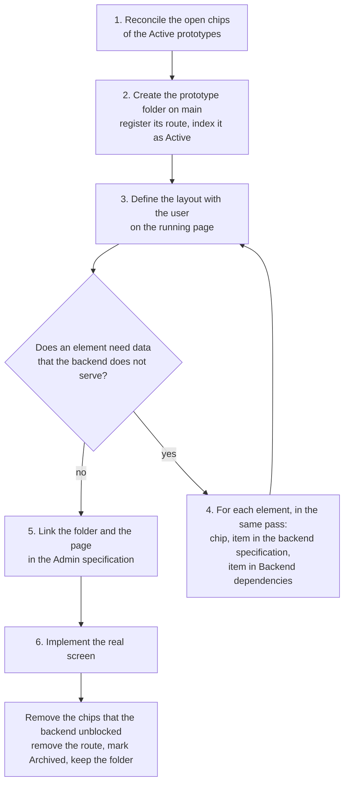

This skill is the procedure for the visual specification of an Admin screen. The rules are in [the visual specification rules](../../../docs/design-system/visual-specification.md) and in the "Visual Specification (Prototype)" section of [AGENTS.md](../../../AGENTS.md). Read both before you start.

This is an optional step of the Admin flow, after the grilling and before `/to-spec`. Before you start, ask the user if the change creates or changes a screen. Continue only when the user says yes. When the user says no, go to `/to-spec` without a prototype.

Not every prototype needs a backend change. A screen can use only data that the backend serves now, or no backend data at all. Then it has no chip and no backend item, and step 4 does not apply. When a screen needs a backend change, this skill makes sure that each chip is linked to an item in a backend specification.

## 1. Reconcile the open chips

Do this first, each time you use this skill, also when the task is about a different page. If no Active prototype has a chip, there is nothing to do: go to step 2.

1. Find each chip of the Active prototypes: read the index in `specs/prototypes/README.md`, and search each Active folder for `<WaitingBackend` (the component is `src/features/access/delegation/WaitingBackend.tsx`). Do not change Archived prototypes.
2. For each chip, open the backend specification that it cites (`backend/specs/<ID>-*.md`) and read its status and the item that the chip waits for.
3. If the backend serves the item now (the specification is `Implemented`, or the item is marked done), remove the chip. Mark the item as resolved in the "Backend dependencies" section of the Admin specification.
4. If the chip cites a specification that does not define the item, that is a gap: go to step 4 for that item.
5. Tell the user, in one short list, which chips you removed and which gaps you found.

## 2. Open the prototype page

1. Create the folder `specs/prototypes/<specification file name without .md>/` on `main`, with the specification. Do not create a branch. Read `specs/prototypes/README.md` first.
2. Register the page under `/prototype/<page>` in `src/features/prototype/PrototypePage.tsx`, and add the prototype as Active to the index in `specs/prototypes/README.md`. The page is not in the navigation and never replaces a real screen.
3. Reuse the design system (`docs/design-system/`) and the real components where they fit.
4. Keep the fixed data in one file in the prototype folder. Use realistic data from the central use case. No API call writes data.
5. Sign in to the local Admin yourself and open the page in the built-in browser (see "Local Functional Test" in AGENTS.md).

## 3. Define the layout with the user

1. Iterate the layout on the running page. Do not block on backend endpoints or field names.
2. Before you draw an element whose data no backend specification defines, tell the user that it needs a backend change.
3. The page shows no text such as "data not available". It shows the intended element.

## 4. Mark and record each backend gap, in the same pass

Only for elements whose data the backend does not serve yet. If there are none, skip this step.

For each such element, do all three steps before you go to the next element:

1. **Chip.** Add `<WaitingBackend spec="<ID>" tip="<what the element is for>" />`. The tip has one or two sentences about the purpose of the element. The component adds the specification number.
2. **Backend specification.** Write the item in the backend specification that the chip cites: the endpoint, field, claim or behavior that the element needs, and a link to the Admin specification and the prototype page. If no backend specification fits, ask the user which one to create or extend. Follow `backend/AGENTS.md` for where and how to write it. Do not leave the gap only in the Admin specification.
3. **Admin specification.** Add the item to its "Backend dependencies" section, with a link to the backend specification.

A chip without an item in a backend specification is an error. An item in a backend specification without its chip is an error too, while the prototype page is Active.

## 5. Link the specification

The Admin specification links the prototype folder and the page (`/prototype/<page>`) as its visual reference. Write the specification by AGENTS.md ("Specifications") and the `/to-spec` skill.

## 6. Implement the real screen

1. If the prototype has chips: when the backend implements an item, remove each chip that the item unblocks, and mark the item as resolved in the Admin specification.
2. When the real screen is implemented, remove the route of its prototype in the same change and mark the prototype as Archived in `specs/prototypes/README.md`. Keep the folder as a record of the layout. Do not update an archived prototype.
3. The real Admin never shows the chip. A limitation of the real screen uses a temporary implementation warning (AGENTS.md).

## Final check

Before you end a turn in which you used this skill, check:

- [ ] Each Admin specification of an Active prototype links its folder and page.
- [ ] The index in `specs/prototypes/README.md` matches the routes in `PrototypePage.tsx`: each Active prototype is registered, and no Archived prototype is.

If an Active prototype has chips, also check:

- [ ] Each chip has a matching item in the backend specification that it cites.
- [ ] Each item in the "Backend dependencies" section of the Admin specification links its backend specification.
- [ ] No chip cites a backend item that is already served.

Report each item that does not pass.
