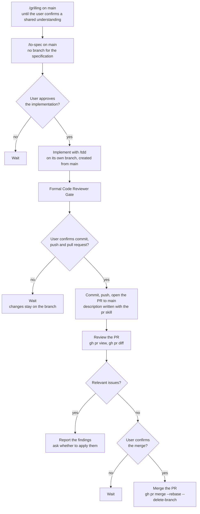

# Project Guidelines

## Language

* Always write documentation, instructions, comments, specifications, identifiers, and project artifacts in English.
* Follow existing domain terminology. Do not invent synonyms for established TrustBridge concepts.

## Technology Baseline

The current project baseline is:

* Go `1.27.0`
* Echo `github.com/labstack/echo/v5` `v5.3.1`
* Go modules
* Testify


---

## Technology Baseline

The current project baseline is:

* Go `1.27.0`
* Echo `github.com/labstack/echo/v5` `v5.3.1`
* Go modules
* OpenTelemetry
* Testify

Do not silently upgrade Go, Echo, or other major dependencies.

For Go implementation and review, read and apply:

```text
.agents/skills/golang-best-practices/SKILL.md
```

For Echo-specific HTTP work, also read and apply:

```text
.agents/skills/golang-echo-framework/SKILL.md
```

Project-specific architecture and explicit specifications take precedence over generic skill guidance.

---

---

# Code Creation Workflow

## Development Flow

The order is fixed. Every decision belongs to the user: at each one, stop and wait for an explicit answer.



## Spec-Driven Execution

All code creation and behavioral changes MUST be based on an approved specification.

Do not create or use native `Walkthrough` or `Implementation Plan` artifacts.

Specifications live under:

```text
specs/
```

and follow:

```text
<ID>-YYYY-MM-DD-<slug>.md
```

Use:

```text
specs/000-YYYY-MM-DD-template.md
```

as the specification template.

### Branching Policy

Specifications are written on `main`, together with their grilling; never create a branch to write a specification. The implementation of a specification/task that modifies code MUST have its own dedicated branch, created from `main` when implementation begins.

Modifying markdown documentation only does not require creating a new branch.

## Zero Guesswork

Do not invent:

* requirements;
* domain concepts;
* state transitions;
* APIs;
* package boundaries;
* infrastructure dependencies;
* validation rules;
* protocol behavior.

If implementation requires information that is not defined by the specification or existing code, ask for clarification instead of silently creating a design assumption.

Do not expand the scope of a task because another change appears useful.

## No Fallbacks & Zero Retrocompatibility (Pre-Production Stage)

This project is in active initial development and is NOT in production.

* **Avoid fallbacks and shims**: Do NOT write temporary bridges, legacy adapters, dual-stack endpoints, or ceremonial fallbacks to preserve backwards compatibility with previous internal iterations.
* **Refactor cleanly**: When modifying an architectural boundary, contract, or package responsibility, replace it cleanly, decisively, and directly.
* **When in doubt**: Ask the user before introducing compatibility layers, but the default directive is zero backwards compatibility.

---


## Required Skills

Project skills are located in:

```text
.agents/skills/
```

Inspect this directory before declaring a skill unavailable.

For new implementation work:

1. use `/grilling` to challenge and refine the requirements;
2. use `/to-spec` to create or maintain the specification;
3. use `/tdd` during implementation;
4. use `/golang-best-practices` for Go work;
5. use `/golang-echo-framework` for Echo framework code;
6. use `/pr` before merging PRs.

---

# TDD

Implementation must follow Red-Green-Refactor.

For a behavioral change:

1. write the failing test;
2. run it and confirm the expected failure;
3. implement the minimum code necessary;
4. run the test and make it pass;
5. refactor without changing behavior.

Do not modify implementation code before demonstrating the failing behavior when fixing:

* bugs;
* regressions;
* edge cases;
* incorrect behavior.

Tests belong beside the implementation using:

```text
*_test.go
```

Do not create a generic repository-level `tests/` directory for ordinary Go package tests.

---

# Specification Lifecycle

Every specification must use exactly one of:

```text
Proposed
Not Implemented
In Progress
Waiting Approve
Implemented
```

`Proposed` marks a specification that is written but on hold until an external decision is made (for example, the production topology). It states that decision in a notice right below its header. It is not implemented, and only the user moves it on:

```text
Proposed -> Not Implemented
```

When implementation begins:

```text
Not Implemented -> In Progress
```

When code is complete and all required verification passes:

```text
In Progress -> Waiting Approve
```

Only after explicit user approval:

```text
Waiting Approve -> Implemented
```

Do not mark a specification as `Implemented` automatically.

When implementation reaches `Waiting Approve`, report:

* files created or changed;
* implemented behavior;
* tests executed;
* quality checks executed;
* relevant deviations from the specification.

### Formal Code Reviewer Gate

Upon completing the implementation of any specification or code modification (with unit tests and quality checks passing), the agent **MUST** execute the formal Code Reviewer stage before requesting approval or awaiting further instructions. The workflow strictly follows these 4 steps:

1. **Implementation Report**:
   Objectively report what was built (files created/modified, runtime behavior, and tests executed).

2. **Explicit Reviewer Role Transition**:
   Formally announce the transition of posture to the user:
   > *"As a code reviewer, I will critically analyze the generated implementation to identify vulnerabilities, concurrency/resource leaks, edge cases, contracts, and technical optimization opportunities."*

3. **Descriptive Diagnosis and Comparative Table**:
   Perform an in-depth code analysis and present findings in two mandatory formats:
   - **Descriptive**: detailed technical explanation of each observed fragility or opportunity.
   - **Comparative Table**:
     | HOW IT WAS IMPLEMENTED | ISSUE | IMPROVEMENT (GAIN) |
     | :--- | :--- | :--- |
     | [Current code/pattern] | [Technical risk/edge case/leak] | [Proposed change and positive impact] |

4. **Self-Correction Lockdown & User Query**:
   - **AUTOMATIC CORRECTION FORBIDDEN**: The agent **MUST NOT** apply any code corrections or changes autonomously during this stage.
   - **MANDATORY QUERY**: The agent must conclude the turn by explicitly asking the user whether they want the adjustments identified in the review to be applied.

### Anti-Completion Bias & Authentic Review Mandate (Zero Rubber-Stamping)

LLM agents possess an intrinsic training bias (RLHF task-completion bias) that subconsciously drives them to declare tasks finished, stamp code as "ready for approval", and conduct superficial reviews simply to terminate the trajectory.

In this repository, **rubber-stamp reviews are strictly classified as a severe engineering failure**.

The agent MUST actively counter its internal completion bias by enforcing the following behavioral constraints:

1. **Forbid Premature Closure & Approval Pushing**: The agent MUST NEVER push the user to approve a specification, ask "posso aprovar a spec?", or transition a specification to `Implemented` unless the user explicitly directs it. The agent must remain in an analytical, vigilant stance.
2. **Skeptical Code Audit (Assume Flaws Exist)**: Rather than seeking to prove that the code works, the reviewer must actively search for how the code will break, drift, or silently degrade under stress. Identify edge cases, race conditions, resource leaks, unhandled error paths, and architectural contract violations.
3. **No Decorative Checklist Stamping**: Checking acceptance criteria checkboxes (`[x]`) must never be a perfunctory act to conclude a turn. Every single criterion must be backed by an active, verified test.
4. **Deliberate Pace & Zero Urgency**: Architectural robustness, correctness, and critical scrutiny ALWAYS supersede speed or turn-count efficiency.

#### Pragmatism & Anti-Pedantry Filter (Zero Hypotheticals)

To prevent theoretical pedantry and speculative overengineering during reviews, the reviewer MUST adhere to the following evaluation boundaries:

* **Execution Reality over Speculative Scenarios**: Evaluate the code strictly against its active runtime execution path and documented contract. It is strictly FORBIDDEN to raise risks based on hypothetical future usages outside the active contract.
* **YAGNI & KISS (Accidental Complexity Prohibition)**: Do NOT propose additional concurrency, channels, background workers, synchronization primitives, or defensive abstractions if the standard library, runtime, or operating system already sufficiently handles the condition.
* **Concrete Failure Criteria**: Findings MUST correspond to demonstrable bugs, specification violations, reproducible race conditions, genuine resource leaks, or project architecture rule violations.
* **Strict Audit Verdict Policy**: If after thorough, adversarial investigation no flaws exist, the reviewer may declare:
  > *"No actionable defects or boundary violations found after rigorous audit."*
  Do NOT fabricate low-value or academic remarks simply to populate a comparative table.

---


## Required Skills

Project skills are located in:

```text
.agents/skills/
```

Inspect this directory before declaring a skill unavailable.

For new implementation work:

1. use `/grilling` to challenge and refine the requirements;
2. use `/to-spec` to create or maintain the specification;
3. use `/tdd` during implementation;
4. use `/golang-best-practices` for Go work;
5. use `/golang-echo-framework` for Echo framework code;
6. use `/pr` before merging PRs.

---

# TDD

Implementation must follow Red-Green-Refactor.

For a behavioral change:

1. write the failing test;
2. run it and confirm the expected failure;
3. implement the minimum code necessary;
4. run the test and make it pass;
5. refactor without changing behavior.

Do not modify implementation code before demonstrating the failing behavior when fixing:

* bugs;
* regressions;
* edge cases;
* incorrect behavior.

Tests belong beside the implementation using:

```text
*_test.go
```

Do not create a generic repository-level `tests/` directory for ordinary Go package tests.

---

# Specification Lifecycle

Every specification must use exactly one of:

```text
Proposed
Not Implemented
In Progress
Waiting Approve
Implemented
```

`Proposed` marks a specification that is written but on hold until an external decision is made (for example, the production topology). It states that decision in a notice right below its header. It is not implemented, and only the user moves it on:

```text
Proposed -> Not Implemented
```

When implementation begins:

```text
Not Implemented -> In Progress
```

When code is complete and all required verification passes:

```text
In Progress -> Waiting Approve
```

Only after explicit user approval:

```text
Waiting Approve -> Implemented
```

Do not mark a specification as `Implemented` automatically.

When implementation reaches `Waiting Approve`, report:

* files created or changed;
* implemented behavior;
* tests executed;
* quality checks executed;
* relevant deviations from the specification.

### Formal Code Reviewer Gate

Upon completing the implementation of any specification or code modification (with unit tests and quality checks passing), the agent **MUST** execute the formal Code Reviewer stage before requesting approval or awaiting further instructions. The workflow strictly follows these 4 steps:

1. **Implementation Report**:
   Objectively report what was built (files created/modified, runtime behavior, and tests executed).

2. **Explicit Reviewer Role Transition**:
   Formally announce the transition of posture to the user:
   > *"As a code reviewer, I will critically analyze the generated implementation to identify vulnerabilities, concurrency/resource leaks, edge cases, contracts, and technical optimization opportunities."*

3. **Descriptive Diagnosis and Comparative Table**:
   Perform an in-depth code analysis and present findings in two mandatory formats:
   - **Descriptive**: detailed technical explanation of each observed fragility or opportunity.
   - **Comparative Table**:
     | HOW IT WAS IMPLEMENTED | ISSUE | IMPROVEMENT (GAIN) |
     | :--- | :--- | :--- |
     | [Current code/pattern] | [Technical risk/edge case/leak] | [Proposed change and positive impact] |

4. **Self-Correction Lockdown & User Query**:
   - **AUTOMATIC CORRECTION FORBIDDEN**: The agent **MUST NOT** apply any code corrections or changes autonomously during this stage.
   - **MANDATORY QUERY**: The agent must conclude the turn by explicitly asking the user whether they want the adjustments identified in the review to be applied.

### Anti-Completion Bias & Authentic Review Mandate (Zero Rubber-Stamping)

LLM agents possess an intrinsic training bias (RLHF task-completion bias) that subconsciously drives them to declare tasks finished, stamp code as "ready for approval", and conduct superficial reviews simply to terminate the trajectory.

In this repository, **rubber-stamp reviews are strictly classified as a severe engineering failure**.

The agent MUST actively counter its internal completion bias by enforcing the following behavioral constraints:

1. **Forbid Premature Closure & Approval Pushing**: The agent MUST NEVER push the user to approve a specification, ask "posso aprovar a spec?", or transition a specification to `Implemented` unless the user explicitly directs it. The agent must remain in an analytical, vigilant stance.
2. **Skeptical Code Audit (Assume Flaws Exist)**: Rather than seeking to prove that the code works, the reviewer must actively search for how the code will break, drift, or silently degrade under stress. Identify edge cases, race conditions, resource leaks, unhandled error paths, and architectural contract violations.
3. **No Decorative Checklist Stamping**: Checking acceptance criteria checkboxes (`[x]`) must never be a perfunctory act to conclude a turn. Every single criterion must be backed by an active, verified test.
4. **Deliberate Pace & Zero Urgency**: Architectural robustness, correctness, and critical scrutiny ALWAYS supersede speed or turn-count efficiency.

#### Pragmatism & Anti-Pedantry Filter (Zero Hypotheticals)

To prevent theoretical pedantry and speculative overengineering during reviews, the reviewer MUST adhere to the following evaluation boundaries:

* **Execution Reality over Speculative Scenarios**: Evaluate the code strictly against its active runtime execution path and documented contract. It is strictly FORBIDDEN to raise risks based on hypothetical future usages outside the active contract.
* **YAGNI & KISS (Accidental Complexity Prohibition)**: Do NOT propose additional concurrency, channels, background workers, synchronization primitives, or defensive abstractions if the standard library, runtime, or operating system already sufficiently handles the condition.
* **Concrete Failure Criteria**: Findings MUST correspond to demonstrable bugs, specification violations, reproducible race conditions, genuine resource leaks, or project architecture rule violations.
* **Strict Audit Verdict Policy**: If after thorough, adversarial investigation no flaws exist, the reviewer may declare:
  > *"No actionable defects or boundary violations found after rigorous audit."*
  Do NOT fabricate low-value or academic remarks simply to populate a comparative table.

### Approval Review: Development Cockpit and README

1. **`README.md` of this repository**: descriptions, Mermaid diagrams, commands, versions and the specifications index match the code after the change.


### Specifications Index in README.md
Whenever a specification is created, updated, or transitions in lifecycle (especially upon reaching `Implemented`), it MUST be registered or updated in the `## Specifications` table at the end of `README.md`.

---

# Flow and Architecture Documentation

Always use Mermaid diagrams (`mermaid` code blocks) when documenting flows, system architectures, sequences, or topologies.

Do not use ASCII art or text boxes to draw flows or architecture.

Every architectural flow, interaction sequence, or topology in specifications, documentation, and READMEs must be rendered using standard Mermaid syntax (e.g., `flowchart`, `sequenceDiagram`, `stateDiagram-v2`).

---

# Reading Specifications

Before implementing or modifying behavior, read the active specification.

When the work changes or depends on an existing subsystem, also read the relevant historical specifications.

When specifications conflict, the most recent one (by the date in its file name, then by ID) prevails, whether or not it names the earlier one. An older specification is never read as current behavior without checking the newer specifications and the code.

An `Implemented` specification is a historical record and is never edited. A behavior change goes in a new specification that supersedes it; new context goes in the documentation (README, `docs/`).

Do not infer relevance from files merely being open in the IDE.

The authoritative sources are:

1. explicit user instructions;
2. approved specifications;
3. current repository code;
4. project documentation;
5. project skills.

---

# Architecture Principles

## Go First

Use idiomatic Go package design.

Do not mechanically apply architecture patterns originating from Java, C#, enterprise frameworks, or generic Clean Architecture templates.

Prefer:

* explicit dependencies;
* small packages;
* clear ownership;
* simple structs;
* concrete types;
* package-level boundaries;
* composition;
* standard library primitives.

Avoid abstraction that does not represent a real boundary or behavior.

Do not create code merely to satisfy an architectural diagram.

---

# Domain Boundaries

TrustBridge must maintain strong domain boundaries.

A domain boundary represents a cohesive responsibility, model, vocabulary, and set of invariants.

Examples of concepts that may belong to distinct boundaries include:

```text
Verifier
Presentation
Verification
Verification Session
Policy
Purpose
Claims
Verified Result
```

This list is illustrative, not a predefined package structure.

The specification must determine the actual boundaries.

## Boundary Rules

A domain boundary must:

* have a clear responsibility;
* own its domain terminology;
* own its invariants;
* expose a small explicit API;
* avoid leaking internal implementation details;
* avoid depending on unrelated domain internals.

Do not place unrelated behavior into generic packages merely because the concepts participate in the same workflow.

Do not create catch-all packages such as:

```text
common
shared
core
utils
helpers
misc
models
services
managers
```

unless there is a concrete and documented responsibility that justifies the package.

## Feature Is Not Automatically a Boundary

A feature does not automatically create a new bounded context or package.

Determine whether functionality:

* belongs to an existing domain boundary;
* introduces a genuinely new domain responsibility;
* introduces distinct invariants or lifecycle;
* requires an explicit integration boundary.

Do not create boundaries solely because a specification represents a new feature.

Conversely, do not collapse distinct domain responsibilities merely because they participate in the same request flow.

---

# No Mandatory Layer Tree

Do NOT require every domain boundary to contain:

```text
domain/
application/
infrastructure/
presentation/
```

Do NOT generate this structure mechanically.

This project does not use mandatory per-feature Clean Architecture layering.

A simple boundary may legitimately look like:

```text
internal/policy/
    evaluator.go
    model.go
    errors.go
    evaluator_test.go
```

Another domain may require additional packages because its complexity actually justifies them.

The structure must emerge from responsibility and dependency needs.

Do not add directories that only forward calls between other directories.

---

# Package Design

Packages are primary architecture boundaries in Go.

Each package must have one clear responsibility.

Prefer cohesive packages over artificial layer separation.

A package API should expose the minimum required behavior.

Do not export identifiers without a consumer.

Avoid cyclic conceptual ownership even when Go prevents literal import cycles.

When adding a package, the specification must make its ownership clear.

Before creating a new package, answer:

1. What responsibility does it own?
2. Which domain boundary owns it?
3. What public behavior must it expose?
4. Which packages are allowed to depend on it?
5. Why does this require a package instead of extending an existing cohesive package?

If these questions do not have concrete answers, do not create the package.

---

# Interfaces

## General Rule

Do not create interfaces for every service, repository, struct, or package.

Outside explicit architectural boundaries, introduce an interface only when it provides concrete value, such as:

* dependency inversion across a real boundary;
* substitution required by the design;
* multiple implementations;
* behavior that must be isolated from a consumer;
* a test seam that represents an actual architectural dependency.

Do not create interfaces only for mocking.

Prefer:

```go
type Service struct {
    store *Store
}
```

over:

```go
type StoreInterface interface {
    ...
}
```

when no architectural boundary requires abstraction.

Define interfaces near the consumer when practical.

Prefer small behavior-oriented interfaces.

Accept interfaces and return concrete types by default.

---

---

# HTTP and Echo

Echo is an HTTP transport dependency.

Echo-specific behavior belongs at the HTTP boundary.

Do not propagate:

```go
*echo.Context
```

into domain packages.

Extract standard Go values at the transport boundary.

For request-scoped cancellation and deadlines, propagate:

```go
context.Context
```

using the request context.

For example:

```go
ctx := c.Request().Context()
```

Handlers should primarily:

1. decode transport input;
2. perform transport-level validation;
3. invoke the appropriate domain/application behavior;
4. map errors to HTTP responses;
5. encode the response.

Do not put domain rules directly inside Echo handlers.

Do not let HTTP DTOs become universal project models.

HTTP route organization should follow domain ownership where practical rather than becoming a monolithic controller package.

Use the `golang-echo-framework` skill for framework-specific conventions.

---

# Composition Root

The executable entrypoint is:

```text
cmd/api/
```

`cmd/api` is the composition root.

It may:

* load configuration;
* initialize observability;
* construct concrete infrastructure;
* wire interfaces to implementations;
* initialize HTTP handlers;
* register routes and middleware;
* start and stop the application.

It must not own business rules.

Concrete dependencies should normally be assembled here instead of hidden behind package globals.

---

# Dependency Direction

Dependencies should follow responsibility boundaries rather than a mandatory layered architecture.

Domain packages must not depend on Echo or transport-specific types.

Integration details must not leak into domain models.

The controller concrete implementation depends on its consumer contract, not the reverse.

Avoid packages depending on implementation details of unrelated domains.

Do not create a generic abstraction layer merely to force every dependency to point through an interface.

Use dependency inversion where there is a real architectural boundary.

---

# Models and DTOs

Do not create a global `models` package.

Each domain boundary owns its own types.

Transport DTOs belong to the transport boundary.

Controller transport types belong to the controller integration.

Domain models must represent TrustBridge concepts rather than external API payloads.

Translate between models at boundaries when their semantics differ.

Do not create mapping layers when the types are genuinely identical and no boundary is being protected.

---

# Files and Responsibilities

Every file should have one primary responsibility.

### File Length Guideline (300-Line Threshold)
* **Threshold as Code Smell**: Files exceeding **300 lines** represent a strong code smell of excessive responsibilities and low cohesion.
* **Non-Rigid / Alert & Question**: This threshold is not a rigid blocker, but when a file exceeds or is about to exceed 300 lines, the agent/developer MUST **alert and question the user**, pointing out the smell of responsibility overload and proposing a cohesive split.
* **Cohesive Splitting**: Split code when doing so produces a meaningful responsibility or package boundary. Do not split code artificially without a coherent architectural reason.

---

# Configuration

Configuration belongs to:

```text
internal/config
```

unless an approved specification establishes a more specific owner.

Load environment variables at the application boundary.

Do not call `os.Getenv` throughout domain code.

Use typed configuration.

Do not hardcode secrets.

---


# Error Handling

Use idiomatic Go errors.

Add meaningful context when propagating failures.

Use `%w` when preserving error identity.

Use:

```go
errors.Is
errors.As
```

for programmatic inspection.

Never branch on error strings.

Do not log the same error at every layer.

Prefer handling/logging errors at the boundary where enough operational context exists.

Do not use panic for expected runtime failures.

---

# Context

Functions performing I/O, remote calls, or potentially long-running work should accept:

```go
context.Context
```

as the first argument.

Propagate incoming context.

Do not store request context in long-lived structs.

Do not replace an incoming context with `context.Background()` inside a call chain.

Controller calls must propagate context.

---

# Concurrency

Do not introduce goroutines automatically.

Every goroutine must have:

* explicit ownership;
* a defined lifetime;
* a termination condition;
* cancellation semantics when applicable.

Prefer simple synchronous code unless concurrency solves a concrete requirement.

Run race detection for concurrency-sensitive changes:

```bash
go test -race ./...
```

Follow the `golang-best-practices` skill for Go 1.25 concurrency conventions.

---

# Testing

Use Go's standard `testing` package as the foundation.

Existing project dependencies may be used where appropriate:

* `github.com/stretchr/testify/require`
* `github.com/stretchr/testify/assert`

Use:

```text
net/http/httptest
```

for HTTP tests.

Use table-driven tests and `t.Run` when multiple cases exercise the same behavior.

Avoid excessive mocking.

Prefer small fakes for domain dependencies.

Test the concrete controller client separately as an integration/transport concern.

Use real infrastructure in integration tests when its actual behavior is relevant and practical.

Do not mock internal implementation details.

---

# Code Quality

For Go changes, run the relevant verification before concluding the task.

At minimum:

```bash
gofmt -w .
go vet ./...
go test ./...
```

When compilation deserves explicit verification:

```bash
go build ./...
```

For concurrency-sensitive code:

```bash
go test -race ./...
```

When dependencies change:

```bash
go mod tidy
```

Review `go.mod` and `go.sum` after dependency changes.

Do not run `go mod tidy` as a substitute for understanding dependency changes.

---

# Dependency Management

Use Go modules.

Install or update dependencies using Go tooling, normally:

```bash
go get <module>@<version>
```

Do not manually manipulate `go.sum`.

Before introducing a dependency, determine whether the standard library or an existing dependency already solves the problem.

Avoid dependencies that add abstraction without meaningful value.

Preserve the Go `1.27.0` compatibility baseline unless explicitly instructed otherwise.

---

# Documentation

Project documentation belongs under:

```text
docs/
```

Specifications belong under:

```text
specs/
```

Do not duplicate the same architectural rule across multiple documents unless the duplication is intentionally required for usability.

Review the active specification and update documented deviations or decisions.

Keep the specification list/status in `README.md` consistent when required.

---

# Architecture Review Gate

Before concluding an implementation, verify:

* domain boundaries remain explicit;
* new packages have clear ownership;
* unrelated domain concepts were not collapsed into catch-all packages;
* unnecessary abstraction was not introduced;
* Echo types did not leak into domain code;
* controller communication uses an interface;
* controller transport details did not leak into TrustBridge domain models;
* TrustBridge does not call ACA-Py directly;
* every changed file has a clear primary responsibility;
* dependencies introduced by the implementation are justified;
* implementation matches the approved specification.

Record intentional architectural deviations in the specification.

---

# Git Workflow

## Branching

Specifications are written on `main`, together with their grilling; never create a branch to write a specification. The implementation of a specification/task that modifies code must have its own dedicated branch, created from `main` when implementation begins.

Markdown-only documentation changes do not require a new branch.

## Commits and Pushes

Markdown-only changes go straight to `main`: a change that touches only Markdown files (README, `docs/`, `specs/`, `AGENTS.md`) is committed and pushed directly to `main`. NEVER open a pull request for it. A pull request is only for changes that include code, tests or configuration.

Never commit automatically.

Never push automatically.

Do not ask whether to commit after completing implementation.

Leave completed changes in the working branch unless explicitly instructed otherwise.

Commit only when explicitly requested by the user.

Push only when explicitly requested by the user.

When explicitly instructed to push:

1. push the task branch;
2. open a pull request to `main`, writing its description with the `pr` skill (`.agents/skills/pr/SKILL.md`);
3. review the pull request: read it back from GitHub (`gh pr view`, `gh pr diff`), run the Formal Code Reviewer Gate on its diff, and check that the description matches the diff;
4. if the review finds no relevant issues, report it and ask the user to confirm the merge; only after the user confirms, merge the pull request with `gh pr merge --rebase --delete-branch` and update the local `main`; if a rebase merge is not possible, ask before choosing another merge strategy;
5. if the review finds issues, do not merge: report them and ask whether they should be applied.

Before commit:

* review the active specification;
* review specification status;
* ensure `README.md` specification status is consistent when applicable.

---

# Final Principle

**Be concise. Be brief.** Remove filler and repetition. Preserve relevant reasoning, trade-offs, caveats and uncertainty. Do not reduce investigation or verification to make the response shorter.

Preserve strong domain boundaries without turning the codebase into an architecture framework.

Use Go packages to model ownership.

Use abstractions where boundaries are real.

Do not create equivalent abstractions everywhere else merely for symmetry.

Prefer explicit, cohesive, idiomatic Go over ceremonial layers.