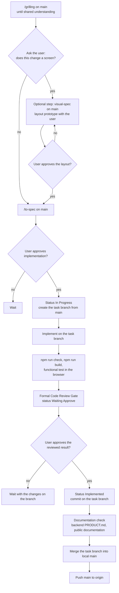

# Admin Agent Guidelines

This module is the React application that manages the Chokepoint platform. Platform management interfaces belong here. Public pages and developer documentation belong in `frontend`. Backend services and business rules belong in `backend`.

---

# Basics

## Language

* Use ASD-STE100 Simplified Technical English when you explain anything to the user.
* Write documentation, instructions, comments, specifications, identifiers and project artifacts in English.
* Use the existing Chokepoint domain terms. Do not invent synonyms.

## Technology Baseline

* React with Vite, client-side rendering. The Admin consumes the Go backend APIs.
* npm `10.9.8` with Node.js `22.23.1` (see `.nvmrc`). Keep dependencies, the lockfile and `.env.local` in this module. Use `npm ci` to reproduce the dependency tree. Keep environment files out of Git, except `.env.example`.

Do not silently change the stack or upgrade major dependencies.

For React work, read and apply the [Vercel React Best Practices skill](.agents/skills/react-best-practices/SKILL.md). Its Next.js rules do not apply to this Vite application. Project rules and approved specifications take precedence over generic skill guidance.

## Design System

Before you implement or review an interface, read [the module design system](docs/design-system/README.md), including its token and layout rules. Reuse `docs/design-system/styles/index.css` and the documented semantic tokens. Keep this module's own visual system.

## Visual Specification (Prototype)

The visual specification of a new screen is a **layout prototype** in the Admin, under the `/prototype` route, with fixed data. It is an optional step of the [Flow](#flow): after the grilling, ask the user if the change creates or changes a screen. Make a prototype only when the user says yes. Follow [the visual specification rules](docs/design-system/visual-specification.md) and use the [`visual-spec` skill](.agents/skills/visual-spec/SKILL.md) for each prototype task: it reconciles the open chips with the backend specifications and records each backend gap in the backend specification in the same pass.

* The prototype lives in `specs/prototypes/<specification file name without .md>/`, on `main` with its specification, with no branch of its own. It renders only under `/prototype/<page>`, registered in `src/features/prototype/PrototypePage.tsx`, and only in the development server: a production build has no `/prototype` route and no prototype code. It is not in the navigation and never replaces a real screen. Read [`specs/prototypes/README.md`](specs/prototypes/README.md) before you use any file there: prototypes are records of one moment, not current behavior.
* The specification links its prototype folder and page (`/prototype/<page>`) as its visual reference.
* Use the design system and realistic data from the central use case. Sign in to the local Admin yourself to run it.
* Define the layout with the user first. Do not block on backend endpoints or field names: write them into the backend specification in the same pass.
* Mark each element whose data the backend does not serve yet with the "Waiting backend · <spec>" chip. Its hover text says what the element is for and names the backend specification.
* When a screen is implemented, the real screen replaces its prototype page: remove the route of the page in the same change and mark the prototype as Archived in `specs/prototypes/README.md`. Keep the folder as a record of the layout.

## Temporary Implementation Warnings

When a feature has a limitation, show a temporary warning in the screen that it affects, near the action or information. In plain language, state the limitation, its practical effect and, when needed, what the administrator must do. Record the limitation in the specification.

* Presentation: `cp-admin-notice`, the warning background and border tokens, a leading `TriangleAlert` icon, a title and an explanation. Use a shared warning component when one exists. Otherwise follow `src/features/identity/IdentityConnectionForm.tsx` and `src/features/permissions/PeopleEditor.tsx`.
* A warning informs. It does not block a workflow unless the approved requirements say so.
* Update or remove the warning when its limitation changes or is resolved. A warning does not resolve the limitation.

---

# Development Workflow

## Flow

The order is fixed. Each decision in this flow belongs to the user: stop and wait for an explicit answer.



## Decisions

* **Grilling.** For each decision, give several real, different options, their consequences and a recommendation. The user can propose another option. If only one option is possible, explain why. Do not invent alternatives.
* **Trivial choices.** Do not ask about choices that a one-line edit can change later, such as wording, order or labels. Apply the recommendation and say in one line what you chose. Ask only about architecture, contracts, scope, data and security.
* **Zero guesswork.** Do not invent requirements, domain concepts, state transitions, APIs, validation rules or backend behavior. When the specification and the code do not define something, ask.
* **Scope.** Do not expand a task because another change looks useful. Name it as a follow-up.
* **No fallbacks.** The project is in initial development and is not in production. Do not write shims, legacy adapters, dual paths or fallbacks for earlier internal versions. Replace a changed contract cleanly. Ask the user before you add a compatibility layer.

## Specifications

All code creation and behavior changes start from an approved specification. Do not create or use native `Walkthrough` or `Implementation Plan` artifacts.

* Location: `specs/<ID>-YYYY-MM-DD-<slug>.md`, from the template `specs/000-YYYY-MM-DD-template.md`.
* Write a specification, its grilling and its layout prototype on `main`. Never create a branch to write a specification or a prototype.
* Register each specification in the `## Specifications` table at the end of `README.md`.
* A specification that consumes a backend API links the backend specification that defines it.

### Reading Specifications

* Before you implement or change behavior, read the active specification. When the work depends on an existing feature, also read its earlier specifications.
* When specifications conflict, the most recent one prevails (by the date in its file name, then by ID). Do not read an older specification as current behavior without a check of the newer specifications and the code.
* Do not infer relevance from files that are open in the IDE.
* Sources, in order of authority: explicit user instructions, approved specifications, repository code, project documentation, project skills.

## Specification Lifecycle

A specification has exactly one status: `Proposed`, `Not Implemented`, `In Progress`, `Waiting Approve` or `Implemented`.

The status changes only at the events in this table. At each event, change the status in the specification header **and** in the `README.md` index in the same step.

| Event | Status change | In the same step |
| :--- | :--- | :--- |
| The user approves the specification for implementation. | `Proposed` or `Not Implemented` → `In Progress` | Commit the status on `main`, then create the task branch from `main`. |
| The code is complete, all checks pass, and the Formal Code Review Gate is reported. | `In Progress` → `Waiting Approve` | Mark each met checkbox (`[x]`). Next to each unmet checkbox, write what is missing. |
| The user approves the reviewed result. | `Waiting Approve` → `Implemented` | Change the status and the index in the commit on the task branch, before the merge. |

Rules:

* `Proposed` means written but on hold for an external decision. A notice below the header names that decision. Only the approval in the first row moves it on.
* The approval in the third row **is** the approval for `Implemented`. Do not wait for a second approval.
* Do not change a status at any other time, and do not mark `Implemented` before the third row.
* Mark a checkbox only with evidence: a build or type check that you ran, a code inspection, or a manual browser check. Do not mark checkboxes only to end a turn.
* Before each push to `main`, check that each specification whose code is in `main` is `Implemented`, in its header and in the `README.md` index.
* Change the content of a specification (decisions, rules, contracts) on `main`. Status and checkbox changes go with the code, on the task branch.
* An `Implemented` specification is a historical record. Do not edit it. A behavior change goes in a new specification that supersedes it. New context goes in the documentation (`README.md`, `docs/`).

## Branching

* The implementation of a specification or task that changes code has its own branch, created from `main` when implementation begins. Name it `feat/<specification ID>-<slug>`, for example `feat/018-requests-denied-inbox`.
* When the local `main` checkout holds work of another task, create the branch in a separate `git worktree`.
* A change to Markdown files only needs no branch.

## Required Skills

Project skills are in `.agents/skills/`. Look there before you say that a skill is not available.

1. `/grilling` to challenge and refine the requirements;
2. `/to-spec` to write or update the specification;
3. `react-best-practices` for React work;
4. `visual-spec` to build or change a layout prototype and its Waiting backend chips.

## Verification

This module has no automated tests. Do not use TDD, and do not create tests, test suites, test fixtures or test infrastructure. Do not add a test requirement through a skill, a specification or a review checklist. The backend has its own testing rules.

Verify each change with:

```bash
npm run check
npm run build
```

and a functional test in the built-in browser. Report only the checks that you ran.

### Local Functional Test

Run functional tests by hand in the built-in browser, where the user can watch. Do not automate them.

1. Open `http://127.0.0.1:5173` and click **Continue to sign in**. The sign-in page is the Keycloak realm `chokepoint-platform` on `127.0.0.1:8180`.
2. Sign in as `admin-a`. It has access to Workspace A, which holds the local identity connections.
3. Password: `CP_SEED_PASSWORD` in `dev-infra/idps/keycloak/.env` (`sed -n 's/^CP_SEED_PASSWORD=//p' .env`). Do not print it in a reply.
4. One-time code: run `dev-infra/idps/keycloak/totp.sh`. The code is valid for 30 seconds, so type it at once.
5. Identity connections are in **Access**, **Integrations**, **Identity providers**.

For a change to harness login screens or settings (identity provider **Harness login**, the agent **Harness login** card, harness sessions), also run the coding harness test with the real Claude Code CLI: [`dev-infra/functional-tests/harness-cli.md`](../dev-infra/functional-tests/harness-cli.md).

Click each field and type into it. The built-in browser does not show native `confirm()` dialogs: it answers "cancel" and logs `Page dialog suppressed` in the console.

## Formal Code Review Gate

When an implementation is complete and its checks pass, do these four steps before you ask for approval:

1. **Implementation report.** State what you built: files created or changed, runtime behavior, and the checks that you ran. Mark the met checkboxes (see Specification Lifecycle).
2. **Reviewer posture.** Announce the change of posture:
   > *"As a code reviewer, I will critically analyze the generated implementation to identify vulnerabilities, concurrency/resource leaks, edge cases, contracts, and technical optimization opportunities."*
3. **Diagnosis.** Give a description of each finding, and this table:

   | HOW IT WAS IMPLEMENTED | ISSUE | IMPROVEMENT (GAIN) |
   | :--- | :--- | :--- |
   | [Current code or pattern] | [Risk, edge case or leak] | [Proposed change and its gain] |

4. **No automatic correction.** Do not apply a correction during this step. End the turn with a question: which adjustments must be applied.

### Review Discipline

* **Assume flaws exist.** Look for how the interface breaks, drifts or degrades: edge cases, stale data, race conditions between requests, unhandled error and loading states, and contract violations. A superficial review is a severe failure.
* **Real findings only.** A finding is a demonstrable bug, a specification violation, a reproducible race condition or a violation of a project rule. Do not raise risks from hypothetical uses outside the active contract.
* **YAGNI and KISS.** Do not propose extra state, effects or defensive abstractions when React, the router or the query library already handles the condition.
* **No findings is a valid result.** After a thorough audit without flaws, say: *"No actionable defects or boundary violations found after rigorous audit."* Do not invent remarks to fill the table.
* **No approval pressure.** Do not ask the user to approve while a criterion is unmet. Correctness takes precedence over speed and turn count.

## Publication: Commit, Merge and Push

The user's approval of the reviewed result authorizes the full sequence below. Do not ask again at each step. Obey a narrower request, such as "commit only" or "no push".

Before approval, keep the changes on the task branch. Do not publish unapproved changes. Pull requests are not required; open one only when the user asks.

After approval:

1. set the specification to `Implemented` and update the `README.md` index (Specification Lifecycle, third row);
2. review and stage only the approved task changes, without secrets or unrelated files;
3. commit on the task branch;
4. run the documentation check, before the merge;
5. fetch origin and update the local `main` without discarding local work;
6. merge the task branch into `main`;
7. run `npm run check` and `npm run build` on the merged `main`;
8. push `main` to origin, without force-push;
9. report the commits, the documentation check and the publication result.

Resolve routine merge conflicts and keep both changes. Ask only when a conflict needs a product decision or would discard unrelated work. Never rewrite remote history.

A change to Markdown files only is committed and pushed directly on `main` under the same approval.

## Documentation Check

Run it after the commit on the task branch and before the merge into `main`, for each code change, with or without a specification. Do not merge a change while a document below is out of date. Do not run it after a change to Markdown files only.

Judge what each document must say, not what it already mentions. A topic that a document does not mention can still be missing from it. List the capabilities, behaviors, contracts, fields, errors and limits that the change adds or alters. For each one, decide if each document below must state it, and find every place that describes the old behavior, in the text and in the Mermaid labels.

| Document | What it states |
| :--- | :--- |
| [`PRODUCT.md` of the backend](../backend/PRODUCT.md) | The product understanding, with the code facts of Admin specifications. This module's `PRODUCT.md` is design context, not this document. |
| Public documentation | The `frontend` module: the pages in `content/docs/en` and `content/docs/pt-BR`, and the Admin screenshots in `public/docs/platform`. A page that describes an old screen, flow or label, a new screen or capability without a page, or a screenshot of a screen that changed is out of date. |

* Update the backend `PRODUCT.md` by the backend `AGENTS.md` (a Markdown change on its `main`).
* Update the public documentation in the `frontend` module, in both languages, by its `AGENTS.md`, and publish it under the user's approval before the merge. Recapture a changed screenshot at the size and framing of the original.
* For each document without a change, say that you checked it and why it needs none.

## Screenshots and Recordings for the Public Documentation

To make a screenshot or a recording of the Admin for the public documentation, use the demo instance in `dev-infra/demo-instance` ([README](../dev-infra/demo-instance/README.md)). Do not capture the development stack: its data are test fixtures (`Development Workspace A`, `Example agent`, `list_test_items`, loopback issuers).

The demo instance is a second local Chokepoint instance that runs next to the development stack and never touches its data. It has its own database (`chokepoint_demo`), API, Admin (`http://acme.localhost:5174`) and company identity provider (the Keycloak realm `acme`). It builds the company Acme the way a customer does: the platform admin Beatriz Nunes signs up through the real flow, creates the workspace, and configures the identity connection, four MCP servers, four agents and their permissions through the product APIs. A traffic script makes real calls, so each allowed and denied call comes from the product. All addresses are in `demo.env`.

1. From `dev-infra/demo-instance`: run `./prepare.sh` once, keep `./up.sh` running, and run `./populate.py` the first time.
2. Keep `./traffic.py` running for a realistic history. The Overview chart and the Inbox fill after about one day.
3. Screenshots: `uv run --no-project --with playwright==1.59.0 python screenshot.py [capture-id ...]` saves the regions of the capture list as PNG at device scale factor 2.
4. Recordings: `uv run --no-project --with playwright==1.59.0 python record.py <scenario>` saves a WebM video with a visible cursor that moves at a human pace and pulses on each click.
5. Each run writes into a new folder `output/<UTC time, ISO 8601 basic>/`. `./reset.sh --yes` rebuilds the same dataset from zero.

The public documentation images go into the `frontend` module (`public/docs/platform`), by its `AGENTS.md`. Add a capture or a scenario to the demo instance scripts instead of a manual screenshot.

---

# Engineering Rules

## Documentation

* Project documentation belongs in `docs/`. Specifications belong in `specs/`.
* Draw flows, architectures, sequences and topologies with Mermaid (`flowchart`, `sequenceDiagram`, `stateDiagram-v2`). Do not use ASCII art.
* The `README.md` descriptions, Mermaid diagrams, commands, versions and specification index must match the code after each change.

## Files and Responsibilities

* Each file has one primary responsibility.
* A file near or over 300 lines is a sign of too many responsibilities. Tell the user, explain the overload and propose a cohesive split. The limit is not a hard block, and it does not justify an artificial split.
* Keep each feature's API client, data hooks and components in its folder under `src/features/`.

## Dependencies

* Before you add a dependency, check whether the platform, React or an existing dependency already solves the problem. Do not add dependencies that only add abstraction.
* Add dependencies with npm in this module only, and commit the lockfile.

---

# Final Principle

**Be concise.** Remove filler and repetition. Keep the relevant reasoning, trade-offs, caveats and uncertainty. Do not reduce investigation or verification to make a response shorter.
