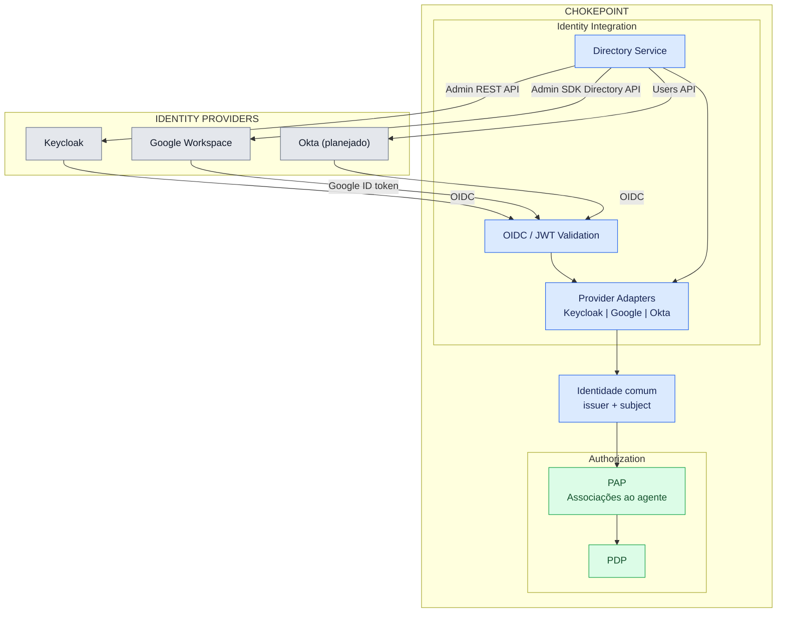

# Integração dos IdPs com o Chokepoint

A integração de cada IdP com o Chokepoint tem **dois fluxos independentes**: autenticação das requisições e consulta do diretório.

O Chokepoint **não sincroniza o ciclo de vida dos usuários** com nenhum IdP (Backend 036, 2026-11-01). Não há webhook, plugin nem SCIM. Um usuário desabilitado no IdP perde o acesso quando o token dele expira. Com a troca de token do Chokepoint (Backend 030, planejada), cada chamada usa um token de 5 minutos e a próxima troca de um usuário desabilitado falha.

## Diagrama de integração

*Keycloak e Google Workspace funcionam hoje. Okta está especificado (Backend 017), ainda não implementado.*

## Protocolos por provedor

| Integração | Keycloak | Google Workspace | Okta |
|---|---|---|---|
| Autenticação de requisições | OIDC/JWT | Google ID token (`hd` = domínio) | OIDC/JWT |
| Diretório | Admin REST API (`view-users`, `view-clients`) | Admin SDK Directory API, com delegação de domínio | Users API |
| Identidade correlacionada | ID do usuário = token `sub` | ID do usuário = token `sub` | ID Okta / claim verificado |
| Ciclo de vida | Não sincronizado | Não sincronizado | Não sincronizado |

## Para que o diretório é lido

- **Selecionar** pessoas e serviços para associar a um agente, com busca e paginação.
- **Nomear** as identidades já associadas e as que aparecem no Investigate. A leitura é ao vivo e em lote por issuer (`POST .../identity-connections/names`). Um nome que não pode ser lido fica ausente, e o Admin mostra o `subject`.

O diretório nunca concede permissão. A identidade é casada por issuer e subject, nunca por e-mail.

Referências:

- Keycloak Admin REST API (26.8.1): https://www.keycloak.org/docs-api/latest/rest-api/index.html
- Keycloak OIDC SubMapper (26.8.1): https://github.com/keycloak/keycloak/blob/26.8.1/services/src/main/java/org/keycloak/protocol/oidc/mappers/SubMapper.java
- Google Admin SDK Directory API: https://developers.google.com/workspace/admin/directory/v1/guides
- Okta Users API: https://developer.okta.com/docs/api/openapi/okta-management/management/tag/User/
