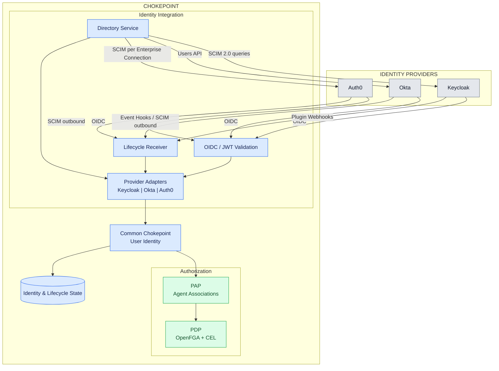
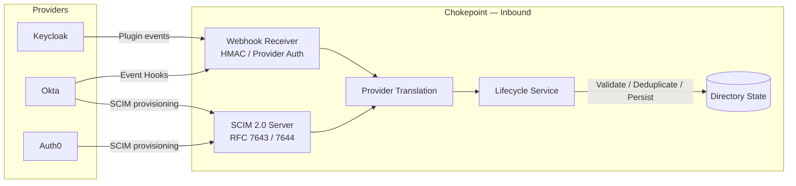

# Integração dos IdPs com o Chokepoint

O desenho de integração dos três IdPs com o Chokepoint fica dividido em **três fluxos independentes**: autenticação OIDC, consulta de usuários e sincronização do ciclo de vida.

O Chokepoint mantém um contrato comum de identidade, mas respeita os protocolos e capacidades de cada provedor.

## Diagrama de integração

*Diagrama lógico: os protocolos passam pelos adapters e endpoints apropriados. A integração funcional atual é Keycloak; Okta e Auth0 estão especificados para implementação.*

## Protocolos por provedor

| Integração | Keycloak | Okta | Auth0 |
|---|---|---|---|
| Autenticação de requisições | OIDC/JWT | OIDC/JWT | OIDC/JWT |
| Diretório | SCIM 2.0 | Users API | SCIM 2.0 por Enterprise Connection |
| Outbound lifecycle | Plugin webhook | Event Hooks ou SCIM | SCIM 2.0 |
| Identidade correlacionada | SCIM `id` / token `sub` no perfil validado | ID Okta / claim verificado | ID Auth0 / claim verificado |
| Destino das alterações | Lifecycle Receiver | Event Hook Receiver ou SCIM Server | SCIM Server |

Há um detalhe arquitetural importante no desenho: **o Lifecycle Receiver não é necessariamente um único endpoint HTTP**. Ele representa uma capacidade do Chokepoint com transportes diferentes.

## Fluxo de provisionamento e sincronização

Esse segundo diagrama representa o destino de integração previsto nas specs 016 e 018. Para Okta, Event Hooks e SCIM são alternativas de integração, não necessariamente dois fluxos que devem ser ativados simultaneamente.

**Minha conclusão arquitetural:** manteria exatamente essa separação no Chokepoint:

- **Authentication:** valida tokens emitidos pelos IdPs.
- **Directory:** consulta usuários para associação a agentes.
- **Lifecycle:** recebe alterações por webhook ou SCIM.
- **Identity Resolution:** produz a identidade interna comum, usada pelo PAP/PDP.

Uma ressalva importante: os eventos de desativação e exclusão atualizam o estado de identidade, mas, conforme as specs atuais, **não revogam automaticamente as associações publicadas nem os tokens já emitidos**.

Referências:

**Keycloak — documentação oficial (versão latest consultada: 26.8.1)**

- Documentação e versão atual: https://www.keycloak.org/documentation
- SCIM 2.0 — gerenciamento de usuários/grupos, busca, paginação, permissões e audience: https://www.keycloak.org/docs/latest/server_admin/#_scim
- Guia de desenvolvimento — Event Listener SPI: https://www.keycloak.org/docs/latest/server_development/#_events
- Código da interface EventListenerProvider (versão 26.8.1): https://github.com/keycloak/keycloak/blob/26.8.1/server-spi-private/src/main/java/org/keycloak/events/EventListenerProvider.java
- Keycloak SCIM UserResourceTypeProvider (versão 26.8.1): https://github.com/keycloak/keycloak/blob/26.8.1/scim/model/src/main/java/org/keycloak/scim/model/user/UserResourceTypeProvider.java
- Keycloak OIDC SubMapper (versão 26.8.1): https://github.com/keycloak/keycloak/blob/26.8.1/services/src/main/java/org/keycloak/protocol/oidc/mappers/SubMapper.java

**Keycloak — extensão externa de webhooks (não nativa)**

- Phase Two keycloak-events — código e configuração: https://github.com/p2-inc/keycloak-events
- Phase Two keycloak-events — README e condições de compatibilidade: https://github.com/p2-inc/keycloak-events/blob/main/README.md

**Padrões, Auth0 e Okta**

- RFC 7643: https://datatracker.ietf.org/doc/html/rfc7643
- RFC 7644: https://datatracker.ietf.org/doc/html/rfc7644
- Auth0 SCIM: https://auth0.com/docs/authenticate/protocols/scim
- Auth0 outbound SCIM: https://auth0.com/docs/customize/events/send-outbound-scim
- Okta SCIM: https://developer.okta.com/docs/concepts/scim/
- Okta Event Hooks: https://developer.okta.com/docs/guides/event-hook-implementation/nodejs/main/

**Confiança: alta** na separação arquitetural e nos papéis SCIM; **média** na cobertura específica por provedor até a validação dos perfis reais.
