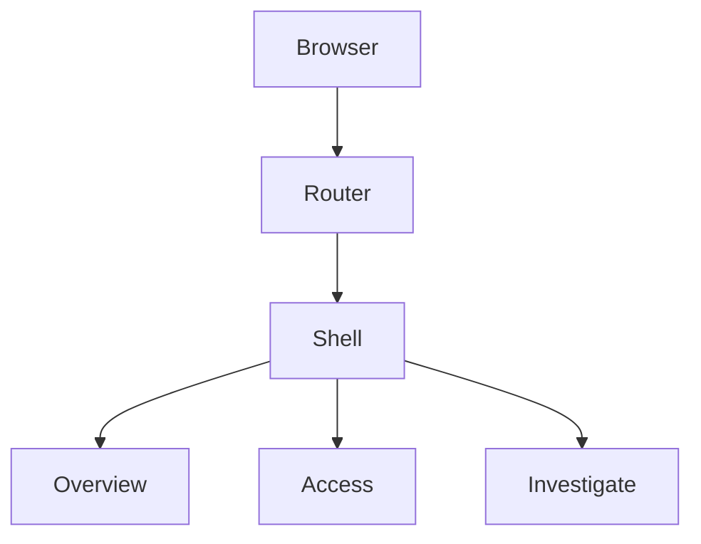

# Specification: Admin Shell

- **Specification ID**: 001
- **Date**: 2026-10-24
- **Slug**: admin-shell
- **Status**: Waiting Approve
- **Owner**: Admin
- **Related Mock Contract**: [Workbench reference](../docs/chokepoint-workbench/src/app.tsx)

## Context & Background

The module has dependencies and a reference mock, but no application entrypoint. The user explicitly requests only the mock's shell and current navigation, with completely empty page content.

## Problem Statement

The actual admin cannot run or navigate between its own pages.

## Solution

Create a React + Vite application using the existing design system and reference header layout. Overview, Access and Investigate each have a separate route and page component. Navigation is client-side, reflects the URL, and supports browser history and direct entry.

## Practical Gains & Operational Outcomes

The admin can run independently of the reference mock. Every current navigation destination has an empty content area.

## User Stories

- As an administrator, I can navigate the current sections using the reference layout.
- As an administrator, I see an entirely blank content area on every page.

## Architecture Gate

This change owns only application composition, routing and the visual shell. It introduces no business contexts, entities, APIs, persistence or backend dependencies. Each page is a separate component. Navigation metadata drives links and routes without duplicated route definitions.

## Implementation Decisions

Use the installed React Router and existing CSS tokens/fonts. Preserve the reference mock. Search and audit are absent. Workspace selection opens a design-system disclosure with the current workspace. Environment selection switches between Sandbox and Production in shell state and persists across page navigation. The profile disclosure shows the presumed platform account. Disclosures close on selection, outside pointer interaction and Escape. No fake operational data is loaded.

## Testing Decisions

The initial shell passed TypeScript and build checks and desktop browser navigation checks. Subsequent header adjustments are not tested, as explicitly requested by the user. This low-impact visual skeleton does not add a testing framework.

## Acceptance Criteria

- All three navigation destinations render an empty main region.
- Header navigation changes routes without a document reload.
- Direct links and browser history work.
- Header, fonts, logo and canvas follow the reference. The footer text is removed at the user’s request.
- Workspace, environment and profile controls open disclosures using the design system.
- The environment can switch between Sandbox and Production.
- Search and audit are absent.

## Out of Scope

Onboarding, IdP, backend, authentication, search implementation, contextual restriction configuration, sample content, tables, cards, headings and empty-state messages.

## Further Notes

Scope and implementation authorization come from the user's explicit request in this conversation. Earlier deleted IdP specifications are not restored.
