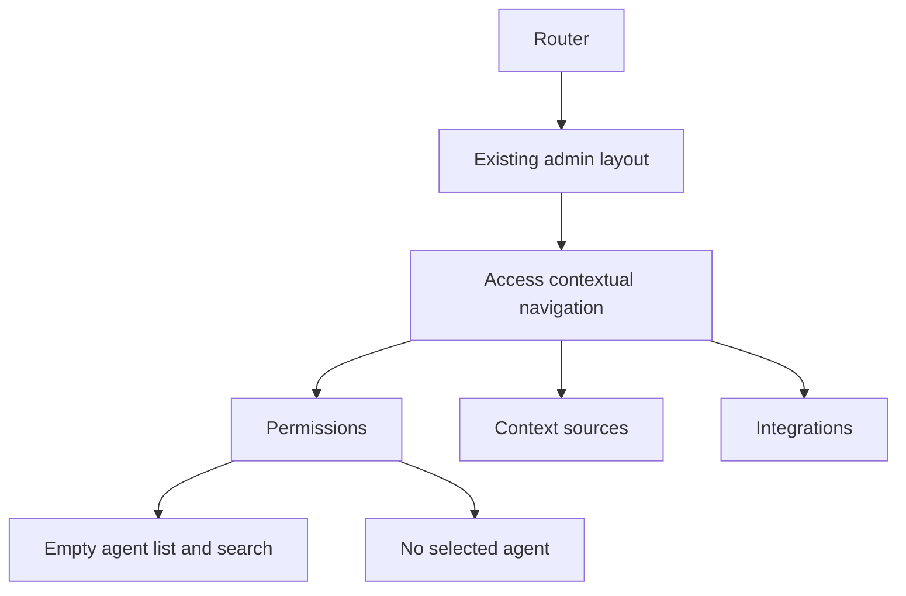

# Specification: Access Workbench Layout

- **Specification ID**: 003
- **Date**: 2026-10-24
- **Slug**: access-workbench-layout
- **Status**: Implemented
- **Owner**: Admin Access presentation
- **Related Specification**: [001 — Admin Layout](001-2026-10-24-admin-shell.md)
- **Related Mock Contract**: [Workbench source](../docs/chokepoint-workbench/src/app.tsx)

## Context & Background

The actual admin has a shared header and empty section pages. The user annotated the workbench mock and explicitly clarified that the requested changes belong in the real admin. The mock remains a visual reference and must not be edited. The user initially confirmed empty lists and later authorized temporary development-only visual preview records, to be removed before commit. The committed/production baseline remains empty until backend endpoints exist.

The pending local feat/http-client branch contains the previously committed HTTP client and reusable header/layout separation. Preserve that work and integrate its approved prerequisites before deriving this implementation branch from main; do not rebuild a second header or HTTP client.

## Problem Statement

Access has no page composition. Copying the mock verbatim would introduce unwanted headings, ambiguous terminology, an evaluation lab and sample state that the user explicitly rejected.

## Solution

Implement the actual Access page using the reference's light layout, spacing, agent rail, central panel and contextual navigation, with the following changes:

| User annotation | Actual admin behavior |
| :--- | :--- |
| Remove the selected introductory text | The later user revision restores ACCESS WORKBENCH and Configure. Teste. Publique. for now; the explanatory paragraph stays omitted |
| Replace Capabilities | Use Tools for the tab and tool terminology in related visible counts/copy; this is the naming proposal for approval |
| Use agents, not agent types | Use Agents wherever that concept is named |
| Remove the selected AGENT TYPES row | The later user revision restores the Agents caption and actual list count above search |
| Remove Evaluation Lab | Do not render the inspector, simulator, evaluation form or regression-test controls |
| Move People beside Context sources as Integrations | Add Integrations as a sibling of Permissions and Context sources in Access navigation; remove the People shortcut and connected-IdP claim from the bottom of the agent rail |

The later restoration of the Agents caption/count supersedes the initial removal of that row. Agents remains the terminology everywhere else. Integrations is the navigation destination replacing the selected rail shortcut; it does not rename the agent-specific People association tab or define an IdP CRUD workflow.

## Practical Gains & Operational Outcomes

- Access gains real React page composition consistent with the reference and current header.
- Navigation and reusable components remain separate from page composition.
- Empty collections truthfully represent the absence of agents, tools and people without creating backend contracts or fictional connected integrations.

## User Stories

- [x] As an administrator, I can open Permissions, Context sources and Integrations within Access.
- [x] As an administrator, I see an empty agent list and can use its search field without receiving sample results.
- [x] As an administrator, I see no selected-agent details or tool/member associations when no agent exists.
- [x] As an administrator, I see the requested layout without the removed introduction, rail caption or Evaluation Lab.

## Architecture Gate

### Bounded Context & Ubiquitous Language

This specification owns Access presentation only. It does not define backend bounded contexts or implement identity, agent registry, MCP registry or enforcement behavior.

| Owner | Responsibility |
| :--- | :--- |
| Application routing | Existing top-level routes and Access child-route composition |
| Shared admin layout/header | Existing workspace/environment/profile controls; no duplicated shell or restored search/audit/footer |
| Access pages | Compose Permissions, Context sources and Integrations views |
| Access components | Contextual navigation, agent list/search region and central selection area |
| Reusable UI components | Existing primitives and design-system appearances; add a shared primitive only if genuinely reusable |

Pages contain composition. Extract reusable or cohesive interactive components; do not place the entire page, header, data and behavior in a single component. Feature-specific components do not become generic UI primitives merely because they are extracted.

### Entities & State Transitions

There are no new persisted entities or business transitions. Lists begin empty. Searching changes only local filter state. Navigation changes the active route. No agent is automatically selected, and no detail panel is populated from invented fixtures.

Workspace and environment controls retain existing behavior. This delivery does not imply that changing them fetches data from APIs that do not exist.

### Navigation and Data Boundary

The proposed route contract is:

| Path | View |
| :--- | :--- |
| /access | Permissions |
| /access/context-sources | Context sources |
| /access/integrations | Integrations |

These are client-side route proposals presented for approval, not backend endpoints. Each destination has its own page component, with a shared Access navigation region and correct active state. Direct URLs and browser history must work. The top-level Access link remains active on its child routes.

No backend calls are introduced. Production initial collections remain empty. Temporarily authorized visual records are isolated from production and TanStack Query keys identify the visual preview and selected environment; real API keys will require the actual authorized workspace/environment contract. There is no mock HTTP server or simulated authorization engine. Future API integrations must preserve the separation between page composition, feature behavior and HTTP transport.

## Implementation Decisions

1. Use the installed React/Vite/React Router baseline, existing local fonts and docs/design-system/styles/index.css. Reuse semantic tokens and the reference geometry, without importing the mock's application, React 16 runtime or localStorage state.
2. Keep Overview and Investigate empty. Keep the current header selectors/profile and main navigation. Search, audit and footer text stay absent.
3. The workbench has only the agent rail and central area after removal of the inspector. Do not leave a blank third column or the inspector's reserved grid space.
4. With no agents, render a reusable brown-icon no-data placeholder. With selected preview data, render the agent details, Tools/People controls, grouped tools and people as separate components. No onboarding or new backend behavior is introduced.
5. Context sources and Integrations expose their own no-data placeholders below the shared Access navigation. No connected-provider status, directory import or integration form is invented.
6. New agent and Review changes retain the reference action appearances and open accessible native dialogs. Creation, tool toggles and review confirmation affect the explicitly labeled local preview cache only; no backend persistence or enforcement is claimed.
7. Tools and agent-specific People are displayed for a selected preview agent, with counts derived from its data. With no selected agent, render the no-data placeholder instead of fictional details.
8. Native semantics, accessible labels and keyboard focus remain required. Use NavLink and aria-current for navigation. Do not introduce modal/menu keyboard patterns for ordinary route links.

## Testing Decisions

Use the rendered Access page and public browser navigation as the main test seam, not private component state or assertions about a folder tree. Follow Red-Green-Refactor for new navigation behavior. Select the minimal React-compatible test tooling during implementation and pin exact versions; do not upgrade React/Vite or add multiple competing test frameworks.

### UI and Routing Tests

- /access, /access/context-sources and /access/integrations render their intended page and correct active navigation.
- Access remains selected in the main header on all three routes.
- Navigation works without document reload; direct entry, back and forward work.
- The agent list is empty, searching does not generate sample rows, and no agent details/tools/member counts are fabricated.
- Removed heading/paragraph, AGENT TYPES caption/count, connected-IdP rail block and Evaluation Lab are absent.
- Integrations appears next to Context sources; the former rail People shortcut is absent.
- Out-of-scope create/review actions are disabled and do not trigger fake workflows.
- Workspace/environment/profile controls retain behavior; Overview and Investigate remain empty.

### Desktop Visual Verification

Compare the rendered actual /access route with the annotated mock on desktop. Verify gutters, spacing, rail/central proportions, removed inspector space, hover/focus states and horizontal overflow. Inspect console errors. Do not run mobile interface testing; that is the user's explicit restriction, not a restriction on code tests.

### Quality Checks

Run the relevant behavior tests, npm run check and npm run build. Use the admin's React best-practices skill. Perform the formal Code Reviewer Gate after implementation and report concrete findings without speculative future architecture changes.

## Acceptance Criteria

- [x] 1. The actual admin, not the mock, implements the annotated Access composition.
- [x] 2. Contextual navigation includes Permissions, Context sources and Integrations with working routes/history.
- [x] 3. Empty lists contain no copied demonstration records, connected-provider claims or simulated access state.
- [x] 4. Evaluation Lab, agent-initial blocks, duplicate environment metadata and the old rail People shortcut are absent; the two-column layout reclaims inspector space.
- [x] 5. Agent terminology uses Agents; Tools replaces Capabilities when that content is present.
- [x] 6. Reusable controls, Access components and page composition have separate responsibilities.
- [x] 7. Relevant tests, TypeScript, production build and desktop visual verification pass.
- [x] 8. README and specification status match implementation evidence; formal review precedes Waiting Approve.

## Out of Scope

Mock edits, populated Overview/Investigate screens, sample agents/tools/people, backend APIs, organization onboarding, server-side agent creation/publication, IdP CRUD, directory synchronization, real context-source connections, MCP discovery, contextual policy/enforcement logic, evaluation lab and mobile UI testing.

## Further Notes

This specification is written on main. User annotation scope and empty lists are confirmed. The user approved implementation, including Tools terminology, the child-route paths and disabled action treatment. This specification supersedes the blank Access page requirement in specification 001; Overview and Investigate remain empty.

After approval, preserve/integrate existing approved prerequisites and create a dedicated implementation branch from main. Publish through approval, commit, merge into main and push, following the updated admin AGENTS.md; no pull request is required.

## Implementation and Verification Record

Implemented on feat/access-workbench-layout after fast-forward integration of the previously approved local HTTP-client/header prerequisites into main. The mock was not modified. Changes are confined to the actual admin's Access composition, nested routes, active header navigation, feature components/styles and rendered-behavior test setup, plus the approved AGENTS.md publication-flow correction.

The first rendered navigation test failed because the Access navigation region did not exist, then passed after implementation. Eight behavior tests now pass through the rendered App: contextual navigation, direct entry at all three paths, empty collections/details, absence of removed elements, disabled actions, preserved workspace/environment/profile controls and empty Overview/Investigate pages. Vitest 5.0.5, Testing Library React 16.3.3/user-event 14.6.8/jest-dom 7.0.1 and jsdom 30.1.3 are pinned as development dependencies. Existing React/Vite versions are unchanged.

npm test, npm run check, npm run build and git diff --check passed. Desktop browser checks at 1440x900 and 1000x649 confirmed two workbench columns, no horizontal overflow, empty collections/details, active links, direct navigation and same-document back/forward history. The console had no warnings/errors. No mobile interface testing was performed.

Formal review found no actionable defects or boundary violations in the implemented contract. No code corrections were applied during that review. No scope deviations, backend calls, sample records or simulated business workflows were added. Tools/People tabs are absent while there is no selected real agent, as specified. The final Implemented status and publication await user approval. The later visual revision tasks below supersede the initial empty-only UI where noted.

## User-Authorized Visual Revision Tasks

The following user instructions supersede the original empty-only composition where noted. Implementation is authorized in the conversation.

- [x] Create a reusable no-data placeholder with a brown icon using the design-system accent foreground token. Apply it to genuinely empty views and no-match results.
- [x] Restore the mock's page title for now. Keep the current Integrations navigation and the removed Evaluation Lab.
- [x] Restore the agent rail caption and count. Use Agents terminology and show the actual list count rather than the prototype's fixed sample count.
- [x] Match the mock's dark Review changes button and light New agent button.
- [x] Add temporary, isolated visual-preview records so the user can inspect an actual selectable list, agent details, grouped tools and people. Removal before commit remains a separate unchecked publication task below.
- [x] New agent opens a real accessible dialog. For this explicitly local visual preview, submitting creates a draft only in the preview cache and selects it. No backend persistence is claimed.
- [x] Review changes opens a real accessible dialog showing preview changes and a local-preview confirmation action. No backend publication or enforcement is claimed.
- [x] Keep JSX, custom hooks and data/query configuration in separate files. Components remain cohesive: navigation, header/actions, agent list/row, details, tool groups/rows, people, dialogs and shared placeholders.
- [x] Prepare TanStack Query with separate client/provider setup and feature data hooks. Query keys distinguish preview data and selected environment. Do not invent backend endpoints or simulate HTTP calls. Local preview changes update the preview cache explicitly.
- [x] Add behavior tests for selection/search, placeholders, dialogs and preview changes, and rerun TypeScript/build and desktop visual verification. No mobile UI testing.

Before commit, remove temporary preview records, restore an empty data source and verify that placeholder components render correctly. Production bundles must not initialize demonstration records. The user has not approved publication of preview fixtures.

### Visual Revision Verification and Remaining Publication Work

Completed in this revision: reusable EmptyState with a brown icon; restored heading; Agents caption/count; light/dark action appearances; isolated development-only preview agents; selectable rows, details, Tools/People and search; New agent and Review changes native dialogs; local cache changes; separate custom hook files; QueryClient/provider and environment-scoped preview query keys.

Thirteen rendered-behavior tests pass. npm run check, npm run build and git diff --check pass. A production-bundle search confirms sample record identifiers/emails are absent. Real desktop browser verification at 1440x1000 and 1000x800 confirmed selected-agent rendering, brown icon rgb(156,79,32), native modal state, Escape handling, opener focus restoration, local draft creation/review and no horizontal overflow or console warnings/errors. jsdom tests provide dialog-method stubs only in test setup; real browser behavior is verified separately.

Required before commit, still pending user visual review:

- [x] Remove sample records and their preview seed import from the application; representative fixtures now exist only under test code.
- [x] Retest the empty runtime source, placeholders and dialog behavior after cleanup.
- [x] Rerun tests, TypeScript, build and final review before the approved publication flow. No application preview records are included.

The user subsequently approved the reviewed result and its publication. Temporary application records have been removed before commit, and the empty runtime source has been revalidated.

Component styles are also separated by responsibility (Access navigation/actions, agent list, details, tools and shared lists); custom hooks are in .ts files, outside JSX layouts. The application environment type is owned by app context rather than a header control.

### Visual Revision Review

Implementation report: shared EmptyState/Dialog/Dropdown primitives, dedicated lifecycle hooks, app-level environment context and QueryClient provider, feature query/cache and interaction hooks, separate Access component/style files, and temporary visual records are present. Thirteen behavior tests, TypeScript and production build pass; actual desktop browser checks verified both native modal flows and the brown placeholder icon.

Formal reviewer posture checked render/data separation, preview-only query keys and initialization, environment isolation, draft/change handling, dialog cleanup/focus return, route/header regression and no-data rendering. No actionable defects were found in the current visual-preview contract. No automatic code corrections were applied during this review. The temporary fixture cleanup and empty-source revalidation remain explicit, uncompleted prerequisites for any commit; no publication has occurred.

## User-Authorized Agent Presentation and MCP Annotation Revision

- [x] Remove initial-letter avatar blocks from agent list rows and selected-agent details.
- [x] Remove the duplicated Sandbox/Production label from selected-agent metadata; retain the actual environment context and query-key isolation.
- [x] Keep the current Lucide Server icon in MCP group headings, as clarified by the user. No agent or MCP icon picker is introduced.
- [x] Replace the mandatory readOnly boolean and binary Read/Write classification with optional MCP ToolAnnotations: title, readOnlyHint, destructiveHint, idempotentHint and openWorldHint.
- [x] Display independently supplied boolean hints, preserving explicit false values. Do not fill absent annotations with invented UI classifications. Tools without annotations remain valid and render without annotation badges.
- [x] Omit destructiveHint/idempotentHint badges when readOnlyHint is true, because those hints are meaningful only for modifying tools. Annotations do not grant access or affect the tool switch/policies.
- [x] Verify the updated behavior tests, TypeScript/build and desktop layout.

Reference: https://modelcontextprotocol.io/specification/2026-07-28/schema#toolannotations. Current preview records include tools with multiple annotations and a tool without annotations. All temporary record cleanup requirements before commit still apply.

Annotation revision verification: 16 tests pass, including omitted annotations, independent true/false hints, read-only applicability, removed agent avatars and absence of repeated environment metadata. TypeScript/build and desktop checks at 1151x800 pass with no overflow or console issues. Formal review found no actionable defects in these changes. Existing temporary-data removal prerequisites remain pending before any commit.

## Annotation Hover Hints

- [x] Add a shared Tooltip component with design-system palette, spacing, typography, radius, shadow and layering.
- [x] Explain each MCP boolean annotation value on hover and keyboard focus; show the actual field/value alongside the explanation. Replace the browser-native title text.
- [x] Keep positioning/open/close logic in a dedicated hook. Render tooltips in a portal to avoid clipping by tool-group overflow. Escape and blur dismiss the hint.
- [x] Verify hover/focus behavior tests and the desktop rendered result.

Hints describe the server's metadata and do not change permissions or fill omitted annotations. Existing temporary preview cleanup requirements remain in force.

Tooltip verification: 17 tests pass, including mouse hover, moving into the tooltip, keyboard focus and Escape dismissal. TypeScript/build pass. Desktop verification at 1151x800 confirms the Additive explanation uses the dark design-system surface, stays within the viewport, avoids overflow clipping through a portal and dismisses with Escape. Formal review found no actionable defects in this addition.

## Final Approval and Publication Verification

The user approved the reviewed result on 2026-10-24. Application preview-data.ts and its import were removed. Representative records now live only in src/features/access/testing/agents.ts, imported exclusively by a test. Production/runtime initial cache data is empty in both development and production. Application route composition is separated from its provider so tests can seed a real isolated QueryClient without mocking the data hook.

Eighteen tests pass, including a new test that opens creation and review dialogs starting from the empty application source. TypeScript, production build and diff whitespace checks pass. Desktop verification at 1151x800 confirms zero agent rows, correct no-data placeholders, no sample names, no overflow and no console errors. The build contains no representative agent identifiers or sample emails. No mobile UI tests were run.

Final review of fixture removal, cache initialization, route/provider separation and regression evidence found no actionable defects or scope deviations. The approved flow is commit on the task branch, merge into main and push main; no pull request is required. Previous notes about temporary records or pending visual approval are historical and superseded by this final record.
