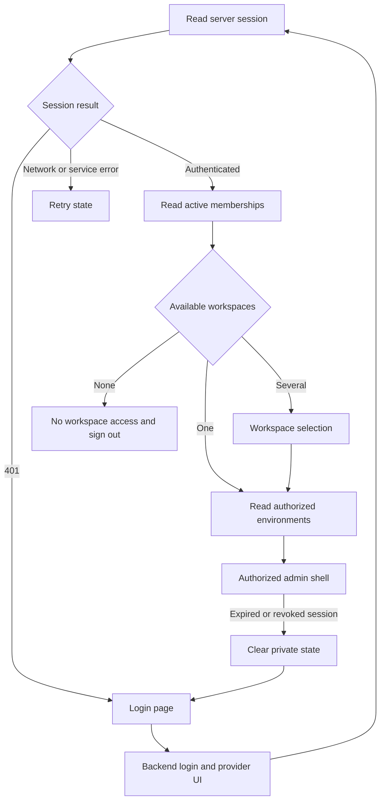

# Specification: Login and Authorized Workspace Selection

- **Specification ID**: 004
- **Date**: 2026-10-24
- **Slug**: login-and-authorized-workspace-selection
- **Status**: Implemented
- **Owner**: Admin authentication presentation and authorized application context
- **Related Specifications**: [001 — Admin Shell](001-2026-10-24-admin-shell.md), [002 — HTTP Client](002-2026-10-24-http-client.md), [003 — Access Workbench](003-2026-10-24-access-workbench-layout.md)
- **Backend Contract**: [003 — Admin Login and Workspace Access](../../backend/specs/003-2026-10-24-admin-login-and-workspace-access.md)
- **Design Reference**: [Admin Design System](../docs/design-system/README.md)
- **Connected Signup Extension**: [005 — First Workspace Onboarding](005-2026-10-24-first-workspace-onboarding.md), [Frontend 002 — Public Entry](../../frontend/specs/002-2026-10-24-public-signin-and-signup.md)

## Context & Background

The user requests separate login specifications before agent CRUD, a real login screen, existing design-system fidelity through impeccable, and strict multitenant security. The user confirms platform OIDC login with local Keycloak, backend sessions and HttpOnly cookies. Public signup and customer IdP connections are deferred.

This screen belongs in admin, the React + Vite management frontend. The separate Next.js frontend remains the public site. Current admin routes are unguarded; the HTTP client sends a fixed development token; workspace/profile display is a placeholder and environments are local UI state. No real login exists.

This document is a proposed implementation contract using the module template. The user subsequently authorizes implementation; final review and publication remain separate. The backend spec owns endpoints and authorization semantics.

## Problem Statement

1. The browser cannot establish an authenticated platform user or show current workspace access.
2. Local context and query state do not establish tenant authorization.
3. A shared token in a browser bundle cannot identify an administrator.
4. Login, denied access and expired-session presentation need a coherent design and failure behavior.

## Solution

Add a standalone login page, session bootstrap, guarded application routes, authorized workspace/environment selection and local logout. Redirect authentication to Keycloak through the backend. Clear private cached state when identity or tenant context changes.

## Practical Gains & Operational Outcomes

- A real login entry uses the same visual language as management screens.
- The IdP owns password/MFA entry; the admin stores neither credentials nor provider tokens.
- Workspace/environment controls show backend-authorized data.
- Query cancellation and cache isolation prevent stale tenant data from appearing after a switch.

## User Stories

- [ ] An administrator can open /login and continue to the configured identity provider.
- [ ] A returning administrator can resume only after session validation completes.
- [ ] A user can choose among their authorized workspaces and environments.
- [ ] A user without memberships sees an explicit access message and can sign out.
- [ ] A user can retry service failures without an automatic login loop.
- [ ] Logout and expiry remove private UI state.
- [ ] Keyboard and assistive-technology users can complete the login/selection flow.

## Architecture Gate

### Bounded Context & Ownership

Admin owns presentation and client state; backend owns authentication, session validity, membership and tenant authorization. A protected React route is a usability boundary, not a security boundary.

| Owner | Responsibility |
| :--- | :--- |
| Application routes | Public login, authenticated route guard, workspace selection and existing child routes |
| Authentication feature | Session query, login/logout actions, safe error mapping and cache lifecycle hooks |
| Workspace context | Authorized current tenant/environment and selection transitions |
| Pages | Login, workspace selection and no-access composition |
| Shared components | Existing buttons, notices, dropdowns, focus and loading patterns |
| API transport | Same-origin requests, cookies, CSRF, cancellation and typed safe status handling |

Keep JSX, custom hooks, API functions and styles separate by responsibility. Do not build a second header, HTTP client, QueryClient or design system. Read the module React skill during implementation. Preserve React/Vite baseline versions.

### States & Invariants

Model session loading, unauthenticated, authenticated, unavailable and signing out explicitly. Workspace access may be loading, empty, ready or unavailable. Treat 401 as missing/expired authentication, 403 as request/access rejection, and dependency/network failures as retryable failures rather than proof of logout.

No private shell renders while session validation is pending. No tenant data renders without resolved authorized workspace/environment. No workspace membership is inferred from email, URL, browser storage or provider claims. Direct routes and browser history still require server validation.

## Implementation Decisions

### Login Design Proposal

Physical scene: an administrator opens Chokepoint during a work session on a desktop in ordinary office light and needs to reach an authorized workspace quickly. Use the existing light theme and restrained color strategy.

- Use the existing brand asset, a single main landmark and one narrow login region, proposed maximum width 26rem. Keep it in the page flow with generous surrounding space, without the authenticated header, workspace selector, card grid, marketing hero or nested panels.
- Heading: "Sign in to Chokepoint". Supporting text: "Use your account to access your workspace." Primary action: "Continue to sign in". The redirect-in-progress label is "Opening sign-in…". The provider owns credential and MFA screens; do not create email/password fields or recovery links in the admin.
- Reuse DM Sans body, Manrope headings, existing brand, text, surface, action, focus, border and danger semantic tokens. Use the existing peach primary button appearance. Do not add a palette, remote font, dark theme, gradient text, decorative glass, security badge or unverifiable security promise.
- Preserve canonical sRGB tokens for fidelity; the existing system takes precedence over generic impeccable color-space preferences. Reuse docs/design-system/styles/index.css rather than literal copied colors.
- Use existing spacing steps: 12–16px within related content, 24px before the primary action and 32–48px around major groups. Body copy stays within the design system's prose width; controls retain documented dimensions and focus outlines.
- Place concise errors inline beside the action; do not use an error modal. Provide a visible retry action, announce errors accessibly and preserve keyboard focus. Cancelled login is a neutral retry state.
- Use semantic buttons/forms and visible names. Loading does not rely on a spinner alone and duplicate initiation is blocked. Respect prefers-reduced-motion; no decorative entrance sequence.
- Workspace selection is a separate page with a short list of authorized workspace names and clear selection actions. No workspace ids, provider tokens or technical assurance claims belong in primary copy. No-access copy: "You do not have access to a workspace." Action: "Sign out".
- Keep layouts usable with text zoom and narrow widths; inherit existing responsive rules. Preserve the user's existing restriction against mobile UI testing; perform desktop visual checks and code-level accessibility checks, and report this verification limit.

### Browser and API Contract

Use the exact endpoint contract in backend 003. The browser starts login with a top-level same-origin form POST to /api/v1/auth/login so backend redirects navigate the browser, not a fetch response. The callback terminates at the backend, which sets the cookie and redirects to a clean admin route.

Read /api/v1/auth/session before rendering protected routes. Its user object supplies real profile presentation and its csrf_token remains in memory. Never inspect or parse the HttpOnly session cookie. Do not handle an authorization code or provider token in React.

Replace the hardcoded Bearer token and Authorization injection. Use same-origin cookie requests. Send the server-issued CSRF token on authenticated mutations and logout. VITE_ settings contain no client secret, token or session key. No tokens in localStorage, sessionStorage, URLs, service workers, analytics or query persistence. No local-token fallback.

Client routes are proposed as /login and /workspaces, followed by the existing admin routes. Preserve a return target only through an allowlisted local-route contract; do not trust arbitrary next/returnTo URLs. Use history replacement on clean login completion and auth redirects to avoid loops and callback artifacts.

Login callback error codes map to short fixed messages. Never render provider error_description, raw backend exceptions or HTML from query strings. Network/503 errors show retry instead of redirecting repeatedly to the IdP. An authenticated user opening /login goes through authorized workspace resolution.

### Multitenant Context and Cache

- Fetch authorized workspaces from the server. One active membership can select its workspace automatically; several require explicit initial selection. Zero memberships show no-access. Never create a workspace as a side effect of login.
- Fetch environments only for an authorized selected workspace. Propose Sandbox as the initial environment when returned by the server; otherwise require explicit selection from returned environments. Empty/missing environments show a no-environment state, not invented choices. Confirm this initial-selection proposal before implementation.
- Store workspace/environment selection in current app memory for this first delivery. Reload resolves it again from authorized data. The backend independently checks every operation; memory is not proof of access.
- Private query keys include authenticated user id, tenant_id and environment_id when relevant. Workspace discovery keys include user id; environment lists include user and tenant ids. Do not reuse preview-only keys as an API contract.
- On context switch, immediately hide previous scoped data, cancel old requests, discard scoped drafts and remove their cached data before rendering the next scope. Ignore stale completions and verify this with delayed-response tests. Shared-browser changes cannot reuse another user's cache.
- On logout or authenticated-endpoint 401, cancel requests, clear all private queries/mutations/drafts and reset workspace/environment/profile/CSRF state. Logout attempts backend revocation first. If revocation fails, hide private state and show that sign-out could not be confirmed, with retry; do not claim the server session ended.
- On scoped 404/403, invalidate the relevant authorized-context query and resolve access again. Do not expose another tenant's name or record existence, or retry a denied mutation in a different workspace.
- Existing Access creation/review remains local preview behavior under its existing contract; it must be cleared/scoped with the selected authorized context. Login does not introduce real agent writes, policy publication or real tool permissions.

### Browser Security and Deployment

Serve admin and /api from one configured browser origin. Keep the existing Vite proxy and backend port. The production hosting contract must route /api to backend and other application routes to the SPA; do not rewrite API failures to index.html.

Specify and verify the SPA host's production CSP: default-src 'self', script-src 'self' without unsafe-inline/unsafe-eval, connect-src 'self', font-src 'self', object-src 'none', base-uri 'none', frame-ancestors 'none', form-action 'self'. Inventory actual stylesheet requirements before enforcing style-src; do not weaken script policy for convenience. Authentication is top-level navigation, not an embedded iframe. No-store applies to session-specific responses, with a restrictive referrer policy on auth pages. Local Vite development policy is distinct from production and must not silently weaken production startup.

No dangerouslySetInnerHTML or unsafe URL sinks for auth/profile/error data. No third-party login analytics. Remove private content from the DOM before auth navigation; a browser back action must revalidate and must not restore a cached authenticated screen as evidence of current access.

## Testing Decisions

Use rendered routes with a real isolated QueryClient and controlled HTTP responses as the main UI seam. Test behavior, not private hook structure. Follow Red-Green-Refactor. Add a real desktop browser flow against backend and Keycloak after backend dependencies are ready.

- Direct entry to each existing route shows no private content until session validation; 401 reaches login and service failures reach retry.
- Login uses backend navigation; loading disables repeat starts; cancellation and safe error codes render accessible inline states.
- No credentials or provider tokens are rendered, persisted or included in the bundle. No old Bearer token remains.
- One, multiple and zero membership cases behave correctly; environments come from the selected workspace.
- Delayed requests from tenant A cannot populate tenant B after a switch. Cross-user cache reuse and draft leakage are prevented.
- Logout success/failure, expiry, revoked membership, back navigation and no-environment states have explicit behavior without redirect loops.
- Forged tenant/environment selection remains denied by the real backend. UI-hidden choices alone are not an isolation test.
- Test keyboard access, focus, accessible names, announcement of errors, duplicate-submit protection and reduced-motion behavior.
- Run npm test, npm run check, npm run build, dependency audit and git diff --check. Verify real desktop layout, console, network redirects, cookie attributes and production security headers. Report unresolved advisories and hosting prerequisites explicitly.

## Acceptance Criteria

- [ ] /login uses the existing design system and redirects to real provider login through the backend.
- [ ] Protected routes wait for server session validation and handle failures without private-content flashes.
- [ ] Workspace/environment controls use only authorized server responses.
- [ ] Tokens/passwords remain outside JavaScript storage; static Bearer authentication is removed.
- [ ] Cache/draft cleanup passes delayed-response, context-switch, logout and identity-change tests.
- [ ] Accessibility behavior, required checks and real desktop login/logout verification pass.
- [ ] README documents the new flow and required backend/provider setup; its spec index matches this lifecycle.
- [ ] Formal reviewer gate completes before Waiting Approve. This document does not claim implementation, test evidence or publication.

## Out of Scope

Public frontend edits, public signup, password/recovery forms, custom MFA, customer IdP onboarding, SCIM, agent CRUD, agent policy APIs, authentication simulation, production hosting implementation, reference mock changes and mobile UI testing.

## Further Notes

Use impeccable's product register and the repo's canonical design references. PRODUCT.md and DESIGN.md capture existing repository context without changing tokens. The page composition above is a reviewable proposal, not a screenshot or implemented UI.

Before implementation, confirm the coordinated backend API/security contract, login copy/layout and workspace/environment initial-selection rules. Implement on a dedicated branch only after explicit approval, following this module's AGENTS.md. Do not change historical Implemented specifications. No commit, merge or push is authorized in this task.

References: [OAuth Security BCP](https://www.rfc-editor.org/rfc/rfc9700.html), [OWASP Session Management](https://cheatsheetseries.owasp.org/cheatsheets/Session_Management_Cheat_Sheet.html), [OWASP CSRF](https://cheatsheetseries.owasp.org/cheatsheets/Cross-Site_Request_Forgery_Prevention_Cheat_Sheet.html).

## User-Required Provider Presentation

The user rejects the default Keycloak appearance. The provider-hosted login, registration, email verification and OTP/MFA pages must use a Chokepoint theme derived from the admin's canonical tokens, local fonts and brand assets. Theme files belong to ../dev-infra/idps/keycloak/themes/chokepoint (resolve from the workspace root). Retain provider-owned form processing, escaping, CSRF and authenticator semantics. No password grant or custom Go password endpoint is introduced. Verify the actual provider pages in the browser, not only the admin entry screen.

## Completion Record

Implementation remains local and awaits user review. Login, signup with verified email/MFA, workspace onboarding and tenant isolation were exercised in development. Backend vet/build/unit/integration/race checks passed, admin had 22 passing tests with TypeScript/build passing, frontend had 11 passing tests with TypeScript/build passing, and dependency scans reported no known vulnerabilities. Go 1.27.3 is explicitly authorized.

The user's final correction moves seed data into a real Goose SQL migration under backend/migrations/development and removes the separate seed package/executable. The SQL migration is applied through cmd/migrate seed with a development-only guard and separate migration history. The previously passing suites are not rerun after this final conversion, at the user's explicit request; the migration command and build are the final limited verification. No commit, push or merge is authorized. Production hosting/CSP/TLS and multi-instance rate-limit deployment remain release prerequisites; Caddy/mTLS is documented only.

## User Approval

Approved by the user on 2026-10-25 for publication. Validation evidence and documented limitations above remain applicable.
