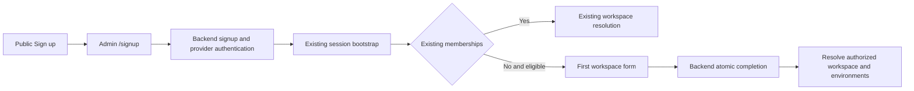

# Specification: First Workspace Onboarding

- **Specification ID**: 005
- **Date**: 2026-10-24
- **Slug**: first-workspace-onboarding
- **Status**: Implemented
- **Owner**: Admin signup and first-workspace presentation
- **Related Contracts**: [004 — Login](004-2026-10-24-login-and-authorized-workspace-selection.md), [Backend 004 — Signup](../../backend/specs/004-2026-10-24-public-signup-and-workspace-bootstrap.md), [Frontend 002 — Public Entry](../../frontend/specs/002-2026-10-24-public-signin-and-signup.md)

> The user confirms open registration with verified email and MFA and authorizes implementation.

## Context & Background

The user adds public signup as a separate connected scope. Admin 004 continues to own sign-in, sessions, authorized selection and cache isolation. The public site links to admin; backend 004 owns account enrollment and atomic first-workspace creation. This specification adds the required management presentation without placing business rules in Next.js.

## Problem Statement

The public signup link needs a real destination. A verified newly enrolled user needs to name their first workspace and receive an authorized context without client-side tenant or membership creation.

## Solution

Add /signup as a provider-enrollment entry and /onboarding/workspace as a session-protected completion page. Use the existing login presentation and admin design system, not another authentication client.

## Practical Gains & Operational Outcomes

Public entry, provider authentication and tenant creation form one coherent flow. The browser never creates membership locally or treats provider registration as tenant authorization.

## User Stories

- [ ] A visitor can start signup and return to authenticated onboarding.
- [ ] An eligible user can name their first workspace and retry a failed submission safely.
- [ ] An existing member reaches their authorized workspace selection without duplicate onboarding.

## Architecture Gate

Pages own composition; feature hooks own enrollment/completion state; API transport reuses admin 004. Backend alone enforces eligibility, identity, membership and tenant creation. No provider SDK/token exchange or password form is introduced in React.

States include session loading, signup entry, provider redirect, workspace form, submitting, retryable failure, denied/ineligible and completed. An authenticated user without membership is not automatically eligible; backend completion decides admission. Tenant context becomes ready only after authorized workspace/environment queries succeed.

## Implementation Decisions

- /signup offers "Create your account" and "Continue to sign up", with a Sign in link to /login. Submit a same-origin browser form to backend /auth/signup. Provider handles credentials, verification and MFA.
- /onboarding/workspace has one workspace-name input and "Create workspace" action. Propose the backend 004 name constraints; show validation inline. Do not ask for tenant id, user id, role, environment choice or existing organization domain.
- Reuse admin 004 product register, logo, fonts, semantic tokens, focus and notice components. Compact single-task composition; no marketing hero, security claims or reference mock changes. Use impeccable with the existing PRODUCT.md/DESIGN.md context during implementation.
- Use backend 004 session/CSRF/Origin contract. Keep the pending completion idempotency key in memory and reuse it for retries of identical input. After reload, resolve server state before resubmitting; backend per-user serialization prevents duplicate initial creation even with a new key.
- Block duplicate submission, retain workspace-name input on recoverable errors and never report success until the backend confirms commit. 409 triggers workspace re-resolution; it is not permission to bypass eligibility.
- After completion, invalidate workspace discovery and load environments through authorized endpoints. Reuse admin 004 context/cache cleanup. Do not synthesize Sandbox/Production records in the browser.
- Session expiry returns to login using fixed local routes; no open return URLs. No tokens in browser storage, query strings or analytics.

## Testing Decisions

Use rendered routes and an isolated QueryClient as in admin 004. Verify signup navigation, protected onboarding, form validation, keyboard/focus/error semantics, repeated submission and idempotency-key reuse, failure retention, existing-membership routing and session expiry. Verify a real desktop signup through Keycloak/backend, then authorized selection. Run npm test, npm run check, npm run build and dependency checks. Preserve the existing no-mobile-UI-testing constraint.

## Acceptance Criteria

- [ ] Signup and onboarding use real backend endpoints without simulated account/tenant data.
- [ ] Existing accounts and retry/error states cannot create duplicate initial workspaces.
- [ ] Admin design system, accessibility and session/cache rules remain consistent with 004.
- [ ] Required behavior checks, real desktop flow and reviewer gate complete before Waiting Approve.
- [ ] README spec index and connected contracts match this lifecycle.

## Out of Scope

Credential/MFA entry, provider administration, customer IdP configuration, invitations, extra workspaces, agent CRUD, public website implementation and mobile UI testing.

## Further Notes

This is a separate signup extension; it does not expand the implementation scope of admin 004. Backend 004 owns policy and endpoint decisions. All proposed copy and layout remain reviewable before implementation under this module's AGENTS.md.

## Completion Record

Implementation remains local and awaits user review. Login, signup with verified email/MFA, workspace onboarding and tenant isolation were exercised in development. Backend vet/build/unit/integration/race checks passed, admin had 22 passing tests with TypeScript/build passing, frontend had 11 passing tests with TypeScript/build passing, and dependency scans reported no known vulnerabilities. Go 1.27.3 is explicitly authorized.

The user's final correction moves seed data into a real Goose SQL migration under backend/migrations/development and removes the separate seed package/executable. The SQL migration is applied through cmd/migrate seed with a development-only guard and separate migration history. The previously passing suites are not rerun after this final conversion, at the user's explicit request; the migration command and build are the final limited verification. No commit, push or merge is authorized. Production hosting/CSP/TLS and multi-instance rate-limit deployment remain release prerequisites; Caddy/mTLS is documented only.

## User Approval

Approved by the user on 2026-10-25 for publication. Validation evidence and documented limitations above remain applicable.
