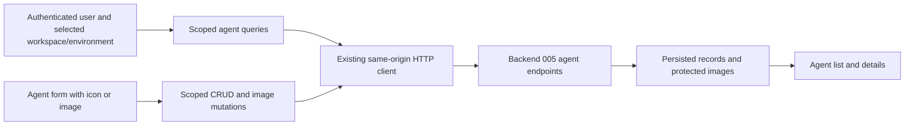

# Specification: Agent CRUD Integration

- **Specification ID**: 006
- **Date**: 2026-10-25
- **Slug**: agent-crud-integration
- **Status**: Implemented
- **Owner**: Admin Access workbench
- **Related Specifications**: [003 — Access Workbench Layout](003-2026-10-24-access-workbench-layout.md), [004 — Login and Authorized Workspace Selection](004-2026-10-24-login-and-authorized-workspace-selection.md)
- **Connected Backend Contract**: [005 — Agent CRUD](../../backend/specs/005-2026-10-25-agent-crud.md)

## Context & Background

Access currently creates local draft agents in a TanStack Query preview cache. The authenticated shell already supplies the user, workspace and environment. Backend 005 defines persistent agent CRUD and agent visual identity. Management UI belongs to this admin module; no change to the separate public frontend is required.

## Problem Statement

Local drafts are not persisted and cannot be managed through real CRUD. The current layout has no selectable agent icon or uploaded image. Preview-only status, tool/people counts and review actions must not be represented as server-backed agent capabilities.

## Solution

Connect the Access workbench to backend 005. Support listing, details, creation, editing and deletion within the selected authorized workspace/environment, including a Lucide icon or small uploaded image. Preserve the existing admin design system and workbench composition.

## Practical Gains & Operational Outcomes

- Agent edits survive reloads and reflect backend responses.
- Tenant/environment switching clears old selections and prevents stale responses from appearing in another scope.
- Users can identify agents using an existing-library icon or their own small image.

## User Stories

- [ ] List and inspect persisted agents in the selected workspace/environment.
- [ ] Create and edit the name, description and selected visual.
- [ ] Choose an icon from the installed library or upload an image.
- [ ] Replace an image or switch back to a catalog icon.
- [ ] Confirm deletion and see the persisted result.
- [ ] Recover from failed requests without losing form input or creating duplicate records.
- [ ] Switch identity or workspace/environment without seeing previous private data.

## Architecture Gate

Keep components, state hooks, API transport and types separate under the existing Access feature. Extend the existing useAccessData/useAgentWorkbench/useAgentForm seams as appropriate. Add a focused agent API module and visual picker/renderer; do not create global repository/service layers in React.

Use the existing HTTP client and auth context. A local cache is a rendering cache, never proof that a write succeeded or that a user has authorization. Server responses are authoritative. Backend records do not contain draft/active lifecycle, tools or people; do not fabricate those fields or map every record to a fictional active state.

## Implementation Decisions

### API Integration

Use the five CRUD endpoints under `/api/v1/workspaces/:tenant_id/environments/:environment_id/agents` from backend 005. Pass `/v1/...` to the existing client, which already prefixes `/api`. Use its same-origin cookies, timeout, CSRF and auth-expiry handling. Do not add Keycloak calls, browser token storage or user identifiers in request bodies.

Send only the editable fields defined by backend 005. Render backend IDs and timestamps. Do not generate an ID locally and present it as a saved agent. Lists use the backend pagination contract as defined in backend 005; do not filter one loaded page and claim it searches all records. Either label local filtering as applying to loaded records or agree a backend search contract before implementation.

Enable queries only when the session and selected authorized workspace/environment exist. Query keys include authenticated user ID, tenant ID, environment ID and applicable pagination/agent ID. Cancel stale reads with query signals. Reset selected agent, dialog state, search, pending file previews and image caches on scope or identity changes. Mutation callbacks capture their originating scope and cannot insert records, change selection, reopen dialogs or navigate in a newly selected scope.

Invalidate/refetch only the affected scoped list/detail/image entries after success. Do not optimistically declare success before server confirmation. Preserve existing cache clearing on logout, expired session and membership loss. Handle 401 through session recovery; handle inaccessible scope/agent 404 without revealing foreign records. Show safe retryable errors for network or infrastructure failures.

### Forms and Save States

Reuse the current New agent dialog for creation and a corresponding edit flow. Keep values on failure, show actionable field/form errors, disable duplicate submission and indicate pending operations. Close only after the relevant operation succeeds. A successful create selects the persisted ID in the same scope. A delete confirmation names the agent; cancellation does not mutate anything. Remove selection only after successful deletion and refresh the correct list page.

Reflect the exact backend name/description limits and uniqueness rules as defined in backend 005. Do not silently invent stricter client-only business rules. No roles or owner-only controls are introduced while membership roles remain deferred.

### Icon or Image Picker

Use Impeccable with the existing PRODUCT.md, DESIGN.md and canonical admin tokens/components. Keep the current light workbench, local fonts, focus behavior and control geometry. Do not edit reference mocks or import the public site's styles.

The agent form contains an Appearance field with mutually exclusive Icon and Image modes. Icon mode provides a searchable, bounded catalog of actual `lucide-react` icons with stable backend-approved keys. Give each choice an accessible name and selected state; support keyboard use. Reuse the current library and stroke style. Do not dynamically execute arbitrary icon names or accept SVG markup. Use the 12-key backend catalog and bot as the initial icon.

Image mode offers a labeled native file input, local preview, replace action and an explicit return-to-icon action. Display agreed formats, size and pixel limits before selection; use PNG/JPEG, 256 KiB and at most 512 by 512 pixels, including the normalized PNG size limit. Do not add cropping, arbitrary remote image URLs or silent resizing. Frontend checks help the user; backend validation remains mandatory.

Use a compact, consistent visual slot in each agent row and selected-agent heading. Show the selected Lucide icon or fitted image without changing row geometry. Preserve the agent name as the accessible identity; decorative thumbnails do not duplicate its announcement. An unavailable image gets a neutral placeholder, never a fabricated uploaded visual. A chosen file preview is explicitly unsaved until the backend confirms it.

### Protected Image Transport and Partial Saves

Backend 005 provides PUT and GET `.../agents/:id/image`. Files are stored on the backend disk; no database blob, third-party image host or public static directory is introduced. Respect the same user/workspace/environment scope for image retrieval as for agent JSON.

Extend the existing same-origin client with narrow binary-response and FormData support. Preserve credentials, timeout, CSRF, auth-expiry and error mapping. Let the browser set multipart Content-Type boundaries. Do not force JSON parsing or manually set multipart boundaries. Abort reads on scope changes and revoke preview/download object URLs when replaced, unmounted, logged out or moved to another scope. Do not persist file bytes or blob URLs in browser storage.

For a new agent using an uploaded image, the backend sequence creates the agent first, then uploads to its persisted ID. If image upload fails after create succeeds, retain that ID and report that the agent exists but its image was not saved. Offer upload retry or switching to an icon, without another POST. Do not silently roll back a persisted agent. The implementation uses bot as its initial fallback icon. On edit, report metadata and image save results truthfully if separate requests have different outcomes.

After image replacement or a mode switch, invalidate scoped image data and use the returned revision to avoid displaying old content. Display no success state for an image until the server has validated and stored it.

### Existing Preview Features

Replace the local create path for agent identity fields with real API mutations. Review changes and Apply preview must not gate or claim to publish CRUD writes: those writes persist immediately on success. Keep tools, people and policies outside this integration. Do not send their preview changes to agent PATCH or populate them with invented data. Resolve their empty/unavailable presentation using existing workbench patterns; a separate feature must define persistence for them.

### Confirmed Connected Decisions

Use names of 1–50 characters and descriptions of at most 200 characters, as directed by the user on 2026-10-25. Use the remaining stated defaults from backend 005: duplicate names, paginated lists of 50 (maximum 100), physical deletion, last committed write and any active workspace member. Filter loaded records only. Creation followed by image upload retains the persisted identifier on partial failure. The user explicitly approved local disk storage with later migration recorded as technical debt; that storage decision is not pending.

## Testing Decisions

The user directs that test work be left aside for this task. Do not add or rerun test suites as part of writing these specifications. When implementation is authorized, run TypeScript and production build checks; do not claim isolation or upload security has been tested without evidence. Desktop manual checks may be reported if explicitly performed; preserve the existing restriction against unsolicited mobile checks.

## Acceptance Criteria

- [ ] Agent list/details and create/edit/delete use backend 005 instead of local persistence.
- [ ] User/workspace/environment scope is explicit in requests, query keys and stale-response handling.
- [ ] New and edit forms support library icon selection and small image upload/replacement.
- [ ] Persisted visuals appear in rows/details using the existing admin design system.
- [ ] Partial image-save failures preserve the actual persisted agent and allow retry without duplicate creation.
- [ ] Session/CSRF handling, private image delivery and object URL cleanup use the existing authenticated boundary.
- [ ] Loading, empty, errors, pending submission and delete confirmation are truthful and accessible.
- [ ] No fake lifecycle status, tools, people or policy publication is introduced.
- [ ] Connected open decisions are resolved before implementation; README records actual build evidence and limitations.

## Out of Scope

Public frontend changes, Keycloak changes, membership roles, tools/people/policy persistence, agent execution/credentials, image cropping, external URL imports, a new icon library and shared/object storage provisioning.

## Further Notes

Implementation was authorized on 2026-10-25. Publication still requires user approval. Local disk image storage is an accepted temporary backend decision. Backend 005 tracks migration to shared storage as technical debt, including persistent volumes, coordinated backups, cleanup and multi-instance limitations. The UI consumes protected image routes and must not depend on a physical disk path.

## Implementation and Review Record — 2026-10-25

Implemented on feat/agent-crud after user authorization. The user sets name to at most 50 characters and description to at most 200; the remaining stated defaults are recorded in the connected contract. Backend uses models, service, concrete repository, handlers and routes under internal/agent, with private disk image operations in images.go. Admin replaces local agent persistence with scoped API queries/mutations, icon selection and image upload, truthful partial-save retry and permanent-delete confirmation.

Backend Go 1.27.3 build passed. Admin TypeScript and production build passed. Migration 00005 was applied successfully to the existing development database, and the updated local API started on 127.0.0.1:8081. Diff whitespace checks passed. No new dependencies or seed agents were added.

The formal code review inspected current-user and membership checks, full scope predicates, forced RLS read/write policy, immutable HTTP input, raster validation, root-confined disk access, post-commit cleanup, scoped private caches and stale mutation callbacks. No actionable defects were identified in that review. This is code review evidence, not a claim that behavioral/security isolation checks were executed.

No test suites, automated CRUD exercises or manual browser validation were run, at the user's direction to leave test work aside. Pre-existing tests were not repaired or altered. Acceptance checkboxes remain unchecked where execution evidence is absent. Local disk storage and offline orphan reconciliation remain documented technical debt. No commit, merge or push is performed for this implementation request; user approval is required for publication.

## User Correction — Preserve the Existing Interface

On 2026-10-25 the user requires the existing workbench interface to remain intact. Restore the exact title "Configure. Teste. Publique.", the existing AccessActions with New agent and Review changes, the original empty-state copy, and the Tools/People detail composition. Keep persisted CRUD and icon/upload integration. Do not redesign or remove existing controls as part of API integration. The restored Review changes dialog retains its existing local-preview boundary; agent CRUD remains persisted independently. TypeScript/production build passed after this correction. The authenticated empty workbench was inspected in the internal browser with its title and both actions visible. No test suites were run.

## User Adjustment — Compact Appearance Layer

On 2026-10-25 the user requests the appearance selector at the top of the existing create/edit modal. The selected icon/image is the trigger for a native popover layer. Its first option is an ellipsis button for image upload, followed by the existing Lucide catalog. Remove the expanded Appearance section and mode controls from the form. Opening the layer must not increase modal dimensions. Keep the existing CRUD save/upload behavior and the rest of the interface intact. TypeScript/production build passed; the layer was inspected in the authenticated internal browser.

## User Approval — 2026-10-25

The user approved this result and requested commit and merge into local main. This approval includes the interface restoration and compact icon/upload layer recorded in admin 006. Preserve the documented verification limits. No push is requested in this publication step.
