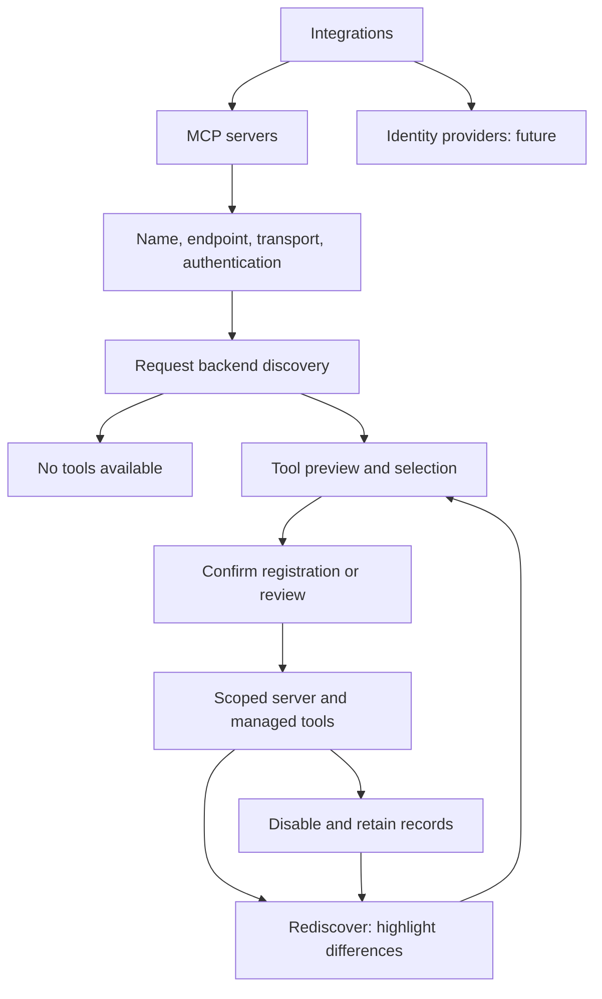

# Specification: MCP Server Management and Discovery Preview

- **Specification ID**: 007
- **Date**: 2026-10-25
- **Slug**: mcp-server-management-and-discovery-preview
- **Status**: Implemented
- **Owner**: Admin
- **Connected Backend Specification**: [006 — MCP Server Registry and Tool Discovery](../../backend/specs/006-2026-10-25-mcp-server-registry-and-tool-discovery.md)
- **Related Specifications**: [003 — Access Workbench Layout](003-2026-10-24-access-workbench-layout.md), [004 — Authorized Workspace Selection](004-2026-10-24-login-and-authorized-workspace-selection.md), [006 — Agent CRUD Integration](006-2026-10-25-agent-crud-integration.md)
- **Related Mock Contract**: [Workbench reference](../docs/chokepoint-workbench/README.md)

## Context & Background

Access already has Permissions, Context sources and Integrations routes. Integrations currently contains an empty placeholder. The mock includes a basic Connect a MCP Server dialog with name and URL; it has no live discovery preview. The existing admin has a Lucide Server icon and MCP annotation badges/tooltips to reuse.

The requirements discussion was the grilling. The user explicitly limited this task to registration CRUD and its discovery/review behavior. The user explicitly authorized implementation on 2026-10-25.

## Problem Statement

Administrators cannot register a real MCP server, choose managed tools or inspect rediscovery changes. The interface must support MCP servers now while accommodating a future Identity providers integration type without implementing IdP CRUD.

## Solution

1. Implement MCP server management under Access → Integrations, distinct from Context sources.
2. Let administrators configure a friendly name, endpoint, transport and authentication, then start backend discovery.
3. Display a modal preview containing selectable tool rows and full expandable metadata before confirmation.
4. Show persisted servers and managed tools, disable/re-enable controls and rediscovery changes without claiming actual runtime enforcement.

## Practical Gains & Operational Outcomes

- **Clear catalog**: friendly server names and a shared default icon replace URL-only identification.
- **Explicit selection**: users see real discoveries and control which tools are registered.
- **Visible change**: badges plus row emphasis identify new, changed and removed tools.
- **Honest scope**: IdP management and runtime authorization remain future features.

## User Stories

- [ ] 1. As an administrator, I can find MCP servers within Integrations and recognize Identity providers as a future integration type.
- [ ] 2. As an administrator, I can give a server a friendly name and configure Streamable HTTP with None or Bearer authentication.
- [ ] 3. As an administrator, I can see that stdio is unsupported before attempting discovery.
- [ ] 4. As an administrator, I can preview tool descriptions, schemas and annotations.
- [ ] 5. As an administrator, I can select individual tools or all available tools, initially all selected.
- [ ] 6. As an administrator, I can cancel without registering a new server.
- [ ] 7. As an administrator, I can review highlighted rediscovery differences while unchanged tools preserve their configuration.
- [ ] 8. As an administrator, I can disable and later rediscover/review a server before re-enabling it.
- [ ] 9. As an administrator, changing workspace/environment never leaks another scope's records, drafts or credentials.

## Architecture Gate

### 1. Bounded Context & Ubiquitous Language

Integrations is navigation and page composition, not a shared domain implementation for MCP and IdP. A cohesive MCP management feature owns server forms, tool preview/review, scoped API operations and query state. Reuse the existing authenticated HTTP client, query provider, dialogs, controls and annotation components. Hooks and API/state logic remain separate from JSX.

### 2. Aggregate Root & State Transitions

The backend is the source of truth for server/tool management state and discovery comparisons. The frontend controls the interaction; it does not connect directly to MCP endpoints or implement tools/list itself.

Create: form → discovering → preview → confirming → saved. Errors preserve usable input; cancellation creates no records. Changed endpoint/authentication invalidates the current preview. Zero discovered tools shows “No tools available” and prevents registration. Selecting zero tools also prevents confirmation.

Rediscovery: unchanged tools retain configuration; New, Changed and Removed rows receive explicit badges and visual emphasis. Changed and removed tools are disabled pending review. Removed tools remain visible as retained records and cannot be re-enabled while absent. Newly discovered tools start selected in the preview; existing selections are preserved. A successful complete empty rediscovery shows missing tools as Removed/disabled, with no re-enable action. A failed discovery is an error, not an empty result.

Disable preserves records. A disabled server makes its tools effectively disabled in management views. Re-enable requires discovery and explicit review. No delete action, endpoint invocation or policy enforcement is added.

### 3. Commands, Queries & Domain Ports

Consume the backend 006 scoped list/details, discovery preview, create, edit, rediscover/review, disable and re-enable operations. Do not create a competing browser discovery implementation. Scope private query keys by authenticated user, workspace and environment; cancel requests and reset drafts/previews on scope changes. Do not treat a client-controlled tenant identifier as authorization.

## Implementation Decisions

- Keep `/access/integrations` and existing Access navigation. Distinguish MCP servers from future Identity providers with clear type labels/navigation. Identity providers must not offer a fake working creation form or claim a connected provider.
- Follow the admin design system's tokens, typography, row-based catalogs, spacing, status shapes and responsive layout. Read its visual language, tokens and controls before implementation. The mock is guidance, not an exact screen to copy; do not modify the reference to hide differences.
- Reuse the existing Lucide Server icon by default. Primary row labels use the user-defined name; endpoint and transport remain available as secondary/detail information.
- Show Streamable HTTP as supported. List stdio with an explicit unsupported warning and disable its connection path. Do not offer process arguments, shell commands or a pretend stdio connection.
- None and Bearer token are the initial authentication choices. Token input is masked, never cached in localStorage/query data or placed in URLs. Saved secrets are never returned to prefill editing; show only whether a token is configured, with explicit replacement behavior.
- The discovery modal shows server metadata and a tool count, native checkboxes, select-all with a partial state, and a selected count. Initially all discovered tools are checked on creation. Keep confirmation disabled with no selection or while saving.
- Each tool row exposes its protocol name, optional title and description. Expandable details show input/output schemas, icons and additional received metadata where present. Keep long schemas within the detail region; do not force page-wide overflow. Do not execute markup or fetch untrusted icon assets without a reviewed loading policy.
- Reuse existing annotation badges and keyboard-accessible tooltips. Preserve false and missing values distinctly, show readOnlyHint/openWorldHint and the other protocol hints, and do not invent a risk classification. Full details retain all received values, including hints omitted by existing compact badge rules.
- Use New, Changed and Removed badges with row emphasis beyond color alone. Changed details show before/after contract differences; removed entries retain their previous metadata. Unchanged rows stay visually quiet. A badge is discovery metadata, not an allow/deny decision.
- Successful existing-server discovery records the disabled/review-required state for changed/removed tools according to backend 006. Canceling the subsequent review does not imply those tools became reviewed or enabled. New-server preview cancellation persists no server/tools.
- Use one accessible modal flow rather than nested dialogs. Provide focus trap, accessible title/description, Escape/return focus, scroll containment and keyboard-operable selection/details.
- Provide connection, authentication, unsupported transport, invalid protocol, no tools, stale preview and save failure states. Never report success based only on HTTP reachability or show raw provider errors/secrets.
- The implementation contract below and backend 006 define API DTOs, limits and preview behavior.

## Testing Decisions

### Unit & Profile Tests

The user explicitly superseded the admin no-test policy and requested unit tests for all changed code. Add focused tests for the API boundary, form/registry hooks, dialog, tool rows, catalog and scoped page entry. Retain manual browser checks for native focus and layout.

### Integration & Contract Tests

Manually use the six-tool, two-tool and empty dev-infra endpoints through backend discovery. Verify no direct browser request to an MCP endpoint. Do not introduce backend automated integration tests through this specification.

### Error Safety & UI Tests

Manually verify all/partial/zero selections; metadata and annotation details; New/Changed/Removed badges and highlighted rows; before/after contracts; zero tools; failed connection/authentication; disabled stdio; cancellation; server disable; re-enable requiring rediscovery/review; keyboard focus, long content and responsive layout.

### Regression Tests

Check Access navigation, existing agent CRUD, workspace/environment switching, cancellation and private query invalidation. Record checks actually performed; do not claim runtime authorization or database isolation from UI results.

## Acceptance Criteria

- [ ] 1. Integrations presents MCP management and accommodates future Identity providers without implementing IdP CRUD.
- [ ] 2. Friendly names, default Lucide Server icon, Streamable HTTP and None/Bearer settings are available; stdio is visibly unsupported.
- [ ] 3. Backend discovery produces a selectable modal with all tools selected initially and complete inspectable metadata.
- [ ] 4. Empty discovery/selection cannot register a server; cancellation creates no records.
- [ ] 5. Rediscovery highlights New/Changed/Removed rows and shows contract changes; unchanged configuration remains intact.
- [ ] 6. Changed/removed tools and disabled servers show correct management states; re-enable requires discovery/review; no delete exists.
- [ ] 7. Scope changes reset private UI state and requests; credentials are not exposed or cached.
- [ ] 8. Unit tests, TypeScript/build and documented manual browser checks pass, as explicitly requested by the user.

## Out of Scope

Actual authorization, tool execution, agent tool assignment, policies, gateway enforcement, IdP CRUD, public frontend changes, OAuth setup, stdio execution, delete, background discovery and a redesign of unrelated Access screens.

## Further Notes

The user authorized implementation on dedicated branches. No commit, issue publication, merge or push is authorized yet. Apply the module React guidance and relevant design skills during implementation; do not expand this task into runtime authorization.

## Approved Implementation Contract — 2026-10-25

The user authorized implementation. Consume backend 006's API/DTOs, 80-character name and connection limits, 10-minute previews, and revision conflicts. Saved tokens are retained when replacement is omitted. Creation requires a nonempty selected set. Existing-server review may retain zero selected tools while disabled; re-enable requires selected available tools. Disable sends the current revision. A successful existing discovery immediately records changed/removed disabled states; cancellation preserves those states. Before/after metadata is visible in expanded affected rows. Backend state is authoritative; no MCP credentials enter query caches.

## Implementation and Verification Record

Implemented on the dedicated feature branch. Migration 00006 was applied locally. Backend uses the official MCP Go SDK v1.8.0. Manual browser checks covered six/two/zero-tool discovery, partial selection, zero-selection prevention, persisted registration, disable/re-enable, New/Changed/Removed rows, previous/current contracts, and cancellation retaining disabled changes. Manual API checks returned 409 for replay/stale updates/cross-environment preview confirmation and 404 for another workspace. Bearer-token rediscovery succeeded without returning the saved token. The temporary changed-contract fixture was stopped after verification; the normal three fixtures remain available.

The user explicitly requested unit tests across all changed code, overriding the admin no-automated-tests policy. Backend tests cover review/diff, validation, encryption/tampering/scope binding, cancellation propagation without database I/O, handler parsing/error redaction/concurrency bounds, routes/no-delete, metadata serialization, configuration and outbound protections. Admin tests cover API requests, both hooks, preview selection/empty states, tool metadata/review rows, integration type navigation and page context gating. Persistence/RLS is not claimed as proved by unit tests; migration and manual scoped API checks provide the recorded local evidence. No automated integration suite was added or run.

Final checks: backend `go test ./...`, targeted registry/config race tests, `go vet ./...`, and `go build ./...` passed. Admin MCP/page unit checks passed (18 tests across seven files), and TypeScript/production build passed. The full admin suite has ten failures in three legacy test files; an isolated export of the original HEAD reproduced the same ten failures (12 passed, 10 failed), while the current tree has 30 passed, 10 failed. These failures are not presented as passing checks and were not repaired outside this task. No runtime authorization or automated database integration verification is claimed.

The independent visual review agent was unavailable because its usage limit was reached. Manual desktop/mobile verification and in-thread review were completed instead; this is not claimed as an independent review. The existing design system was preserved: semantic light palette, DM Sans/Manrope/JetBrains Mono, row catalogs, native controls/dialogs, token-based spacing and responsive table scrolling. PRODUCT.md schema drift was not repaired as part of this feature.

The user approved the reviewed result and authorized commit, merge into main, and push on 2026-10-25.

## Publication Approval — 2026-10-25

The user explicitly approved the result and authorized commit, merge into local main and push to origin. This approval includes the unit tests and cryptography adjustment recorded above. The known legacy admin test failures remain documented; no passing result is claimed for that full suite.
