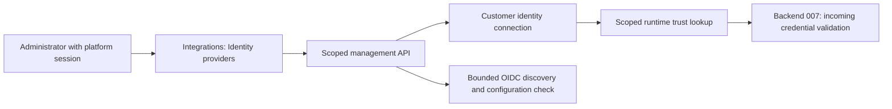

# Specification: Customer OIDC Connection Management

- **Specification ID**: 008
- **Date**: 2026-10-25
- **Slug**: customer-oidc-connection-management
- **Status**: Implemented
- **Owner**: Admin and Backend; canonical management contract in Admin
- **Related Specification**: [Backend 007 — MCP Request and Identity Validation](../../backend/specs/007-2026-10-25-mcp-request-and-identity-validation.md)
- **Related Specifications**: [007 — MCP Server Management](007-2026-10-25-mcp-server-management-and-discovery-preview.md), [004 — Platform Login](004-2026-10-24-login-and-authorized-workspace-selection.md), [Backend 002 — Tenant Isolation](../../backend/specs/002-2026-10-24-postgres-migrations-and-tenant-isolation.md)
- **Related Mock Contract**: [Admin design system](../docs/design-system/README.md)

> Implemented on the task branches after explicit user authorization; status is Waiting Approve. The implemented contract and verification records below supersede the initial draft proposals. Stable architecture decisions are consolidated in [Backend Architecture](../../backend/ARCHITECTURE.md#customer-identity-and-mcp-ingress).

## Context & Background

The platform already has its own OIDC login, backend browser sessions and workspace/environment access. Those authenticate administrators to Chokepoint. This feature instead configures trust in the customer's identity provider for calls made by services that run agents and call MCP tools.

Access → Integrations already has MCP servers and an Identity providers placeholder. This specification replaces that placeholder with customer connection management. It does not change platform login or create a customer login page.

The conversation supersedes earlier research that placed ID-JAG or Token Exchange on the initial runtime path. Those protocols are future capabilities. Keycloak is supported through generic OIDC, without a separate provider type or connector.

## Problem Statement

1. Administrators cannot register the customer issuers and audiences accepted for runtime MCP calls.
2. Trust must be isolated by workspace and environment. Sandbox configuration must not change Production trust.
3. Multiple issuers must be supported without using unverified claims to select arbitrary remote endpoints or merge identities.
4. Connection management and runtime credential validation need one coordinated contract, separate from platform authentication and upstream MCP credentials.

## Solution

1. Manage generic OIDC connections under Access → Integrations → Identity providers.
2. Scope every connection to a workspace and environment; allow multiple enabled connections in each environment.
3. Persist connection trust configuration for consumption by Backend 007.
4. Initially accept signed JWT access tokens only. Document opaque-token introspection and ID-JAG/Token Exchange as future capabilities with actual non-operational implementations in Backend 007.

## Practical Gains & Operational Outcomes

- **Environment isolation**: each environment has its own trust configuration.
- **Provider independence**: Keycloak and other compatible providers use the same OIDC connection type.
- **Clear responsibility**: administrators configure trust; runtime validation authenticates incoming calls; authorization decides access.
- **Explicit capability limits**: registering an issuer does not claim that every token or protocol from that issuer is supported.

## User Stories

- [ ] 1. As an administrator, I can manage customer identity connections within Integrations.
- [ ] 2. As an administrator, I can use Keycloak through generic OIDC.
- [ ] 3. As an administrator, I can configure different trust in Sandbox and Production.
- [ ] 4. As an administrator, I can keep multiple connections enabled in one environment.
- [ ] 5. As an administrator, I can inspect and change connection configuration.
- [ ] 6. As an administrator, I can understand which runtime credentials are supported now.
- [ ] 7. As an administrator, I cannot expose another workspace's configuration by changing an identifier.
- [ ] 8. As an application owner, I do not need another Chokepoint login for the represented person.

## Architecture Gate

### 1. Bounded Context & Ubiquitous Language

- **Customer identity connection**: environment-owned trust configuration for a customer issuer.
- **Issuer**: exact identifier of the trusted issuing authority.
- **Accepted audience**: resource identifier for which an incoming access token may be accepted.
- **Connection revision**: configuration version used to bind validation and cache entries to the correct trust state; exact persistence contract remains to be confirmed.

Admin owns the management feature, forms, query state and API consumption. Backend owns persistence, administrative authorization, discovery and runtime trust lookup. Keep customer trust separate from platform administrator login and MCP-server upstream credentials. Do not add a provider-specific Keycloak connector.

### 2. Aggregate Root & State Transitions

The customer identity connection is the management aggregate. Its scope is fixed to its workspace and environment. Multiple connections may be enabled in that scope.

Create, read, update and delete are the requested management operations. Enable/disable controls, exact transitions and deletion effects require confirmation below. A successful discovery check is not proof of a completed login or successful runtime access-token validation.

### 3. Commands, Queries & Domain Ports

Management operations belong to the existing authenticated administrative API. Apply current backend session, membership, Origin, CSRF, environment ownership and tenant RLS rules. Browser input selects a scope but never grants access.

The runtime consumer needs an explicit scoped trust lookup that returns only enabled, applicable connection configuration. It does not use an administrator browser session to authenticate an MCP client. Management persistence can remain concrete; the user-requested ports and adapters apply at the runtime integration boundaries, not mechanically to every repository.

## Implementation Decisions

### Agreed decisions

| Decision | Contract |
| :--- | :--- |
| Provider support | Generic OIDC only; Keycloak uses that same connection type |
| Scope | Per environment, qualified by workspace |
| Cardinality | Multiple enabled connections per environment; a later change may reduce this |
| Current credential | Signed JWT access token from the configured customer issuer |
| Opaque credentials | Future introspection capability, with a real implementation returning an explicit not-implemented error in Backend 007 |
| ID-JAG and Token Exchange | Future flow, with named contracts and executable not-implemented implementations in Backend 007 |
| Platform login | Separate existing subsystem; customer connections do not replace it |
| Initial delivery | No customer login redirect, ID-JAG exchange or token issuance required |

### Draft screen and persistence contract — confirmation required

Use the existing Identity providers integration type. Follow the admin design system when implementing the screen. Reuse the scoped HTTP client and query lifecycle; keep network/state logic separate from JSX. Do not modify the reference mock or unrelated MCP screens.

Proposed list: connection name, issuer, enabled state and last configuration-check result. Proposed actions: create, inspect, edit, enable/disable, test configuration and delete. These details were discussed as a proposal, not individually approved.

| Proposed persisted field | Meaning |
| :--- | :--- |
| Connection ID | Server-generated stable identifier |
| Workspace ID and environment ID | Full tenant-qualified ownership |
| Name | Administrator-facing label |
| Issuer | Exact trusted OIDC issuer |
| Accepted audiences | Explicit resource audiences accepted by runtime validation |
| Groups claim mapping | Optional configuration for verified group extraction |
| Enabled | Whether runtime trust lookup can select the connection |
| Revision and timestamps | Configuration identity, creation and modification |
| Last configuration-check result/time | Bounded, redacted metadata; not an authentication guarantee |

Do not add Client ID, client secret, scopes requested during login or callback URL merely because platform login has those fields. Public-key JWT verification does not need a confidential login client. Future introspection/exchange configuration belongs to its future capability contract.

Discovery metadata and JWKS are obtained server-side from approved trust configuration, with bounded calls, TLS validation, destination restrictions and key caching. Untrusted request claims must never supply a URL to fetch. Exact network policy, algorithm policy and cache/revision behavior must align with Backend 007 before implementation.

Do not persist raw access tokens, passwords, refresh tokens or private signing keys as connection fields. Discovery may cache public keys; that is distinct from storing customer credentials. A groups mapping receives only verified claims. OIDC claims do not import the whole customer directory or guarantee immediate account-disable propagation.

Proposed API resource: a customer identity connection collection beneath the existing workspace/environment management prefix. Exact resource name, methods, DTOs, limits, pagination, revision conflicts and status codes remain pending; no endpoint in this draft is permission to invent that contract during implementation.

## Testing Decisions

### Unit & Profile Tests

Use existing management seams rather than inventing a testing framework. Backend unit tests cover validation, scope propagation, operation errors and redaction. Admin checks cover observable form/catalog behavior and scope changes according to the module's applicable testing policy. Exact automated UI test scope must be confirmed before implementation.

### Integration & Contract Tests

Do not add or run automated integration tests without the explicit request required by backend AGENTS.md. Unit tests do not prove PostgreSQL RLS or live provider interoperability. Record that limitation. If later authorized, use isolated infrastructure rather than mutating the developer database.

### Error Safety & UI Tests

Verify absent scope, loading, empty list, validation errors, failed discovery, unavailable provider and expired platform session. Reset drafts and cancel stale requests on workspace/environment changes. Do not expose provider payloads, token values or internal exceptions in UI errors.

### Regression Tests

Preserve platform login, authorized scope selection and existing MCP connection management. Reuse semantic tokens and accessible form/dialog controls. Do not claim runtime authorization from successful CRUD tests.

## Acceptance Criteria

- [ ] 1. Customer OIDC management exists in Integrations and is separate from platform login.
- [ ] 2. Keycloak uses the generic OIDC type.
- [ ] 3. Connections are workspace/environment scoped and multiple may be enabled.
- [ ] 4. The confirmed CRUD/API contract is implemented with existing administrative protections.
- [ ] 5. Runtime trust lookup exposes only applicable enabled configuration to Backend 007.
- [ ] 6. Signed JWT is identified as the only operational credential-validation capability in this delivery.
- [ ] 7. Discovery results do not claim a login, directory import or complete runtime authentication test.
- [ ] 8. Applicable checks pass with recorded evidence; unexecuted integration checks remain explicit.

## Implemented CRUD Contract

The user approved the mockups and requested implementation. The implemented resource is `/api/v1/workspaces/:tenant_id/environments/:environment_id/identity-connections`. GET collection supports `limit` (default 50, maximum 100) and `offset` (maximum 1,000,000); GET `/:id` reads one record. POST creates with revision zero. PUT `/:id` replaces the editable configuration with its current positive revision. DELETE `/:id` supplies the current revision in a JSON body. Conflicts, including a duplicate exact issuer in the same scope, return 409. Creation returns 201; updates return 200; deletion returns 204. No connection is moved between environments.

Name is 1–80 characters after trimming. Issuer is an exact absolute URL of at most 2,048 bytes. Audiences contain 1–10 distinct, nonempty strings of at most 2,048 bytes each. Groups claim is an optional dot-separated path of at most 128 bytes. API JSON is limited to 32 KiB and rejects unknown fields, null and trailing documents. No secret, callback or confidential client fields are added.

Multiple distinct issuers can be enabled in one environment. One record per exact issuer avoids ambiguous runtime trust selection; each record may accept multiple audiences. Changing issuer, audiences or groups mapping clears the previous configuration-check result. Enable/disable is a revision-checked update. Deletion permanently removes only the connection; it does not remove identities or grant access elsewhere. Runtime trust is read again before handoff so deleted/disabled/changed connections cannot reuse an earlier validation result. No validated-token cache is introduced.

POST `/check` checks an unsaved form without persistence. POST `/:id/check` checks the current saved revision, stores a redacted `verified` or `failed` result and increments revision. An expired/canceled check does not claim success. The check verifies discovery issuer and usable public keys, not user login or correctness of a token's audience. Unsaved check results are not silently carried into a newly saved connection.

The screen implements the approved row catalog and dedicated create/edit form. Type selection is preserved in the URL with `?type=identity`. Scope changes remount the feature and abort in-flight mutations. Backend unit tests and administrative browser checks are used; no automated Admin tests are introduced under its current policy.

## Out of Scope

Platform login changes; a dedicated Keycloak connector; customer password collection; login redirects; SCIM; directory synchronization; implemented opaque-token introspection; implemented ID-JAG/Token Exchange; upstream credential changes; permission policy evaluation; public frontend changes; committing or publishing these specifications.

## Further Notes

This is one of the two requested specifications. It owns the cross-module CRUD contract; Backend 007 owns request and credential validation. Both must be read together. The user superseded the earlier instruction against creating Markdown by explicitly requesting these specifications; implementation was later authorized and is recorded below; final publication approval remains pending.

Use the repository specification workflow and lifecycle. Keep this document on main while it is discussed. Implement only after approval, on a dedicated implementation branch. No issue tracker publication is requested; the module-local specification and README index are the reviewable artifacts.

## Implementation Authorization — 2026-10-25

The user approved the two screen mockups and explicitly requested implementation. The earlier notices withholding implementation authorization are historical. The approved mockups define the management fields and actions. Implementation stays on dedicated branches until review and user approval. No commit, merge or push is authorized yet. Backend unit tests use the public validation and configuration seams described above; Admin uses type/build and manual browser checks under its no-automated-tests policy.

## User Clarification: Reusable Agent Permission Groups — 2026-10-25

The user clarified that the existing Agent CRUD remains: an agent represents a reusable permission grouping, not a separate runtime authentication principal. Rules configured for a grouping apply to its associated users; a user's claim values remain individual. User-to-group membership and effective permissions belong to policy evaluation. This delivery does not invent or implement new assignment/policy persistence.

The incoming call identifies the represented user and requested MCP operation. It does not need an authenticated agent name or credential. Retain the existing Agent CRUD, routes and image storage. No agent-removal migration is included in the final changes.

A removal migration was briefly applied to the local development database under the user's earlier instruction, before this clarification. The table/schema and CRUD were restored. The uncommitted local removal/restoration files and their local migration-history entries were discarded as part of that explicit scope reversal, without altering published migrations. Deleted local records were not automatically recovered. No destructive agent-removal migration is shipped to other environments.

## Implementation and Verification Record

Implemented on `feat/customer-oidc-management`, coordinated with backend `feat/customer-oidc-validation`. Added identity connection API/types, catalog/form, scoped query/mutation lifecycle and semantic CSS. Existing MCP modules use a neutral environment scope type; the identity tab replaces its placeholder. Existing Agent CRUD is retained.

Verification: Admin type check and production build passed under Node 22.23.1/npm 10.9.8. Real browser checks on the local API covered create, edit, discovery check, disable and delete; the temporary connection was removed. Manual API checks accepted two connections in one environment (201 each), updated a connection (200), rejected a stale revision (409), and concealed another workspace (404). The final screen produced no console errors/warnings. No automated Admin or infrastructure integration suite was run. These checks do not prove a complete provider interoperability matrix or permission evaluation.

## Formal Review Coordination

Backend 007 records two pending runtime recheck findings: infrastructure error classification and comparison of connection identity plus revision. The CRUD browser checks and build passed; runtime corrections require the user response mandated by the repository review gate. Existing Agent CRUD is retained.

## Runtime Review Follow-up — 2026-10-25

The user authorized both runtime review adjustments. Backend 007 now distinguishes infrastructure failures from authentication/permission failures and binds the final trust recheck to connection ID plus revision. Focused regression tests reproduced the old failures and pass after correction; backend unit, vet, build and access-validation race checks passed. The Admin source did not change in this follow-up. Status remains Waiting Approve.

## Documentation Publication Approval — 2026-10-26

The user approved committing, merging and publishing the specifications first. This approval includes their README indexes and the durable architecture decisions. Implementation source, tests and migrations remain on the task branches and are excluded from this publication. Waiting Approve continues to describe the implementation lifecycle; it does not mean specification publication is unapproved.

The latest clarification makes AuthZEN SARC the standard PEP/PDP evaluation contract and COAZ-MCP its mapping. Current Go identity/operation types are validation helpers only. The standard mapping and PDP communication are not implemented by this documentation publication.

## Implementation Publication Approval — 2026-10-26

After the documentation-only publication, the user explicitly directed all task changes to main. This approves the reviewed implementation and its two corrected findings, plus commit, merge and push in both modules. Status changes to Implemented for this specification's declared scope. AuthZEN projection/PDP communication, full MCP handshake/session support and tool execution remain outside this implementation; future identity capabilities still return not-implemented errors.
