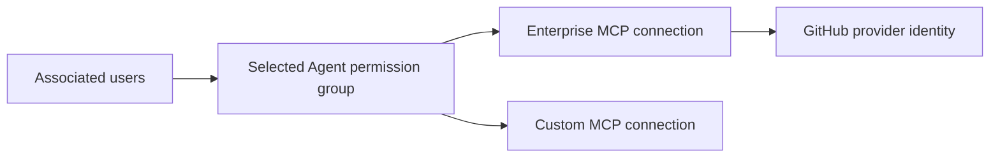
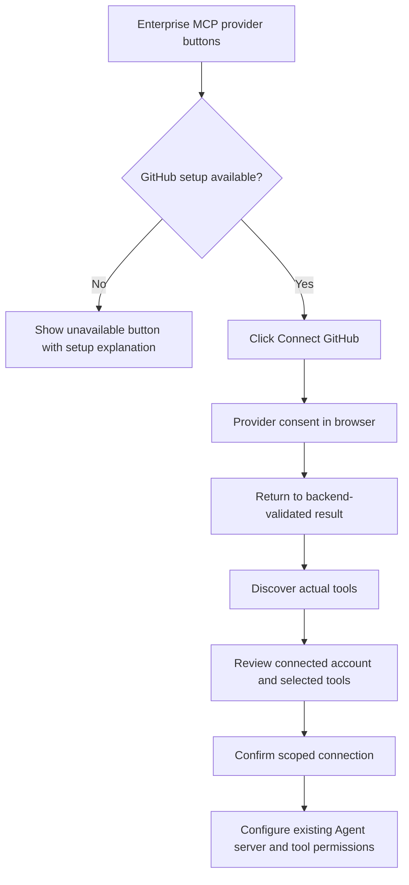

# Specification: Enterprise and Custom MCP Connections

- **Specification ID**: 010
- **Date**: 2026-10-27
- **Slug**: enterprise-and-custom-mcp-connections
- **Status**: Implemented
- **Owner**: Admin, Integrations
- **Connected Backend Specification**: [014 — Enterprise MCP Providers and GitHub OAuth](../../backend/specs/014-2026-10-27-enterprise-mcp-providers-and-github-oauth.md)
- **Related Specifications**: [007 — MCP Management](007-2026-10-25-mcp-server-management-and-discovery-preview.md), [009 — Authorization Workbench](009-2026-10-26-authorization-management-workbench.md)

> The user authorized implementation on 2026-10-27. The delivery contract below records the concrete implementation choices. The user approved the reviewed result and publication on 2026-10-27, accepting the documented verification limits.

## Context and Problem Statement

Integrations currently contains MCP servers and identity providers. MCP setup asks for a name, endpoint and optional bearer token. Users must understand endpoint configuration even when they want a known enterprise platform.

The user requested a clear distinction between enterprise MCP integrations and custom MCP servers, with guided OAuth and official icons. GitHub is first. The supplied screenshots illustrate relationships and navigation, not an instruction to reproduce Okta's visual system, runtime identity model or tool counts.

## Proposed Solution

Keep the existing Integrations location and identity-provider navigation. Inside MCP connections, offer two clearly labeled entry paths:

- **Enterprise MCPs**: curated platform setup, beginning with GitHub. The backend supplies supported provider metadata and availability.
- **Custom MCPs**: endpoint-based setup using the existing discovery and review contract.

Use a compact catalog/list composition from the Admin design system. Show the official GitHub mark, provider name, short purpose and a clear Connect action. Connected instances show their configured name, connected account, actual connection/authentication status and managed tool count. Multiple instances of one provider remain distinguishable.

Future Atlassian, Slack and Salesforce entries are roadmap scope. They must not expose a working Connect action until the backend supports them. Their presence in the visible first-release catalog is not a requirement.

### Enterprise MCP registration in Admin

Admin must support registering an actual connection of type **Enterprise MCP** through branded provider buttons. The operator clicks **Connect GitHub**, completes provider authentication, reviews discovered tools and confirms registration in the selected workspace/environment.

Enterprise selection uses branded provider buttons. Endpoint, transport and authentication type are fixed by the provider. Configure GitHub opens the customer’s setup guide and Client ID/client secret form; secrets are stored encrypted within the current scope. Connect GitHub stays disabled until application credentials are saved, then starts OAuth. Endpoint entry belongs to **Custom MCPs**.

The registered connection retains its enterprise type and provider identity. Its list row and details identify it as an Enterprise MCP and display GitHub's official mark and name alongside the configured connection name. The custom endpoint path registers a **Custom MCP** connection. Do not infer connection type from the hostname, display name or authentication method.

The backend supplies the supported provider definitions. Choosing GitHub creates a configured instance of that provider; it does not let an administrator register an arbitrary new provider implementation through the browser. Adding support for another enterprise provider follows the extension contract in Backend 014.

Registration completion requires backend confirmation of the saved connection and selected tool catalog. Merely selecting the enterprise type or finishing OAuth must not create a success state that claims registration is complete. Edit, rediscovery and reauthorization retain the connection's type/provider identity; conversion between enterprise and custom is outside this proposal.

## Connection Ownership and Agent Relationship

The recommended model stores connections in the selected workspace/environment. An Agent's permission editor references existing qualified connections and tools. It does not create a separate GitHub OAuth application or duplicate a connection for every Agent. Agent records retain their current permission-group meaning.

The connected account must be explicit. If shared credentials are chosen, explain which account the calls use. If per-user grants are chosen, distinguish organization configuration from each user's authorization and do not call the connection usable before the required user grant exists. Do not label administrator consent as access to an entire GitHub organization.

## Agent Connection Graph

The user explicitly requested a graph for Agents, inspired by the supplied screenshots. Include it in the selected Agent's detail experience, alongside access to its existing permission controls. It is a core part of this proposal, not a future decorative enhancement.

The graph shows the selected Agent and its configured relationships to users and MCP connections. Enterprise connections identify their provider with its official mark; custom connections have a distinct MCP representation. The operator must be able to understand which connections the Agent can access and inspect the associated tool permissions without opening each server in sequence.

This diagram describes configured relationships. Chokepoint enforcement is implicit and is not rendered as another graph node. Provider identity can appear inside its enterprise connection node instead of duplicating it as a separate node. Do not invent a target application behind a custom MCP when the system has no such relationship data.

### Content and interaction

- Center the selected Agent and branch to its configured MCP connections. Show associated users in a compact group that can be inspected without rendering every member as a mandatory node.
- Label connection edges with the actual published tool-permission count for this Agent. Server access without tool grants must display zero granted tools and must not suggest callable access.
- The Agent is a structural anchor. Clicking an MCP connection shows its scoped details and tool grants, with an Open connection action. User nodes show actual associated identities. Do not repeat a Manage permissions action on graph nodes. Selecting a node highlights its related edges and exposes readable details.
- Provide pan, zoom and fit-to-view for larger graphs. Keep a usable initial fit and a legible empty state with the relevant permission-management action.
- Represent published permissions as the active configuration. If a permission draft is shown, identify it explicitly as unpublished; do not merge it into the active graph.
- Distinguish connection enabled state, authentication availability and tool-review state where the backend supplies them. Missing or unknown status must remain unknown.
- Treat tool counts as configured grants, not a claim that every runtime request will be permitted. User identity, conditions, provider permissions and current runtime checks still apply.

The graph is a view of configuration, not execution telemetry. Do not display invented recent activity, live request animations or a verified runtime path without supporting data. It also does not change the Agent's current meaning as a permission grouping.

### Data and component boundaries

Build graph data from workspace/environment-qualified Agent associations, published server/tool grants and connection metadata. Backend 014 coordinates any additional read contract needed to supply this data. Avoid loading every connection's full tool schemas merely to draw the graph. Record exact projection fields and pagination/completeness rules before implementation; an incomplete response must not look like a complete relationship map.

Keep data acquisition, graph projection, layout, node rendering and the details view in cohesive components/hooks. Provider-specific OAuth behavior stays in the connection flow. Graph layout must not acquire credentials or evaluate policy. Choose a rendering dependency only after assessing existing dependencies and the required interactions.

Graph connection and user nodes remain keyboard-accessible. Do not add a second relationship list; the user explicitly removed it. Status and edge meaning must remain readable without color. On narrow screens, preserve the selected Agent, connection identity and detail actions even when the graph needs panning.

## Proposed GitHub Flow

This is an application integration with the GitHub-hosted MCP service. The browser performs consent and returns to the Chokepoint backend's registered HTTPS callback. The backend owns token exchange, storage, refresh and outgoing MCP requests. The Admin flow must not ask the operator to install an IDE extension, run a local harness, launch Docker or configure stdio.

GitHub application registration belongs to the customer. The Admin stores each customer’s application configuration in the selected workspace/environment. Creating an Agent permission assignment reuses existing connections. Missing configuration opens an actionable setup flow.

Use normal browser navigation and a stable return view. Refreshing the return page must read backend state rather than repeat a code exchange. Keep authorization codes and credentials out of component state, storage, logs, query caches and API read responses.

Provider denial, cancellation, missing app configuration, organization approval requirements, expired authorization attempts, failed discovery and concurrent connection changes each need an actionable state. Backend status is authoritative. A timeout with an unknown write outcome requires reading current state before another action.

OAuth completion does not mean the server is enabled, tools are approved, or Agent permissions are published. Show the actual next step. Existing discovery selection and mapping review remain separate tasks.

## Architecture Gate

| Responsibility | Proposed owner |
| :--- | :--- |
| Integration navigation and enterprise/custom selection | Small Integrations composition component |
| Provider catalog and details | Focused provider catalog components consuming backend metadata |
| OAuth start and return status | Dedicated hook/API functions and return view |
| Existing custom endpoint form | Existing MCP connection form, kept cohesive |
| Discovery and tool review | Reuse current tool review components where the backend contract is the same |
| GitHub assets and display metadata | Focused provider presentation entry with official asset provenance |
| Agent graph data and layout | Dedicated graph projection hook and layout behavior |
| Agent graph nodes, selection and details | Focused graph view and node/detail components |

A new provider should normally add its display metadata/asset and consume backend-declared capabilities. Add a dedicated setup component only when its contract needs different user input. Do not hardcode separate GitHub OAuth implementations in list, detail and Agent screens. No inheritance hierarchy, generic plugin engine or file containing all provider flows is required.

Private queries retain user/workspace/environment qualification. Scope changes abort pending reads, reset connection selection and prevent a returned OAuth operation from appearing in the wrong environment. Use the existing authenticated HTTP client and backend membership/CSRF rules for management writes.

## Visual and Asset Contract

Use the [Admin design system](../docs/design-system/README.md), semantic tokens and catalog layout. Preserve readable statuses, keyboard operation, visible focus, mobile actions and a clear selected environment. Platform logos are identification assets; keep status colors and controls in the Chokepoint system.

Use the [official GitHub logo toolkit](https://brand.github.com/foundations/logo). Store the approved asset locally with its source recorded. Preserve its geometry and permitted colors. Pair the mark with GitHub text; avoid redundant accessible text when the adjacent label already names it. Provider logos must not rely on user-controlled URLs or a generic substitute icon.

This proposal defines flow and information responsibilities. It does not introduce a new visual mock, source asset or component implementation.

## User Stories

- [x] 1. An administrator can choose enterprise or custom MCP setup without confusion.
- [x] 2. An administrator can recognize GitHub by its real platform icon and name.
- [x] 3. An administrator can complete browser OAuth without copying tokens.
- [x] 4. An administrator can see the actual connected account before saving the connection.
- [x] 5. An administrator can review discovered tools and then manage Agent permissions separately.
- [x] 6. An administrator can understand setup, approval, reauthorization and discovery failures.
- [x] 7. An administrator can register a connection explicitly as Enterprise MCP and identify its type and provider after saving.
- [x] 8. An administrator can inspect an Agent's users, MCP connections and published tool grants in an interactive graph.
- [x] 9. An administrator can navigate from an MCP graph node to its connection details; Agent permission controls remain in their existing tab.

## Validation and Acceptance Criteria

Follow this module's policy: no new automated tests, test fixtures or test infrastructure. Validate with type checking, production build and manual rendered-browser checks when implementation is authorized.

- [x] 1. Enterprise and custom paths are visibly distinct and preserve environment context.
- [x] 2. GitHub uses an official asset and the backend-declared connection contract.
- [x] 3. OAuth success, denial, cancellation, expiry, missing setup and discovery failure have usable states.
- [x] 4. Connection state, tool review and permission publication remain accurate and distinguishable.
- [x] 5. Keyboard, narrow viewport and scope-change behavior pass manual checks.
- [x] 6. Type checks and production build pass; live OAuth evidence is reported separately.
- [x] 7. Enterprise MCP registration persists and displays the explicit connection type and provider; Custom MCP registration remains a distinct path.
- [x] 8. Enterprise connection starts from a branded provider button without endpoint or transport inputs. Customer application credentials belong to Configure GitHub; manual endpoint entry remains confined to Custom MCP setup.
- [x] 9. The Agent graph reflects real scoped associations, published grants and connection metadata, distinguishing enterprise and custom connections.
- [x] 10. Node selection, detail navigation, pan/zoom/fit, empty and incomplete-data states work in manual browser checks; interactive graph nodes support keyboard access without a duplicate list.
- [x] 11. Drafts, configured grants and runtime access decisions are not conflated; provider logos and displayed counts match their actual source data.

## Open Contract Work

The authorized delivery contract below resolves the shared account, GitHub App, API and local-disable behavior with Backend 014. Per-user credential linking remains outside this delivery.

## Out of Scope

Future provider implementations; public frontend changes; automatic endpoint-agent discovery; editing permissions by drawing or deleting graph edges; runtime traffic visualization; changing the current Agent identity model; granting permissions merely because OAuth succeeded. Viewing and inspecting the Agent graph are in scope.

## Authorized Delivery Contract — 2026-10-27

The user directed implementation after reviewing enterprise buttons and the Agent graph. This delivery uses an environment-scoped shared connection, with the connected GitHub account visible in review and details. This does not grant organization-wide delegation. Per-user credential linking is a separate feature.

GitHub uses each customer’s own GitHub App, configured in Admin and encrypted in workspace/environment-qualified storage. No global GitHub application environment variables are used. Its callback is `ADMIN_ORIGIN/api/v1/mcp-oauth/callback`. App registration controls GitHub permissions; the flow requests `offline_access` for token refresh. No OAuth App scope list is substituted for GitHub App permissions. The official MCP endpoint is fixed by the adapter. The initial integration exposes the provider's actual tool catalog, with no tool access until explicit Chokepoint permission publication.

Disabling a connection stops local use and increments its revision. It does not revoke a GitHub grant shared with other uses of the registered application. Reconnect uses OAuth and discovery review before replacing the saved credential. Enterprise connections enable supported setup/discovery forwarding while every tool call keeps authorization enforcement.

### Coordinated HTTP contract

All management paths below are relative to `/api/v1/workspaces/:tenant_id/environments/:environment_id/mcp-servers` and require the existing session/membership rules. POST operations retain Origin/CSRF validation.

| Operation | Input / output |
| :--- | :--- |
| `GET /providers` | `{items: [{id, name, description, available}]}`; no application secrets or editable endpoint |
| `POST /enterprise/start` | `{provider_id, server_id?, revision?}` returns `{authorization_url}` and sets an HttpOnly SameSite=Lax authorization-binding cookie |
| `GET /enterprise/previews/:preview_id` | Returns `{server, preview, existing_id?}` for the current administrator and scope; the grant remains encrypted |
| Existing confirmation POST | `{preview_id, selected_tools, enable}`; atomically saves the connection and reviewed tools |
| `GET /summaries?offset=N` | Lightweight `{items, next_offset}` with connection identity, type/provider/account, enabled/authentication/review status and revision; no tool schemas |
| `GET /api/v1/mcp-oauth/callback` | Bound state/code callback; redirects to scoped Admin review or a sanitized failure state |

Connection reads include `connection_type` (`enterprise` or `custom`), optional `provider_id`, `account` and `authentication_status`. Scope and provider are validated by the backend; endpoint/authentication overrides are rejected. OAuth attempts and encrypted discovery previews expire after ten minutes. Attempts are one-use and bind the initiating user, scope, random state and browser cookie.

Credential grants are encrypted using registry bindings. A persisted thirty-second lease serializes refresh across API processes, with no database transaction held during provider I/O. Refresh completion checks the lease and connection revision. Ambiguous refresh failure requires reauthorization; MCP tool calls are never replayed. Both SDK execution and PEP proxy credential reads use the registry resolver.

The graph combines existing published permission reads with the lightweight summaries, exhausting pagination before drawing. It shows configuration rather than runtime telemetry and keeps its interactive nodes keyboard-accessible. No new graph database, permission engine or graph rendering dependency is introduced.

## Implementation and Review Evidence

Implementation is present on the dedicated task branch. Backend unit/vet/build/race checks and Admin type/build checks pass. The local migration and real seeded-user browser checks were performed. The temporary validation Agent was removed. See the [implementation and formal review record](../../backend/docs/reviews/014-enterprise-mcp-review.md) for changed areas, evidence and limits.

Status remains In Progress because authenticated GitHub interoperability is unverified until the platform-owned GitHub App is configured. The user-authorized scope-change correction resolves the recorded P2 stale-navigation finding; see the follow-up review record. Acceptance criteria that depend on those checks are intentionally not marked complete. No commit, merge or push was performed.

## Scope-change confirmation — User correction, 2026-10-27

Before an explicit workspace or environment switch, check mounted editors for pending local changes or an unconfirmed connection review. If present, show a single confirmation that switching discards unsaved changes. Cancel preserves the current scope and edits. Continue performs the existing scope switch and drops the local editor state. Selecting the current scope does not prompt. Saved server-side drafts are not described as lost. No automatic saving, persistence/resume flow or additional switch steps are added.

The guard is shared by both auth selection functions. Editor hooks register their own dirty state and remove registration on unmount. Pending operations retain their existing cancellation behavior; an aborted enterprise save does not navigate after scope teardown.

Validation: production build and TypeScript checks pass. Using the seed user in the rendered application, an unsaved permission edit triggered the environment warning; cancelling retained Sandbox and the edit, and confirming switched to Production. Workspace selection calls the same guard, verified by code inspection; a second-workspace browser run was not performed with the single-workspace seed account. No backend permission draft or publication was changed during this check.

## UX refinement — User direction, 2026-10-27

The GitHub provider includes a numbered setup guide with circular markers and official GitHub documentation links before the customer’s application form. Explain app registration, callback, minimal permissions, Client ID/client secret, installation and Connect GitHub.

The graph directly connects the Agent to its Custom or Enterprise MCP connections. Remove the explicit Chokepoint authorization/enforcement node, the relationship list and the permanent runtime-authorization footnote. Put the meaning of published links/tool counts and per-call authorization in the existing help tooltip next to Agent connections. Do not show a generic Agent detail panel by default or repeat Manage permissions on nodes. MCP details retain their tool list, status and Open connection action.

## Tenant-owned GitHub application correction — 2026-10-27

The user explicitly requires each customer to register its own GitHub application configuration through Admin. No GitHub application environment variables are used. Provider endpoints and transport remain fixed.

The provider card exposes Configure GitHub and Connect GitHub. Connect is disabled until credentials are saved. Configure opens a collapsed numbered setup guide followed by Client ID and Client secret inputs for the selected workspace/environment. The backend encrypts the application secret with that exact scope, never returns it, and exposes configured status, Client ID and revision only. Existing membership, Origin/CSRF and forced RLS controls apply. A customer cannot read or change another customer's configuration. No API restart is required.

OAuth start, callback and refresh load the selected scope's application through the provider adapter. Attempts bind the application revision; replacement makes in-flight callbacks fail safely. Grants retain the application revision; refresh with a replaced application requires reconnection rather than exchanging a refresh token with a different client. Existing access tokens may finish their validity period. Optimistic revision checks prevent silent concurrent overwrites.

Contract: GET and PUT `/mcp-servers/providers/:provider_id/application` under the existing workspace/environment management prefix. PUT accepts `{client_id, client_secret, revision}`; GET/PUT return `{client_id, configured, revision}`. A replacement requires both values and never exposes the existing secret. Runtime reads have scope-qualified read-only access to encrypted application configuration for refresh.

Validation: backend unit/contract tests, encryption scope tests, build/vet/race checks; Admin build and real browser checks using the documented seed account. No automated Admin tests. Real GitHub consent requires the customer's valid GitHub application registration.

## One connection per enterprise provider — 2026-10-27

Each workspace/environment has at most one connection for each enterprise provider, including disabled connections. Reconnect updates that connection. Enforce this constraint in PostgreSQL as well as Admin. Custom MCP connections remain plural. Enterprise shows provider blocks with connected account, status, managed-tool count and connection actions. It has no connection search, table, pagination or generic No connections yet message. The provider block links to its existing connection details and tool mappings. GET `/mcp-servers/providers/:provider_id/connection` returns `{connection: Server | null}` under the existing scoped prefix. Concurrent first-time confirmations cannot create duplicate provider connections.

### Missing application credentials and help disclosure

Connect GitHub is disabled when the scoped provider catalog reports no configured application. Its hover/focus helper explains that the customer must first enter and save Client ID and Client secret through Configure GitHub. Do not give that explanation when loading, a request failure or another busy action is the disabling reason. The setup guide appears before the configuration fields and starts collapsed.

## Result approval and verification limits

The user approved publication on 2026-10-27 after the implementation review. Checked criteria record the delivered implementation, supported by the local checks in the review report; they do not assert an authenticated GitHub interoperability run. Real GitHub OAuth, live tool discovery and live execution remain unverified until a valid customer GitHub App is configured. Manual UI checks were targeted, not a complete keyboard-only accessibility audit. Interactive server-to-client request/response forwarding is outside this delivery.
