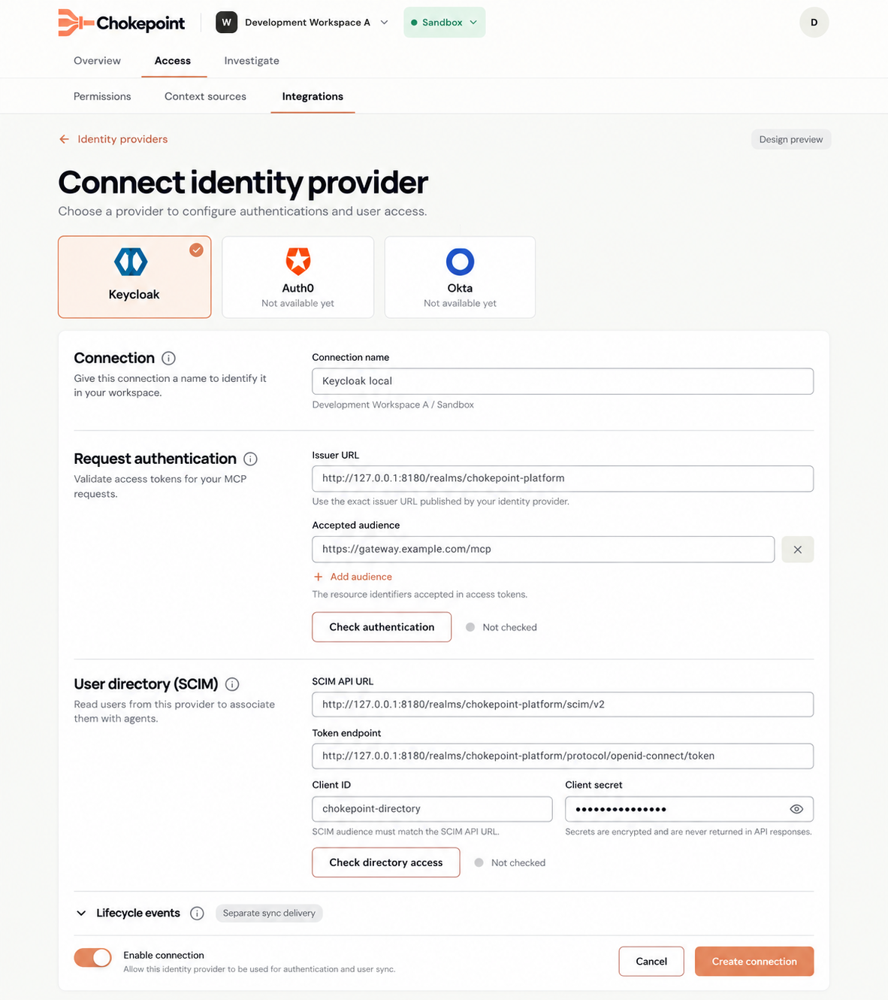

# Specification: SCIM People Selection for Agent Permissions

- **Specification ID**: 012
- **Date**: 2026-10-28
- **Slug**: scim-people-selection
- **Status**: Implemented
- **Owner**: Admin — Access and Permissions
- **Related Specification**: [Admin 009 — Authorization Management Workbench](009-2026-10-26-authorization-management-workbench.md)
- **Related Specification**: [Backend 015 — SCIM User Directory](../../backend/specs/015-2026-10-28-scim-user-directory.md)
- **Related Specification**: [Backend 016 — IdP Lifecycle Sync and Webhooks](../../backend/specs/016-2026-10-28-idp-lifecycle-sync-and-webhooks.md)

> Implementation authorized by the user on 2026-10-28. Backend 016 remains a separate Proposed delivery. The implementation contract and evidence are recorded below.

## Context & Background

People currently asks administrators to select an enabled issuer and manually enter `User subject (sub)`. The user requests real IdP users, loaded as soon as an IdP is selected, searchable in a paginated list, selectable in batches, and inspectable in a popup. Keycloak SCIM is first; Auth0 and Okta are later. Backend 015 owns discovery and identity mapping.

## Problem Statement

The current subject input requires administrators to know an opaque identifier and does not present available people. OIDC issuer configuration alone does not supply a directory or prove that its users match token subjects.

## Solution

Replace manual subject entry with a directory-backed People flow. Selecting a configured IdP immediately fetches its users. Show a search input and a list with 20 users per page, selection controls, association actions and a user-details popup populated from the IdP through the backend. Add selected users to the existing agent permission draft; review and publication remain required.

## Practical Gains & Operational Outcomes

- Administrators identify real users by returned information rather than typing a subject.
- Multiple users can be selected in one operation.
- Discovery and association failures are visible without creating invented users or silently granting access.

## User Stories

- [ ] 1. As an administrator, I want users to load when I select an IdP, so that I can see available people immediately.
- [ ] 2. As an administrator, I want to search and browse 20 users per page, so that I can find people in a large directory.
- [ ] 3. As an administrator, I want to select multiple users and associate them together, so that I can manage access efficiently.
- [ ] 4. As an administrator, I want to open a user's details in a popup, so that I can confirm their identity.
- [ ] 5. As an administrator, I want to see and remove existing associations, including when the directory is unavailable, so that I retain control of the draft.

## Architecture Gate

### 1. Bounded Context & Ubiquitous Language

Admin owns presentation and local selection state. The backend owns credentials, SCIM requests, normalization and identity mapping. The existing permission aggregate owns persisted members and draft/publication state. Follow the admin design system and separate UI, data access and interaction state by responsibility.

### 2. Aggregate Root & State Transitions

IdP selection triggers a scoped user query. Search and pagination query the selected directory. Explicit multi-selection and association edit the local permission document; Save draft and Review & publish retain their existing semantics. Opening details is separate from selection. Loading, empty, error, unconfigured, inaccessible and unavailable directory states must be distinguishable. Changing selection or receiving stale requests must not mix users across IdPs or workspace/environment scopes.

### 3. Commands, Queries & Domain Ports

Use the authenticated, scoped backend directory configuration, user list/search and detail contract from Backend 015. Association APIs consume the common Chokepoint identity contract from Backend 015, translated by backend adapters. The backend uses one adapter per provider implementing multiple lifecycle contracts and reports unsupported operations through capabilities and explicit errors. Admin must not infer that one supported SCIM operation means every lifecycle operation is available. Admin must not map SCIM IDs or token claims itself; coordinate changes to existing member identity fields across modules. No browser-to-IdP credentials, tokens or SCIM calls. Final endpoint shapes and user fields must be resolved together before implementation.

## Implementation Decisions

1. Select an enabled configured identity provider; immediately load the first page of its directory users. Present 20 per page with explicit pagination and a search field. Do not ask the administrator to type a subject.
2. Present multiple-user selection and an explicit action to associate selected users. Show existing association state and avoid duplicate members. A click on a user opens a popup with available IdP details; selecting a user is a distinct action.
3. Preserve the draft, save, review, publish, conflict and revoke workflow. Listing or selecting does not itself publish access. Preserve the ability to review and remove existing associations even if directory lookup fails.
4. Handle loading, no matches, missing directory setup, backend/provider errors and missing profile fields without fake entries; offer an appropriate retry where possible. Keep raw credentials and provider errors out of the UI.
5. Redesign the IdP create and edit forms with a clearer layout and icon helpers explaining their sections. Place SCIM directory configuration in a separate section of the same IdP form, distinct from OIDC trust and its check. Apply the existing design system, semantic tokens, accessible helper content and keyboard support. Keep data fetching and view components focused; avoid a single omnibus file.
6. Keep unsubmitted selections across page changes and searches for the same IdP. Switching IdPs clears that selection without a confirmation. Keycloak is the initial supported provider. Display Auth0 and Okta as known provider options with an explicit "Not available yet" label. They must not enter a successful directory/association flow; reflect backend capability status and show safe unavailability if an unsupported request is attempted. Future Entra/AWS support is documented in Backend 015. Keycloak is functional first; Auth0/Okta backend adapters exist but raise explicit unavailability errors.

## Approved Visual Reference — 2026-10-28

The user approved the generated Keycloak create-form mock as the visual direction for this screen. Use it together with the existing admin design system for implementation. This approval concerns the visual reference; it does not approve implementation, resolve the remaining technical decisions or change this specification's Proposed status.

[Open the full-size mock](../docs/previews-design/scim-identity-provider/create-keycloak-approved.png).

Preserve the provider buttons with icon above name, selected Keycloak state, unavailable Auth0/Okta states, section explanations and information helpers, aligned fields, separate authentication/directory checks and compact scope context. The lifecycle section remains tied to the separate Backend 016 delivery. Apply the same composition to the edit form.

The image is a generated design reference, not a screenshot of implemented functionality. Its sample URLs, credentials, wording and rendered logos are illustrative: use official sourced provider assets and the approved functional contracts in production. In particular, verification copy must accurately say that authentication checks metadata/keys, and the activation helper must not imply that lifecycle sync is already available.

## Provider Selection and IdP Form — Confirmed UX

### Entry and provider identity

Create starts with exactly three provider buttons: Keycloak, Auth0 and Okta. Each button shows the real official provider icon with the provider name below it. Use official reusable brand assets, preserve their proportions, and retain source/license records; do not substitute generic shield icons, initials, emoji or invented marks. Provider buttons have clear focus and selected states and accessible text names.

Clicking a provider selects its form context. Keycloak reveals the functional configuration form. Auth0 and Okta show their provider context and a clear "Not available yet" state; no working Save/Connect action is offered for unsupported contracts. Their capability state comes from the backend. Do not imply that selecting an unavailable provider establishes a connection.

Persist provider type as connection configuration. Edit opens the saved provider context and its capability-appropriate form; never guess the provider from an issuer URL or silently convert an existing generic connection. The user explicitly excluded backward compatibility and fallback and requested deletion of old configurations; Backend 015 removes the old identity connections.

Show a visible, non-blocking warning in the Keycloak create/edit authentication section: the access-token `sub` must match the user's SCIM `id`. The standard mapper has this relationship; a custom or pairwise subject mapper can change it. The current configuration checks do not verify the relationship, so the administrator must confirm it using a real user token before granting access. This warning is temporary and can be removed when this limitation is addressed.

Show non-blocking warnings that explain the current limits: People warns that IdP deactivation or deletion does not remove published associations or necessarily invalidate existing tokens; the administrator must remove and publish the association change. The Keycloak directory section warns that SCIM may omit users from external or federated directories. The form also explains that the separate checks verify issuer metadata/keys and SCIM access, not user login, token audience or tool permission.

### Form composition

Use a readable main form with aligned fields and section spacing. Keep workspace/environment context visible as compact contextual information. Remove the competing sidebar treatment that places "OIDC" next to a "Signed JWT" badge as if these were alternate provider choices. Signed JWT is a technical credential format, not the provider type or a separate configuration task.

The form has distinct sections, each with an accessible information-icon helper explaining its purpose and the consequence of its settings:

1. **Connection**: selected provider, display name and workspace/environment scope.
2. **Request authentication**: exact trusted issuer and accepted audience(s) for incoming MCP access tokens. Explain that the issuer identifies who issued the token and the audience identifies the API for which it was issued. The check verifies metadata and signing keys only; its result is named accordingly.
3. **User directory (SCIM)**: SCIM API base URL, token endpoint, service-client ID and a write-only client secret for the supported Keycloak client-credentials profile. Explain that these credentials authorize backend directory queries. Include the SCIM API audience configuration or a documented provider-derived value, distinct from the MCP resource audience. Provide an independent directory check that verifies authenticated discovery and the required user-read/search capabilities. Never reuse the inbound MCP audience as the SCIM audience by assumption.
4. **Lifecycle events**, only when appropriate to the provider capability and deployment: show the actual support/setup status. Keycloak webhook delivery depends on a listener extension and does not become available merely by enabling SCIM. Plugin-backed Keycloak events are specified by the separate Backend 016 delivery; connection/list/association work must not imply that webhook execution is already available. Define the receiver endpoint, authentication/setup instructions and truthful check/status from the backend event profile; distinguish plugin installation/configuration from native SCIM availability. A lack of support must be explicit; do not display a fake ready webhook URL or treat SCIM polling as webhook support.
5. **Activation and save**: enable state and existing scoped save semantics, with check results next to the sections they describe. Neither check claims successful end-user authentication, correct real-token correlation, automatic lifecycle revocation or tool permission.

Helpers must be available by keyboard and touch as well as pointer. Keep essential field labels and error messages visible without requiring a tooltip. The common capability/configuration contract controls sections and operations; provider forms may compose provider-specific fields without duplicating the page shell or mapping external identities in React. Sections for operations unavailable in a provider must not accept configuration as if they work.

## IdP Data Handling

Consume only the normalized allowlisted list/detail fields defined by Backend 015. User detail is a purposeful subset of provider information, not a raw SCIM JSON inspector. Do not render credentials, tokens, MFA/recovery material or arbitrary custom metadata. Keep subject/provider identity references internal to selection and association; do not copy full profile objects into the permission document.

Do not persist directory responses, popup data or selections in localStorage, sessionStorage, IndexedDB or a new persistent query cache. Scope transient state to the administrator, workspace, environment and connection; clear it on logout/scope changes and cancel stale requests. Secrets are write-only configuration inputs, never populated from read responses or retained in browser persistence. No analytics or console logging of profiles, search text, secrets or provider payloads.

## Open Decisions

- Agree with Backend 015 on search semantics, exact response fields and how the UI navigates SCIM pages.
- Selection persists across pages and searches for the same IdP; switching IdPs clears unsubmitted selections without confirmation, as directed by the user.
- Decide how to present previously associated members who no longer appear in the directory or cannot be resolved; preserve removal and do not infer removal means automatic runtime revocation.
- Finalize credential lifecycle/API details with Backend 015 using the form sections above. Do not infer a provider or provide a backward-compatibility fallback for generic IdP records.

## Testing Decisions

Follow the admin module's current policy: no new automated tests. Run applicable type/lint/build checks and validate the real rendered desktop flow with a configured local Keycloak directory and backend. Check list loading, search, 20-user pagination, multi-selection, details popup, draft and publication, errors, and scope changes. Coordinate the real issuer/subject evidence and integration checks with Backend 015. Apply design-system guidance and inspect accessible interaction states.

On 2026-10-28, the Admin type check and production build passed. Backend 015 records a local Keycloak check of search, details, multi-user association, publication and permitted/denied tool calls. This does not establish every desktop acceptance criterion, including pagination, failure and scope-change states.

The user subsequently confirmed that the implementation and its validation were already complete and directed completed specifications to be closed. Individual results for the other desktop checks were not recorded here. The separate Backend 015 identity-mapping limitation remains documented there and in the Admin warning.

## Acceptance Criteria

- [ ] 1. Selecting a configured Keycloak IdP loads real directory users without manual subject entry.
- [ ] 2. Search and pagination show at most 20 users per page.
- [ ] 3. Multiple users can be selected and associated in one action without duplicate members.
- [ ] 4. Clicking a user opens a popup with available IdP information without changing selection.
- [ ] 5. Associations use the existing draft and publication workflow; existing associations remain manageable on directory failure.
- [ ] 6. Loading, empty, configuration and failure states are clear and scoped correctly.
- [ ] 7. The IdP create and edit forms have a clearer layout, section explanations using icon helpers, and a separate SCIM section.
- [ ] 8. Auth0 and Okta options are visible with "Not available yet" status, and cannot be mistaken for working integrations.
- [ ] 9. User list, detail and association consume the provider-independent Chokepoint contract without provider-specific identity translation in the browser.
- [ ] 10. Create starts with three official icon/name provider buttons; edit uses the saved provider type; forms adapt to the backend capability contract.
- [ ] 11. Request authentication, SCIM directory and any supported lifecycle configuration have separate explanations, checks and truthful state. The old OIDC/Signed JWT sidebar confusion is removed.
- [ ] 12. Profile data is minimized, permission documents contain identity references rather than full profiles, and no persistent browser directory/profile store is introduced.
- [ ] 13. Applicable admin checks and real desktop validation pass.

## Out of Scope

Groups and group membership; query caching and polling/periodic synchronization; automatic lifecycle revocation; functional Auth0/Okta integration and Entra/AWS implementation; changes to MCP audience configuration; direct browser IdP access; implementation approval or publication.

## Further Notes

The Keycloak SCIM API and OIDC token-validation check are separate capabilities. Do not present a successful OIDC metadata check as a successful directory check. Provider field availability and identity mapping are owned by Backend 015.
