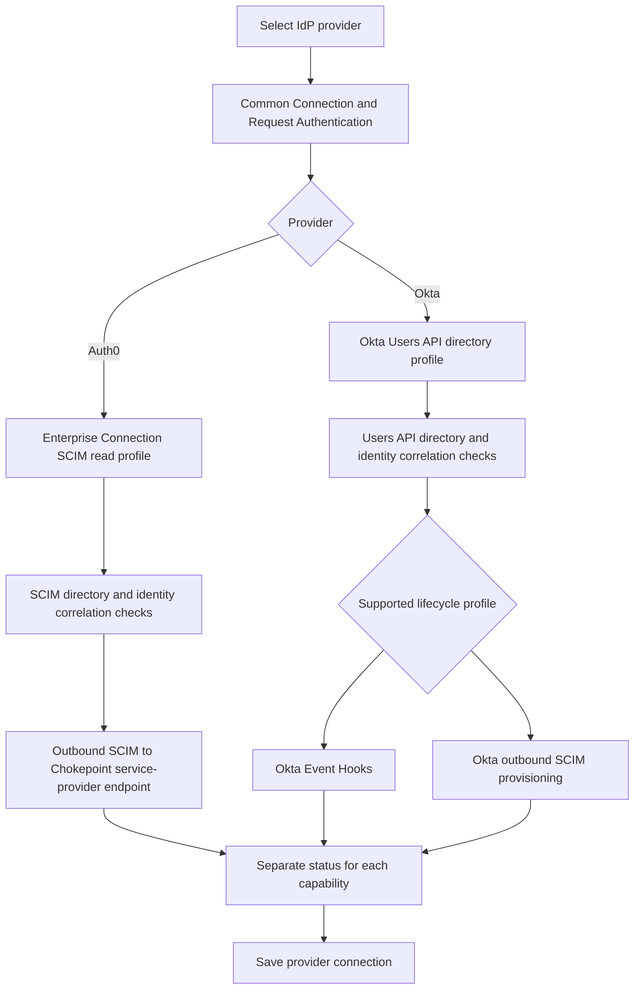
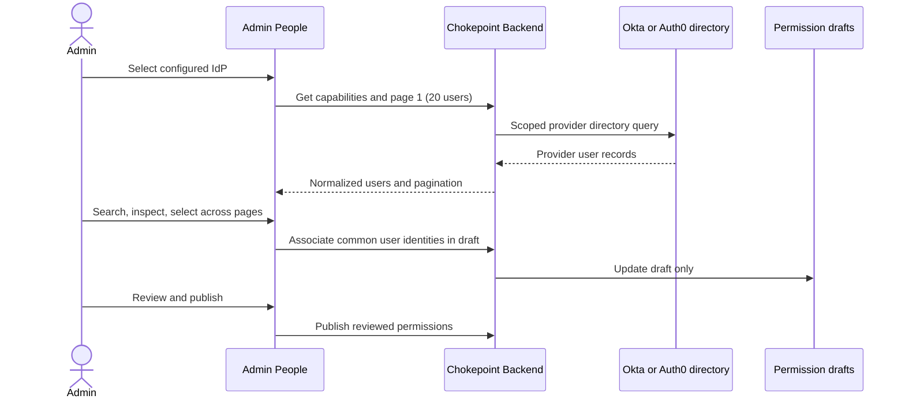

# Specification: Okta and Auth0 People Selection and Provider Configuration

- **Specification ID**: 013
- **Date**: 2026-10-28
- **Slug**: okta-auth0-people-selection-and-provider-configuration
- **Status**: Proposed
- **Owner**: Admin — Access and Permissions
- **Related Specification**: Admin 012 — SCIM People Selection for Agent Permissions
- **Related Specification**: Backend 017 — Okta and Auth0 Identity Directory Integration
- **Related Specification**: Backend 018 — Okta and Auth0 Outbound Lifecycle Synchronization
- **Related Specification**: Backend 015 — SCIM User Directory for Agent Associations
- **Related Specification**: Backend 016 — IdP Lifecycle Synchronization and Outbound Webhooks
- **Related Specification**: Backend 010 — Permission Assignments and Policy Management

> Proposed extension of Admin 012 for Okta and Auth0. The backend specs 017/018 define supported integration profiles, provider capability contracts and lifecycle behaviors. This document neither claims that those backend profiles are already implemented nor authorizes a UI to simulate support. Exact management API fields, provider entitlements and end-to-end verification remain open.

## Context & Background

Admin 012 establishes the People workflow and the approved IdP form composition: provider selection using official logos; separate Connection, Request authentication, User directory, Lifecycle events, and Activation and save sections; independent connection checks; directory search and detail; 20 users per page; multi-selection; and explicit PAP draft/review/publication.

Backend 017 extends the directory and identity-correlation capability to Auth0 and Okta. Both support SCIM 2.0, but their actual **directory-reading profiles differ**: Auth0 offers a queryable SCIM service-provider endpoint scoped to an eligible Enterprise Connection; Okta documents SCIM provisioning as a client toward downstream apps, and its Users API is a documented route to read its Universal Directory. A customer-provided, verified queryable SCIM source may be another explicit Okta directory profile; the mere statement “Okta supports SCIM” does not establish an Okta-hosted SCIM read endpoint.

Backend 018 extends lifecycle ingestion. Auth0 outbound SCIM uses an Event Streams Action that sends SCIM requests to a Chokepoint SCIM service-provider endpoint. Okta can use Event Hooks or, when configured and verified, outbound SCIM provisioning. These mechanisms need different setup forms, validation and operational states. They are **not** all generic webhooks.

## Problem Statement

The Keycloak-first Admin 012 cannot be made functional for Okta/Auth0 by changing only the provider logo. Fixed Keycloak SCIM credentials and lifecycle webhook fields would misrepresent how Auth0 Enterprise Connection SCIM, Okta Users API, Okta Event Hooks and inbound SCIM provisioning work. Users could mistake a successful OIDC metadata check or reachable receiver URL for validated directory lookup, proven identity correlation or healthy lifecycle delivery.

## Solution

Extend the existing provider-selection and People experience using backend-advertised, operation-level capabilities. Retain one common Admin shell and reusable People interaction components; compose **provider-specific configuration sections and explanations** where underlying protocols differ. UI does not choose implicit fallbacks, map external IDs to runtime tokens, invent unsupported features, or perform direct IdP requests.

- **Auth0 directory**: show the configured Enterprise Connection SCIM read profile when supported; expose the connection-specific scope, its SCIM endpoint, credential setup and bounded search/detail check. Show a separately configured Management API profile **only** if Backend 017 implements and advertises it.
- **Okta directory**: show the verified Okta Users API profile for its org directory, with OAuth/service credential fields dictated by Backend 017. A separately verified SCIM read-source profile can be offered only when supported; never label Okta's outbound SCIM client as the org's inbound SCIM directory.
- **Auth0 lifecycle**: show outbound SCIM destination configuration: Chokepoint SCIM service-provider base URL, credentials to place in Auth0 Action secrets, resource capability status, required provisioning setup and delivery health.
- **Okta lifecycle**: expose an explicit profile choice among supported **Event Hooks** and **outbound SCIM provisioning**. Event Hooks use a receiver URL, verification challenge, a configured authorization secret and event subscriptions. Outbound SCIM uses a SCIM base URL, provisioning authentication, resource operations and activation/deactivation semantics. Never combine both into one generic “Webhook URL” field.

## Practical Gains & Operational Outcomes

- Administrators can configure the actual supported directory and lifecycle profiles instead of guessing protocol directions.
- People selection and PAP memberships remain consistent across Keycloak, Okta and Auth0 through backend-normalized Chokepoint identities.
- Independent checks expose the distinction between request-token trust, directory access, identity correlation, and lifecycle delivery.
- The UI accurately distinguishes configured, supported, verified, degraded and unavailable capabilities.

## User Stories

- [ ] 1. As an administrator, I can select Okta or Auth0 using its official logo and see only relevant supported configuration fields.
- [ ] 2. As an Auth0 administrator, I can configure an eligible Enterprise Connection SCIM read source and understand that only the connection's users are returned.
- [ ] 3. As an Okta administrator, I can configure an authorized Users API directory profile without being told that outbound SCIM is a readable Okta org directory.
- [ ] 4. As an administrator, I can search and select real users, inspect allowed details and associate them with an agent draft across pages.
- [ ] 5. As an Auth0 administrator, I can configure and verify a Chokepoint inbound SCIM endpoint for Auth0 outbound provisioning.
- [ ] 6. As an Okta administrator, I can configure the selected supported Event Hooks or SCIM provisioning profile and see its real status.
- [ ] 7. As an administrator, I can diagnose unsupported operations, failed checks, unverified identity correlation and delivery recovery without seeing secrets or raw provider data.

## Architecture Gate

### 1. Bounded Context & Ubiquitous Language

Admin owns forms, presentation, selection and transient state. Backend 017 owns credential processing, directory transport, identity normalization and runtime identity correlation; Backend 018 owns authenticated lifecycle ingress, SCIM server behavior and durable event processing. Backend 010 owns PAP drafts, publication and permissions. One backend provider adapter per IdP may implement multiple narrow contracts. Admin never processes SCIM payloads or provider-specific token claims as permission-domain inputs.

- **Provider**: explicit stored Keycloak, Okta or Auth0 type; never inferred from issuer URL.
- **Directory profile**: backend-supported way to list/search/detail a specific scope of provider users.
- **Lifecycle delivery profile**: provider mechanism that delivers account changes to Chokepoint (Event Hook or SCIM provisioning).
- **Capability state**: operation-level backend result, separate from configuration and health.
- **Correlation verified**: backend-confirmed correspondence between selected directory identity and validated runtime evidence; a successful directory query does not prove it.
- **Associated member**: backend-normalized stable identity referenced by the PAP permission document.

### Provider-Specific Admin Configuration

This diagram depicts **candidate/selected profiles**, not unconditional entitlement or delivered implementation. Backend capability responses govern whether a node can be configured or tested.

### 2. Aggregate Root & State Transitions

Selecting a provider changes form context; it does not create a connection. Saving a configuration persists only supported, validated-to-schema settings. Connection checks and lifecycle checks remain independent; any material change of issuer, directory scope, credentials or delivery profile invalidates relevant stale check results. Disable/removed state must block operations with truthful errors.

People selection remains draft-local until Save draft and Review & publish. Cross-page selections persist only within the current IdP connection and current admin/workspace/environment scope. Switching the IdP clears pending selections as Admin 012 prescribes. Already-associated members remain visible and removable even if directory lookup fails or the user disappears from the provider. Lifecycle changes do **not** automatically revoke published PAP associations under Backend 016/018.

### 3. Commands, Queries & Domain Ports

The Admin consumes backend management APIs for provider catalogs, operation-level capabilities, provider-specific configuration schemas, OIDC trust checks, directory checks, runtime-identity correlation check/result, directory search/detail, lifecycle setup/status, and PAP draft/publication. Required errors include not configured, unsupported, unauthorized, forbidden, mapping unverified, rate limited, receiver not verified, degraded delivery and upstream unavailable; avoid turning these into an empty success state. Exact API paths and field names must be coordinated with Backend 017/018 before implementation.

## Implementation Decisions

1. **Reuse Admin 012's visual system.** Exactly three official provider icon/name buttons (Keycloak, Auth0, Okta) appear on create. Use the approved form composition and design-system semantics; no generic logo substitutions. Replace the old blanket “Not available yet” label only per backend-advertised functional capability; unsupported operations remain visibly unavailable.
2. **No Keycloak form clone.** Keep common Connection and Request authentication panels. Directory and Lifecycle panels are profile-aware and show provider-specific fields and setup instructions. Each has its own test result and timestamp/status where supported.
3. **Authentication check is narrow.** Display issuer and accepted MCP resource audience(s). The OIDC metadata/JWKS check cannot be labeled a real login, user-subject correlation check, directory access check or tool authorization test.
4. **Auth0 directory scope is explicit.** Name and identify the Enterprise Connection and show that SCIM read operations are connection-scoped. Require backend-provided SCIM API URL, credential configuration and supported search/filter capability. Do not claim tenant-wide listing or cross-connection identity aggregation.
5. **Okta directory transport is explicit.** Label the Users API profile accurately and show its required least-privilege authorization fields. If a verified SCIM source profile becomes supported, present it as a separate transport with distinct scope and checks; never silently substitute it for the Users API.
6. **Directory check versus correlation check.** Independent status must distinguish: provider endpoint reachable; authorized list/search/detail works; mapping between directory user and real validated request identity is verified. A mismatch/unverified mapping prevents a supposed successful association flow when the backend rejects it; UI cannot bypass the backend gate.
7. **People flow preserved.** Load real users immediately on choosing a configured supported IdP; search and paginate at 20 per page, with provider-native cursor/offset translated by backend. Do not fabricate counts/totals. Support cross-page multi-select, separate details popup, duplicate prevention, draft save, review/publish and conflict states.
8. **Auth0 lifecycle setup.** Clearly distinguish outbound from Auth0 (Chokepoint receives SCIM). Show Chokepoint SCIM base URL, integration token handling (issue/rotate/revoke via supported backend controls), required Auth0 Event Streams/Action setup guidance, SCIM Users resource status and delivery/recovery state. Never present an Event Streams Action as a raw arbitrary webhook to a generic receiver.
9. **Okta lifecycle setup.** If Event Hooks selected, show callback URL, verification challenge status, secret setup and subscribed events; distinguish challenge verification from actual event receipt. If outbound SCIM selected, show SCIM service-provider base URL, integration authentication, supported `/Users` operations, assignment/deprovisioning behavior and sync status. Only show choices supported by backend 018; no silent dual activation.
10. **No false security signals.** Okta Event Hook secret-header authentication is not the same as an HMAC body signature. SCIM provisioning credentials are not end-user access tokens. The UI must not label a configured endpoint as healthy or fresh solely because the URL is reachable.
11. **No automatic permission revocation.** Indicate when lifecycle status becomes inactive/deleted without telling administrators that it necessarily revokes published agent memberships or already-issued tokens. Existing associated members remain removable in PAP even when no directory match is available.
12. **Privacy and scope.** Browser receives only backend-normalized allowlisted fields. Do not store user profiles, tokens, secrets, query text or selections in persistent browser storage; clear transient selections on logout/connection/environment/workspace changes. Never send browser requests directly to provider APIs. Secrets are write-only, never prefilled from reads or logged.
13. **Configuration lifecycle.** Backend-supported credential rotation, hook challenge, SCIM profile and capability checks must have accurate configured/verified/failed/unsupported states. Material edits invalidate old check status. Backend errors are sanitized; UI offers safe retry on transient errors but no implicit provider/protocol fallback.
14. **Accessibility and UX.** Information helpers work via keyboard and touch; essential labels and failures are visible without tooltip hover. Show loading, empty, pagination, unavailable, insufficient scope, unverified mapping and lost/delayed lifecycle event states distinctly. Use source-preserving official brand assets.
15. **Delivery boundaries.** Admin implementation is dependent on functional Backend 017/018 endpoints; UI may show supported/unavailable states before that implementation, but may not activate unsupported flows or claim working directory/lifecycle behavior.

## Provider Configuration Matrix

| Admin capability | Auth0 | Okta | Gate |
| --- | --- | --- | --- |
| Inbound MCP request authentication | Configured OIDC issuer/audience | Configured OIDC issuer/audience | Backend trust verification; not directory test |
| Directory read | Enterprise Connection SCIM endpoint; optional separately delivered Management API profile | Okta Users API; optional independently verified SCIM read-source profile | Backend 017 profile availability and authorized query |
| Directory scope | One eligible Enterprise Connection per declared SCIM profile | Authorized Okta org/API scope, as configured | Show actual scope, never imply all users |
| Identity correlation | Verified Auth0 ID/SCIM identity with runtime token subject and source scope | Verified Okta user identity with configured runtime claim (e.g. `uid` where proven) | Backend 017 correlation verified |
| Lifecycle ingress to Chokepoint | Outbound SCIM via Action | Event Hooks **or** outbound SCIM | Backend 018 supported profile selected |
| Inbound SCIM service-provider configuration | Chokepoint `/Users` SCIM base URL + token | Chokepoint `/Users` SCIM base URL + token if profile selected | RFC 7644 resource and authentication checks |
| Event Hook configuration | Not the specified Auth0 outbound SCIM profile | Callback URL + verification challenge + header-secret configuration | Verification separate from healthy delivery |
| Agent membership | Common Chokepoint identity | Common Chokepoint identity | Existing PAP draft/review/publish |

## Open Decisions and Evidence Required

- Final management API schema and capability enumeration for Backend 017/018 (directory profiles, lifecycle profiles, validations and statuses).
- Exact Auth0 Enterprise Connection SCIM eligibility, credentials, list/filter behavior and identity-correlation proof for each customer configuration.
- Exact Okta Users API token/scopes, paging and runtime identity mapping for each customer configuration; whether any independent SCIM read-source profile is explicitly delivered.
- Choice/default for Okta Event Hooks versus outbound SCIM; provider-side UX/setup instructions and actual scope of events or SCIM operations.
- Whether Auth0/Okta outbound SCIM supports initial bootstrap/backfill in the target setup; which health/recovery states Backend 018 exposes and how Admin labels them.
- Exact management credential issuance/rotation/reveal policies and callback/challenge verification flow.
- Final list/detail field allowlist, handling of users absent from lookup, and display of lifecycle state when it differs from a live directory result.
- Official brand asset source/license tracking and responsive/admin accessibility review.

## Testing Decisions

Follow Admin 012's no-new-automated-tests policy unless it is explicitly superseded. Run existing type/lint/build checks and perform real desktop verification for each **implemented** profile with a reachable backend, scoped permissions and a controlled provider setup. Verify the provider selector, configuration sections and separate checks, real directory lookup/search/detail/pagination, cross-page selection, existing associations on directory outage, draft/publish, stale-response cancellation, scope changes, token/secret redaction and keyboard accessibility.

For Auth0, test an eligible Enterprise Connection SCIM read and an actual outbound SCIM Action against Backend 018's SCIM server. For Okta, test Users API read plus the selected verified lifecycle profile (Event Hook verification/delivery or outbound SCIM). Confirm UI distinguishes delivered event, durable processing and recovery-needed states. Backend 017/018 own protocol/security and data consistency tests; Admin does not substitute visual confirmation for those tests.

## Acceptance Criteria

- [ ] 1. The provider selector presents Keycloak, Okta and Auth0 using approved official assets and reflects backend capability/availability accurately.
- [ ] 2. Okta/Auth0 forms reuse Admin 012's visual composition while showing their actual supported configuration profiles, not fixed Keycloak fields.
- [ ] 3. OIDC, directory, identity correlation and lifecycle checks have distinct results and explanations.
- [ ] 4. Auth0 Enterprise SCIM lookup correctly indicates the specific connection scope and shows real normalized users only when supported.
- [ ] 5. Okta user discovery uses the configured backend-advertised read profile with accurate naming and scope.
- [ ] 6. Real people search, at most 20 results per page, cross-page multi-selection, user detail, and draft/review/publication work without direct browser-to-IdP calls.
- [ ] 7. An unverified or mismatched directory/runtime identity is not presented as a successful permission association.
- [ ] 8. Auth0 outbound SCIM setup is represented as SCIM provisioning to Chokepoint, including correct receiver and credential context.
- [ ] 9. Okta lifecycle setup accurately distinguishes Event Hooks from outbound SCIM and exposes only selected/supported profiles.
- [ ] 10. A reachable endpoint, successful challenge or OIDC check is not reported as complete lifecycle synchronization.
- [ ] 11. Existing associations can be reviewed/removed when the directory is inaccessible or the user is absent; lifecycle deletion does not imply automatic PAP revocation.
- [ ] 12. No unsupported operation returns a fake UI success or silent profile fallback; all unavailable states are explicit.
- [ ] 13. No provider secrets/raw identity data persist in browser storage or appear in logs/diagnostics; scope isolation holds.
- [ ] 14. Implemented profiles pass real end-to-end desktop checks and the existing admin type/lint/build checks.

## Out of Scope

Groups, roles and group membership; direct browser-side provider API calls; new general profile cache; polling; automatic access revocation on deactivation/deletion; unverified SCIM-read endpoints; silent provider/protocol fallback; Microsoft Entra/AWS implementation; functional provider integration without Backend 017/018 delivery; automatic permission publication; code/deployment authorization.

## Further Notes and References

The named SCIM roles refer to protocol **client** and **service provider**, not different inbound/outbound standards. SCIM 2.0 is specified by RFC 7643/7644 (September 2015). For Chokepoint to accept Auth0/Okta outbound SCIM, Chokepoint plays the SCIM **service-provider** role. For a verified read-source, Chokepoint plays the SCIM **client** role. Okta Event Hooks are a different event-delivery profile.

- RFC 7643 — SCIM Core Schema: https://datatracker.ietf.org/doc/html/rfc7643
- RFC 7644 — SCIM Protocol: https://datatracker.ietf.org/doc/html/rfc7644
- Auth0 SCIM overview: https://auth0.com/docs/authenticate/protocols/scim
- Auth0 outbound SCIM: https://auth0.com/docs/customize/events/send-outbound-scim
- Okta SCIM concepts: https://developer.okta.com/docs/concepts/scim/
- Okta Event Hook implementation: https://developer.okta.com/docs/guides/event-hook-implementation/nodejs/main/
- Okta Users API: https://developer.okta.com/docs/api/openapi/okta-management/management/tag/User/

The provider-specific factual contracts and open limits remain in Backend 017 and 018. If their implementation changes an operation's documented availability, the Admin must consume the actual capability response rather than hardcoding the preceding matrix as a runtime guarantee.
