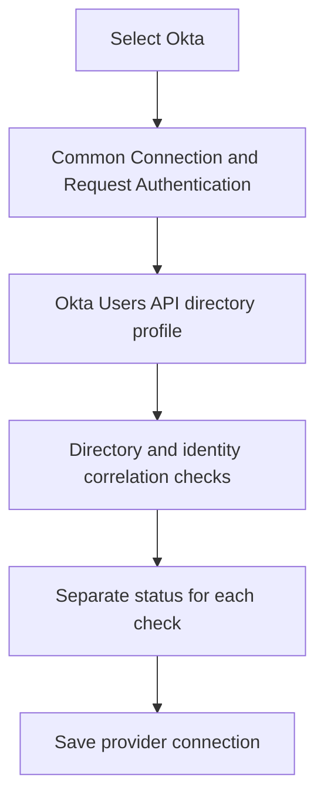
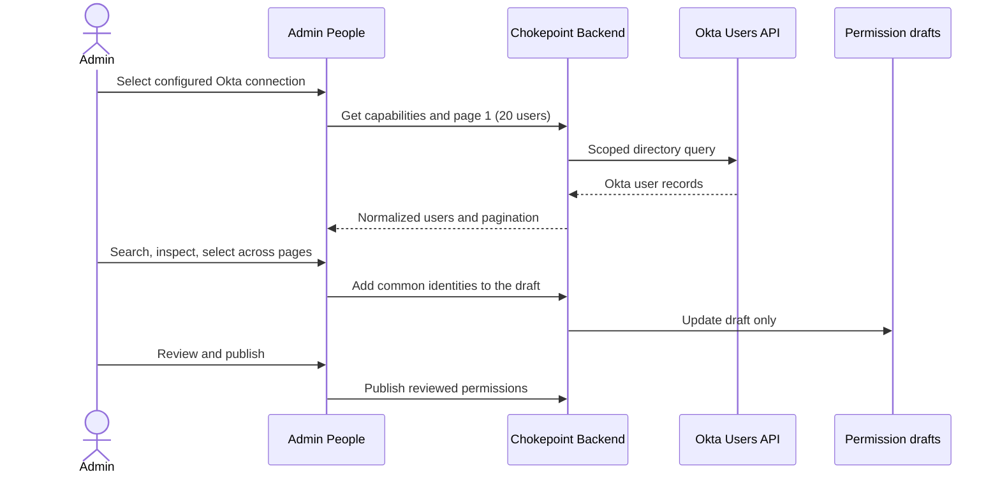

# Specification: Okta People Selection and Provider Configuration

- **Specification ID**: 013
- **Date**: 2026-10-28 (revised 2026-10-31)
- **Slug**: okta-auth0-people-selection-and-provider-configuration
- **Status**: Proposed
- **Owner**: Admin — Access and Permissions
- **Related Specification**: Admin 012 — SCIM People Selection for Agent Permissions
- **Related Specification**: Admin 028 — Remove Lifecycle Sync Screen and Google Warnings
- **Related Specification**: Backend 017 — Okta Identity Directory Integration
- **Related Specification**: Backend 036 — Remove Identity Lifecycle Synchronization and SCIM Directory Reads
- **Related Specification**: Backend 010 — Permission Assignments and Policy Management

> Revised on 2026-10-31. Auth0 is no longer a supported identity provider. Chokepoint does not synchronize user lifecycle from any provider and reads directories through each provider's native API, not SCIM (Backend 036). The file name keeps the original slug because other documents link to it. This document does not claim that Backend 017 is implemented and does not authorize a UI to simulate support.

## Context & Background

Admin 012 establishes the People workflow and the IdP form composition: provider selection with official logos; separate Connection, Request authentication, User directory, and Activation and save sections; independent connection checks; directory search and detail; 20 users per page; multi-selection; and explicit PAP draft/review/publication.

Backend 017 makes the Okta adapter functional. It reads the Okta org directory through the Okta Users API and correlates the Okta user ID with the validated runtime identity. Okta's SCIM support is a provisioning client toward downstream applications, not a readable Okta directory.

## Problem Statement

The Keycloak form cannot be made functional for Okta by changing only the provider logo. Keycloak fields would misrepresent how the Okta Users API is authorized. Administrators could mistake a successful OIDC metadata check for validated directory access or proven identity correlation.

## Solution

Extend the existing provider-selection and People experience using backend-advertised, operation-level capabilities. Keep the common Connection and Request authentication panels. The User directory panel shows the Okta Users API profile with the credential fields that Backend 017 defines. The UI does not choose implicit fallbacks, map external IDs to runtime tokens, invent unsupported features, or call the IdP directly.

## Practical Gains & Operational Outcomes

- Administrators configure the actual Okta directory profile.
- People selection and PAP delegations stay consistent across Keycloak, Google Workspace and Okta through backend-normalized Chokepoint identities.
- Independent checks distinguish request-token trust, directory access and identity correlation.

## User Stories

- [ ] 1. As an administrator, I can select Okta using its official logo and see only its supported configuration fields.
- [ ] 2. As an Okta administrator, I can configure an authorized Users API directory profile.
- [ ] 3. As an administrator, I can search and select real Okta users, inspect allowed details and add them to an agent draft across pages.
- [ ] 4. As an administrator, I can diagnose unsupported operations, failed checks and unverified identity correlation without seeing secrets or raw provider data.

## Architecture Gate

### 1. Bounded Context & Ubiquitous Language

Admin owns forms, presentation, selection and transient state. Backend 017 owns credential processing, directory transport, identity normalization and runtime identity correlation. Backend 010 owns PAP drafts, publication and permissions. Admin never processes provider payloads or token claims as permission-domain inputs.

- **Provider**: explicit stored provider type; never inferred from issuer URL.
- **Directory profile**: backend-supported way to list/search/detail Okta users.
- **Capability state**: operation-level backend result, separate from configuration and health.
- **Correlation verified**: backend-confirmed correspondence between the selected directory identity and validated runtime evidence; a successful directory query does not prove it.

### Okta Admin Configuration

Backend capability responses govern whether a node can be configured or tested.

### 2. Aggregate Root & State Transitions

Selecting a provider changes form context; it does not create a connection. Saving persists only supported, schema-valid settings. A material change of issuer, directory scope or credentials invalidates stale check results. A disabled or removed connection blocks operations with truthful errors.

People selection stays draft-local until Save draft and Review & publish. Cross-page selections persist only within the current IdP connection and current admin/workspace/environment scope. Switching the IdP clears pending selections as Admin 012 prescribes. Already-associated subjects remain visible and removable even if directory lookup fails or the user disappears from the provider.

### 3. Commands, Queries & Domain Ports

The Admin consumes backend management APIs for provider catalogs, operation-level capabilities, the Okta configuration schema, OIDC trust checks, directory checks, the correlation check, directory search/detail, and PAP draft/publication. Required errors include not configured, unsupported, unauthorized, forbidden, mapping unverified, rate limited and upstream unavailable; none becomes an empty success state. Exact API paths and fields are coordinated with Backend 017 before implementation.

## Implementation Decisions

1. **Reuse Admin 012's visual system.** Okta appears with its official icon and name. Replace the "Not available yet" label only when the backend advertises the capability as functional.
2. **No Keycloak form clone.** Keep the common Connection and Request authentication panels. The User directory panel shows the Okta fields and setup instructions, with its own check result.
3. **Authentication check is narrow.** Display issuer and accepted audience(s). The OIDC metadata/JWKS check is not labeled a real login, a correlation check, a directory check or a tool authorization test.
4. **Okta directory transport is explicit.** Label the Users API profile and show its least-privilege authorization fields.
5. **Directory check versus correlation check.** Independent status distinguishes: endpoint reachable; authorized list/search/detail works; the mapping between directory user and validated request identity is verified. The UI cannot bypass the backend gate.
6. **People flow preserved.** Load real users on choosing a configured Okta connection; search and paginate at 20 per page with the backend translating Okta cursors. Do not fabricate totals. Support cross-page multi-select, details, duplicate prevention, draft save, review/publish and conflict states.
7. **Privacy and scope.** The browser receives only backend-normalized allowlisted fields. Do not store profiles, tokens, secrets, query text or selections in persistent browser storage; clear transient selections on logout and on connection, environment or workspace change. Secrets are write-only.
8. **Accessibility and UX.** Helpers work via keyboard and touch; essential labels and failures are visible without hover. Show loading, empty, pagination, unavailable, insufficient scope and unverified mapping states distinctly.
9. **Delivery boundary.** Implementation depends on functional Backend 017 endpoints. The UI may show the unavailable state before that, but may not activate an unsupported flow.

## Open Decisions and Evidence Required

- Final management API schema and capability enumeration for Backend 017.
- Exact Okta Users API credential, scopes, paging and runtime identity mapping for each customer configuration.
- Final list/detail field allowlist and handling of users absent from lookup.
- Official brand asset source and license tracking.

## Testing Decisions

Run the existing type/lint/build checks. The user runs the interface check with a reachable backend and a controlled Okta org: provider selector, configuration sections and separate checks, real directory search/detail/pagination, cross-page selection, existing associations on directory outage, draft/publish, scope changes, secret redaction and keyboard accessibility. Backend 017 owns protocol, security and data consistency tests.

## Acceptance Criteria

- [ ] 1. The provider selector shows Okta with its official asset and reflects backend availability accurately.
- [ ] 2. The Okta form reuses Admin 012's visual composition and shows the Users API profile, not Keycloak fields.
- [ ] 3. OIDC, directory and identity correlation checks have distinct results and explanations.
- [ ] 4. Okta user discovery uses the backend-advertised read profile with accurate naming and scope.
- [ ] 5. People search, 20 results per page, cross-page selection, user detail and draft/review/publication work without browser-to-IdP calls.
- [ ] 6. An unverified or mismatched directory/runtime identity is not presented as a successful association.
- [ ] 7. Existing associations can be reviewed and removed when the directory is inaccessible or the user is absent.
- [ ] 8. No unsupported operation returns a fake success or silent fallback.
- [ ] 9. No provider secret or raw identity data persists in browser storage or appears in logs; scope isolation holds.
- [ ] 10. The interface check passes and the existing admin type/lint/build checks pass.

## Out of Scope

Auth0; lifecycle synchronization in any form (Event Hooks, SCIM provisioning, webhooks); SCIM directory reads; groups and roles; direct browser-side provider API calls; profile caching; polling; automatic permission publication or revocation; Microsoft Entra and AWS.

## References

- Okta SCIM concepts: https://developer.okta.com/docs/concepts/scim/
- Okta Users API: https://developer.okta.com/docs/api/openapi/okta-management/management/tag/User/
