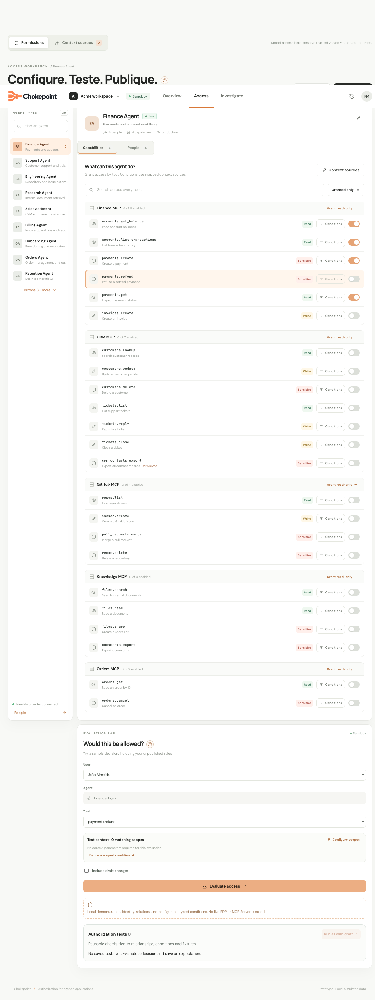

# Specification: Contextual Access Navigation

- **Specification ID**: 019
- **Date**: 2026-10-29
- **Slug**: contextual-access-navigation
- **Status**: Implemented
- **Owner**: Admin — Access navigation
- **Related Specification**: [Backend 023 — Decision Trace Read API](../../backend/specs/023-2026-10-29-decision-trace-read-api.md)
- **Related Specification**: [Backend 024 — Signal Review and Resolution](../../backend/specs/024-2026-10-29-attention-signal-review-and-resolution.md)
- **Related Specification**: [020 — Investigate](020-2026-10-29-investigate-problems-and-decisions.md)
- **Related Specification**: [021 — Overview](021-2026-10-29-overview-dashboard.md)
- **Visual reference**: [Temporary screen references](../docs/spec-references/2026-10-29-overview-investigate/README.md)

> Implementation authorized by the user on 2026-10-29 as a coordinated backend/Admin delivery. Result approval is still required before implementation commits, merge or push.

## Context & Background

The mock's Adjust permissions action opens Access with an Agent selected, the capabilities section open and the affected tool highlighted. This was verified in the browser through Overview → Requests denied → Inspector → Adjust permissions. The real Admin currently ignores most signal target parameters; Access selects its own default Agent.

The user confirmed the visual destination. Runtime parameters must use actual backend entity identities rather than relationships invented in sample data.

## Problem Statement

An action can open a generic page rather than the actual entity. A token application identifier is not an Agent UUID. A route must not infer authorization or group identity from a display name.

## Solution

Extend existing Access route handling and signal target mapping with validated scoped context. Reuse the existing Agent rail and permission editors. Preserve origin state for returning to Investigate/Overview.

## Practical Gains & Operational Outcomes

- A recorded policy opens its actual group/rule.
- A tool or principal action keeps the selected context instead of requiring another search.
- Contextual navigation does not create a new relationship between applications and permission groups.

## User Stories

- [x] As an administrator, I want Adjust permissions to focus the relevant existing group/tool, so that I can work on the recorded problem.
- [x] As an administrator, I want a tool-review or person action to open the actual object, so that I do not search again.
- [x] As an administrator, I want return navigation to retain my filters and page.

## Visual Specification

Use the highlighted tool and selected section as the visual example. The mock's evaluation lab and unrelated Access redesign are not part of this specification. Apply the [reference guide](../docs/spec-references/2026-10-29-overview-investigate/README.md), existing design tokens and actual editor structure.

## Architecture Gate

Access owns interpreting its route context and selecting its existing editors. Investigate consumes Backend 023 action descriptors; attention signal navigation consumes Backend 024 targets. Keep scope in authenticated application context and query keys. Navigation never supplies privileges or directly publishes a permission change.

## Implementation Decisions

1. **Access query contract.** Support `/access?agent_id=<actual-group-uuid>&section=grants|policies|people&server_id=<uuid>&tool=<qualified-name>&policy_id=<uuid>&decision_id=<trace-id>&signal_id=<uuid>` as applicable. A trace-id is the existing positive BIGINT decision ID serialized as text; group, policy, server and signal IDs retain their actual UUID contracts. Use URLSearchParams. Optional query parameters select the existing editor; backend reads still check current membership and scope. Unknown section values are rejected or cleared with an explanatory state, not executed as route names.
2. **Exact recorded targets.** Condition denies use the recorded group_id and policy_id. Open the selected group's Permissions view and the relevant policy with server/tool context visible. Tool-focused grant actions open Servers & tools and scroll/focus the qualified tool row, including its server_id to distinguish identical names across servers. Do not toggle a grant or save/publish on navigation.
3. **Real group context.** Use actual group references from Backend 023. If one group is applicable, select it directly. If several are relevant, retain them in the existing Agent rail with the tool focus preserved; do not invent one unique granting group. If none is identified, keep the tool/problem context and explain that no matching permission group was recorded. The existing rail remains the place to choose an actual group. Do not add an application-to-Agent configuration or compare names/UUIDs to client_id.
4. **Person context.** Use decision_id or signal_id as a scoped lookup reference so raw issuer/subject values do not need to appear in a shareable URL. The backend resolves the exact principal and related real groups. Open the existing People context, focus/highlight that exact principal and preserve the source signal. Multiple groups can be exposed in the same rail; one current directory name does not establish identity.
5. **Tool review.** Map tool-not-reviewed to the actual Custom/Enterprise connection type and server/tool reference. Extend the existing Integrations destination parameters to select the matching connection and affected tool in its review UI. Do not send every tool to the Custom tab or select a server by name. A discovery item with several changed tools opens that real connection's affected-tool context, without fabricating a single tool.
6. **Selection lifetime.** Load a requested Agent by ID even when it is not in the first rail page. Apply the destination section/focus after relevant data is loaded. Keep the target selected through ordinary query refresh. On user selection of another group, preserve or clear context deliberately rather than reapplying the old deep link on every render.
7. **Return state.** Preserve list view, period, exact filters, page, selected decision and signal ID. Internal return URLs are validated application routes. Refresh/deep-link entry works without a previous in-memory navigation event.
8. **Inbox exit lifecycle.** Preserve signal_id for an opened Inbox item through the detail flow. Reuse Admin 020's exit confirmation contract when leaving a signal-targeted detail in Access/Integrations as well. Do not show duplicate modals for one transition. Cancel keeps the current detail; a failed resolve keeps the destination and offers retry. Permissions publication and signal resolution remain separate operations.
9. **Missing data.** Deleted groups/policies, missing people, unknown applications and unavailable tools produce explicit unavailable states with safe navigation back. Never silently select an unrelated first Agent and present it as the recorded rule. Scope changes clear private selection and abort requests.
10. **Presentation.** Reuse the module design system and existing components. The target row receives a restrained highlight and keyboard focus without shifting the whole page unexpectedly. Keep actions and focus visible on narrow screens.

## Testing Decisions

This Admin has no automated tests (specification 016). Do not add test files, test fixtures, test infrastructure or a TDD requirement. During implementation run npm run check and npm run build, then manually verify the behavior in the built-in browser with the real scoped backend. Use the project's local authentication instructions. No Admin build or runtime checks have been run for these documentation-only changes.

Manually open a real condition deny, a missing-grant call, an unreviewed tool and a disabled principal. Verify direct URL/refresh, server-qualified tool highlighting, a group outside the first rail page, multiple/absent/deleted targets, return-state restoration, keyboard navigation and the Inbox exit modal. Confirm that navigation never saves or publishes grants.

## Acceptance Criteria

- [x] 1. Known actual group/policy IDs open the correct existing editor and server-qualified tool.
- [x] 2. Person and tool-review targets retain exact scoped context.
- [x] 3. No token client_id is treated as an Agent UUID or a new configuration requirement.
- [x] 4. Deep links work after refresh and on a requested group outside the first page.
- [x] 5. Originating signal state and list return context survive navigation without duplicate modals.
- [x] 6. Check/build and manual browser verification pass during implementation.

## Out of Scope

- Rebuilding Access, adding the mock evaluation lab or changing publication rules.
- New application-to-Agent configuration or changes to runtime authorization.
- Priority, Intelligence algorithms and post-adjustment watching.

## Further Notes

Deliver with Backend 022–024 and Admin 020. Admin 021 reuses these targets. The screenshot is temporary; remove it only when its implementation is approved and update image references at the same time.

## Verification Evidence

Implementation and verification completed on 2026-10-30. See the [verification record](../docs/verification/2026-10-30-investigation-overview.md) for executed checks, manual observations, source inspection and limitations. The user approved the result on 2026-10-30.
