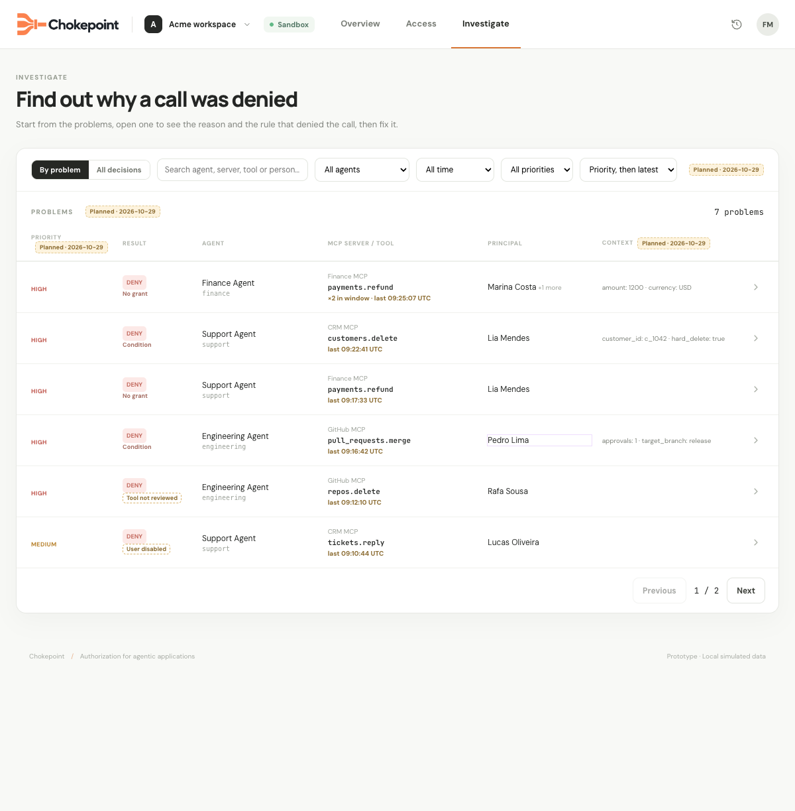
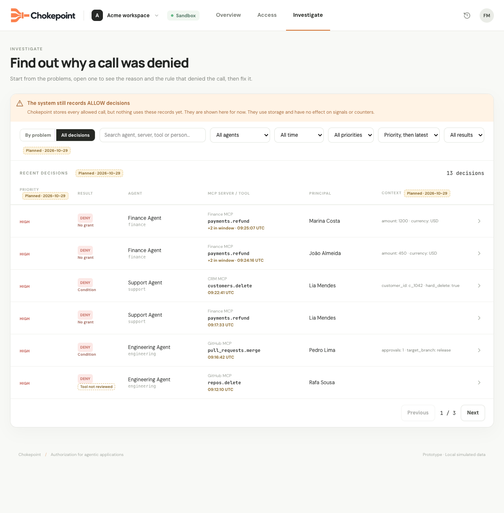
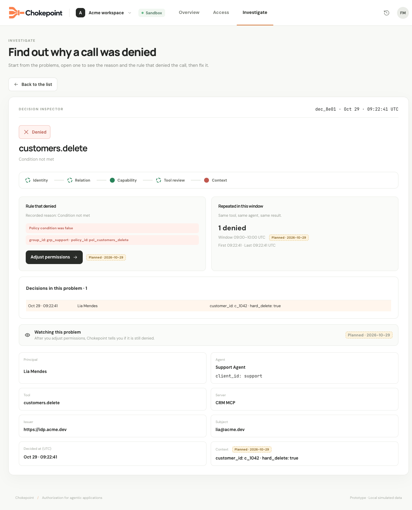
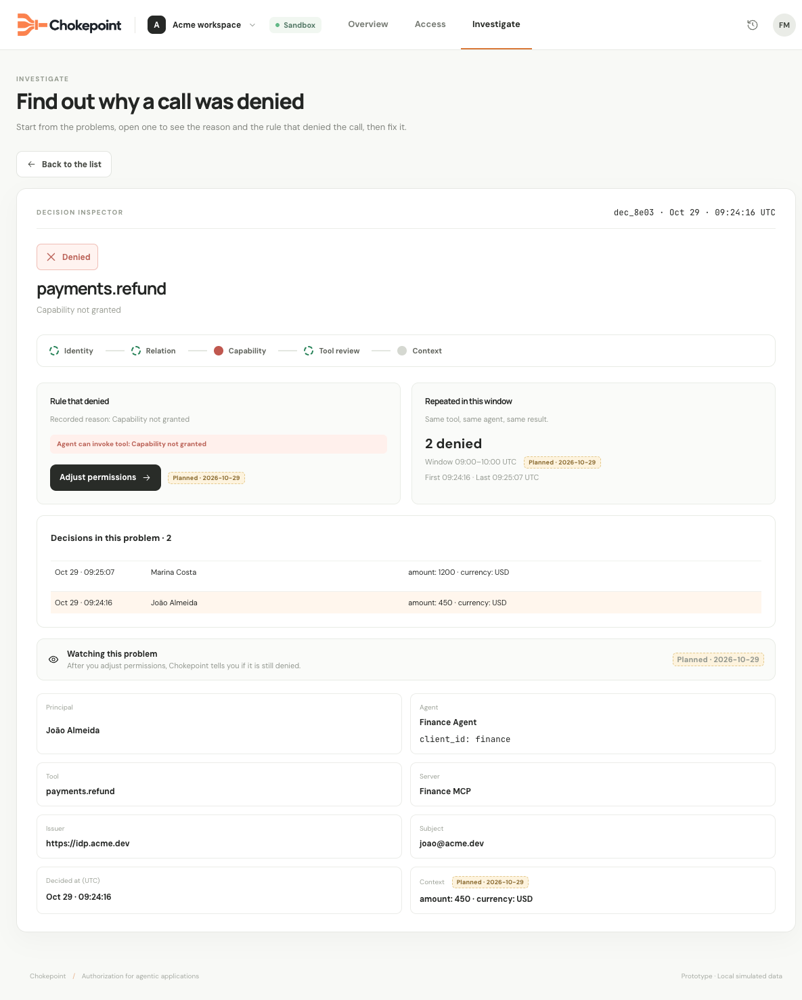

# Specification: Investigate Problems and Decisions

- **Specification ID**: 020
- **Date**: 2026-10-29
- **Slug**: investigate-problems-and-decisions
- **Status**: Implemented
- **Owner**: Admin — Investigate
- **Related Specification**: [Backend 022 — Decision Trace Evidence](../../backend/specs/022-2026-10-29-decision-trace-evidence.md)
- **Related Specification**: [Backend 023 — Decision Trace Read API](../../backend/specs/023-2026-10-29-decision-trace-read-api.md)
- **Related Specification**: [Backend 024 — Signal Review and Resolution](../../backend/specs/024-2026-10-29-attention-signal-review-and-resolution.md)
- **Related Specification**: [019 — Contextual Access Navigation](019-2026-10-29-contextual-access-navigation.md)
- **Related Specification**: [021 — Overview](021-2026-10-29-overview-dashboard.md)
- **Visual reference**: [Temporary screen references](../docs/spec-references/2026-10-29-overview-investigate/README.md)

> Implementation authorized by the user on 2026-10-29 as a coordinated backend/Admin delivery. Result approval is still required before implementation commits, merge or push.

## Context & Background

The workbench mock is the visual target for Investigate. It has By problem and All decisions views and a decision inspector. The current Admin page is not that implementation. The user confirmed the screens, safe condition evidence, actual path recording and manual review/resolution behavior.

## Problem Statement

Administrators cannot browse the recorded calls or open a reason-qualified problem. Existing signal actions lose the parameters. The mock simulates paths and displays sample argument values that must not be copied into the real Admin.

## Solution

Implement the mock's list/inspector composition using Backend 022–024, real paged queries and Admin 019 contextual destinations. Treat visual sample data as examples only.

## Practical Gains & Operational Outcomes

- Repeated denials appear as one problem per reason and UTC window.
- The inspector explains the recorded decision using the actual rule and path.
- An administrator can move to the affected permission and explicitly finish an Inbox item.

## User Stories

- [x] As an administrator, I want grouped problems and individual decisions, so that I can choose the right level of detail.
- [x] As an administrator, I want filters, UTC periods and pagination, so that I can inspect retained history.
- [x] As an administrator, I want recorded rules and path steps without real argument/source values.
- [x] As an administrator, I want exact corrective actions and a review/resolution choice when leaving an Inbox detail.

## Visual Specification

The [temporary reference guide](../docs/spec-references/2026-10-29-overview-investigate/README.md) lists mandatory differences. Omit all priority UI and Watching this problem. Replace sample Context values with the recorded condition. Do not copy Planned/Differs tags or the obsolete warning that permits have no use.

## Architecture Gate

Keep API client, query hooks, list and inspector components in the Investigate feature. Backend 023 owns grouping, counts, filters and paging. React does not rebuild server-side problem groups from one page of calls. Query identity includes user/workspace/environment plus all active filters. Scope/selection changes cancel stale requests and remove prior private content. Navigation reuses Admin 019.

## Implementation Decisions

### Lists

- Default to By problem. Rows contain reason/result, observed application identifier/name, server/tool, count/latest time, principal summary and recorded condition summary.
- All decisions contains recorded permits and denies, with result filter All/Allow/Deny. Permits have no deny reason or priority. Preserve the result indicator and compact row hierarchy of the mock.
- Support agent, period (all retained, 24 hours, 7 days, 30 days), literal text and result where applicable. Use Latest first. Omit priority filter, column, badges and ordering; Intelligence will provide priority in future work.
- Use Backend 023 filters and pages (six rows by default). Reset page on filter changes. Keep filters, view and selected item in route/search state so refresh and return work. All time means all retained history, not unlimited storage.
- Clicking an application, tool or principal value applies an exact filter; distinguish that control from opening the row. Use accessible controls without nested interactive buttons. Principal identity is issuer plus subject, not name.
- A grouped row opens the latest matching decision and its complete canonical problem window. Count labels distinguish filtered-list counts from the full-window detail count returned by the backend.

### Inspector

Show decision ID/time, result, fixed reason description, tool/server, current principal display name and recorded identifiers. Render the path stored by 022. Tooltips explain each recorded step state. Not evaluated is distinct from failed and from not applicable. Never run the mock evaluator or infer historical passed checks from the current catalog.

The rule area shows the recorded condition expression, policy/group references and outcomes without evaluated values. Preserve expression constants that are part of the rule. No-grant and pre-PDP blocks have a fixed explanation; show Not evaluated where no condition ran. Permits show actual supporting group/grant references and applicable condition evidence rather than a fabricated single granting rule.

Show full-window repetition count, first/last times and UTC bounds. For a deny, all these use the full server/tool/agent/reason/window key. Page through all decisions in the problem instead of silently limiting the breakdown to six forever. Selecting a decision in this breakdown stays inside the same detail; it does not invoke the exit modal.

Adjust permissions, Review tool and Open person consume Backend 023 targets and Admin 019 navigation. Preserve origin state and originating signal ID. A current missing rule/object does not erase recorded evidence.

### Reviewed/Resolved workflow

For the Inbox item whose detail is opened, persist Reviewed immediately through Backend 024. Opening and closing a detail does not change permissions or automatically resolve the problem. An already Resolved item is not silently reopened by viewing it.

On a click that leaves the opened item's detail (Back to the list, another page or a corrective destination), show one accessible modal:

- **Keep reviewed:** keep the recorded review and continue to the requested destination.
- **Mark resolved:** persist the administrator's resolution, then continue.
- **Cancel / Escape:** stay in the current detail.

This is the user's explicit change to the mock. Scope the guard to the opened Inbox item and its canonical problem context; do not attach lifecycle status to individual permit/deny records or introduce a second workflow store. When direct problem navigation identifies an existing signal, use that signal. Handle a detail with no originating/matching Inbox item without manufacturing a new signal merely because of a read.

A status failure remains visible with retry; do not navigate while falsely showing that resolution succeeded. Viewing another decision within the same problem does not repeat the modal. An explicit switch to another item's detail finishes the old item flow first. Browser/tab termination cannot guarantee a custom modal; the already saved Reviewed state remains. Use the same shared guard with signal-targeted Access details rather than creating competing confirmations.

### Loading, empty, error and limitation states

Preserve list geometry while loading. Distinguish no denials, no retained history, no filter matches, expired history and request failure. A failure retains filters and offers Retry. Do not say Nothing is blocked right now merely because retained data contains no denials.

The user decided on 2026-10-30 not to show a recording-completeness warning in Investigate. Old records without path/condition evidence show that absence explicitly. Remove the mock warning claiming permits have no use: permits feed the dashboard and unused-tool indicator. Names come from current directory reads and may be unavailable.

### Layout and accessibility

Use existing design tokens and the mock's actual list-to-detail composition, not an unrelated split-pane redesign. Keep counts aligned, expressions wrappable/scrollable within their region and timestamps visibly UTC. On narrow screens preserve all actions and meaningful row labels. Dialog focus is trapped and restored; status and step states are readable without color alone. No global overflow hiding.

## Testing Decisions

This Admin has no automated tests (specification 016). Do not add test files, test fixtures, test infrastructure or a TDD requirement. During implementation run npm run check and npm run build, then manually verify the behavior in the built-in browser with the real scoped backend. Use the project's local authentication instructions. No Admin build or runtime checks have been run for these documentation-only changes.

Manually cover both views, all filters, pagination and exact row filters; two reasons in one hour; same problem in another hour/server; permits; selected breakdown decisions; condition/path evidence without source values; all contextual actions; return/refresh; Reviewed and Resolved choices, cancellation and failed mutations; old/expired evidence; loading/error/empty states; keyboard and narrow-screen layout. Compare rendered screens to the temporary references with their explicit exclusions.

## Acceptance Criteria

- [x] 1. Both views consume real filtered/paged APIs and preserve list state.
- [x] 2. Problem identity and all repetition counts include the reason and UTC window.
- [x] 3. The inspector renders recorded path/rule evidence and no actual source/argument values.
- [x] 4. Contextual actions open real targets and preserve origin context.
- [x] 5. Opening an Inbox detail reviews it; leaving offers the specified modal and explicit resolution.
- [x] 6. Priority and Watching this problem are absent; no recording-completeness warning is shown.
- [x] 7. Check/build and manual browser verification pass during implementation.

## Out of Scope

- Intelligence priority and risk algorithms, priority UI or High priority metrics.
- Watching after adjustment, automatic resolution inferred from calls, re-evaluation or a policy simulator.
- Actual argument/source values and historical-name storage.
- Automated Admin tests.

## Further Notes

Release with Backend 022–024 and Admin 019 after individual specification approvals. Admin 021 depends on this Investigate destination. Temporary screenshots remain until implementation approval; update/remove their links with their cleanup.

## Verification Evidence

Implementation and verification completed on 2026-10-30. See the [verification record](../docs/verification/2026-10-30-investigation-overview.md) for executed checks, manual observations, source inspection and limitations. The user approved the result on 2026-10-30.
