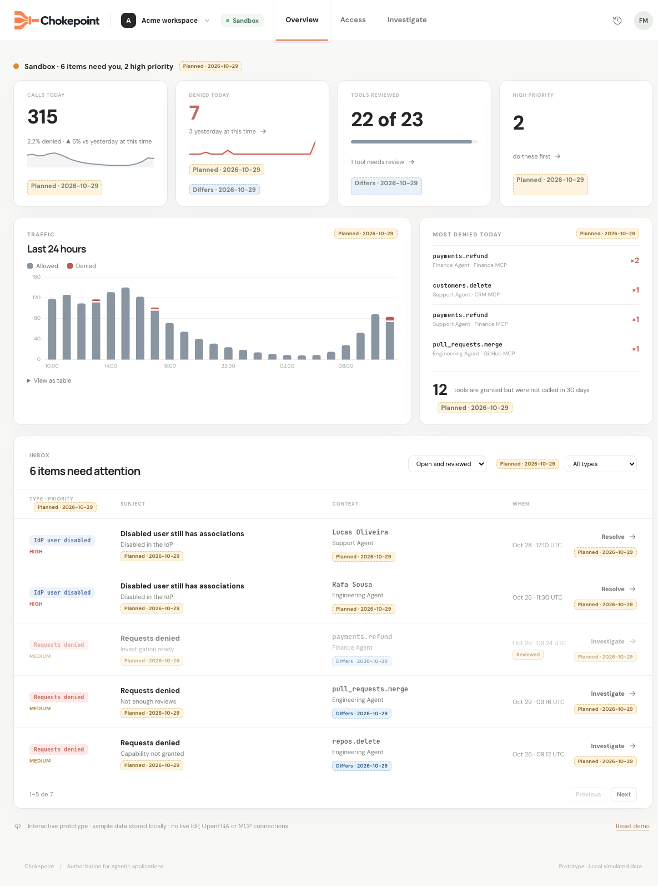

# Specification: Overview Dashboard

- **Specification ID**: 021
- **Date**: 2026-10-29
- **Slug**: overview-dashboard
- **Status**: Implemented
- **Owner**: Admin — Overview
- **Related Specification**: [Backend 023 — Decision Trace Read API](../../backend/specs/023-2026-10-29-decision-trace-read-api.md)
- **Related Specification**: [Backend 024 — Signal Review and Resolution](../../backend/specs/024-2026-10-29-attention-signal-review-and-resolution.md)
- **Related Specification**: [Backend 025 — Overview Aggregation API](../../backend/specs/025-2026-10-29-overview-aggregation-api.md)
- **Related Specification**: [019 — Contextual Access Navigation](019-2026-10-29-contextual-access-navigation.md)
- **Related Specification**: [020 — Investigate](020-2026-10-29-investigate-problems-and-decisions.md)
- **Visual reference**: [Temporary screen references](../docs/spec-references/2026-10-29-overview-investigate/README.md)

> Implementation authorized by the user on 2026-10-29 as a coordinated backend/Admin delivery. Result approval is still required before implementation commits, merge or push.

## Context & Background

The mock's Overview presents operational status, traffic, most-denied rows, unused access and an Inbox. Admin 018 implemented the earlier Inbox/counters, with unreviewed-only rows and generic actions. This specification replaces that composition with the agreed visual target and confirmed exclusions.

## Problem Statement

The current page cannot compare daily traffic, plot hourly calls or expose unused tools. Reviewed items disappear. A generic counter destination and sample mock values do not give administrators the context they need.

## Solution

Build the Overview composition from Backend 025 aggregates and Backend 024 Inbox data. Reuse Admin 020 investigation and Admin 019 contextual navigation. Keep the mock's hierarchy and the module's actual design system.

## Practical Gains & Operational Outcomes

- Administrators can see recorded usage and denied traffic at a glance.
- A dashboard row opens the relevant filtered investigation.
- Reviewed work remains visible until explicitly resolved or resolved by an existing factual source transition.

## User Stories

- [x] As an administrator, I want recorded calls today and the equivalent yesterday period.
- [x] As an administrator, I want allowed/denied traffic by UTC hour and the most-denied combinations.
- [x] As an administrator, I want tools with granted access but no recorded permits, so that I can review them.
- [x] As an administrator, I want an Inbox with status/type filters and exact actions.

## Visual Specification

The [temporary reference guide](../docs/spec-references/2026-10-29-overview-investigate/README.md) defines approved differences. Omit High priority and every priority badge/filter. Reflow the three remaining metrics naturally. Sample values, application/group relations, old warnings and Planned/Differs tags are not implementation requirements.

## Architecture Gate

Overview consumes aggregates rather than reconstructing them from client-side pages. Keep dashboard API client/hooks/components with the owning feature; reuse attention components for lifecycle and Admin 019–020 for navigation/guards. Every private query is keyed by the current user/workspace/environment. Scope changes abort stale requests and clear previous content.

## Implementation Decisions

1. **Status line.** Name the selected environment and the number of Open Inbox items. Use an all-clear statement only when that query succeeds and Open is zero. Reviewed items remain visible in the default list but are not counted as new attention. No severity assessment is inferred without Intelligence.
2. **Calls today.** Show recorded allowed+denied calls for the backend's UTC today interval, denied share, equivalent yesterday comparison and the sparkline. Use backend raw values; no hardcoded trend arrows or percentages. With no denominator/comparison, show a clear unavailable comparison rather than NaN/infinity.
3. **Denied today.** Show the recorded denied count, yesterday at the same time and sparkline. Clicking opens Investigate for today's UTC interval and denied results, instead of filtering Inbox types as the old Admin does.
4. **Tools reviewed.** Show reviewed/total and the coverage meter, with needs-review text. Clicking opens the existing relevant tool catalog/review destination via Admin 019. Empty catalog has zero values and no invalid meter ratio. Do not add risk classification to review.
5. **Traffic.** Match the mock's stacked allowed/denied bars, legend and View as table disclosure. Use the exact rolling 24-hour interval defined by Backend 025, visible UTC times and marked partial boundary hours. Hour-aligned data can produce 24 or 25 clipped buckets; do not hardcode the sample number of bars. Tooltips and the accessible table expose counts and exact bounds. Zero-filled buckets are still rendered.
6. **Most denied today.** Render up to four backend-ranked rows with tool, server, observed application name/identifier, fixed reason description and count. A row opens Investigate with today's UTC interval and its exact server/tool/agent/reason filters. It must not open an unrelated latest problem or treat the daily total as one hourly group.
7. **Unused tools.** Show the backend's count using No recorded allowed calls in 30 days. The indicator opens a compact paged detail list within the Overview flow, using the existing dialog/detail primitives and the 025 unused-tools query. Each row identifies server/tool and real current Access targets for reviewing its grants. This is the drill-down described by the mock's Planned tooltip, not a new usage-attribution report. Several groups granting one tool do not increase the count. Do not require knowing which grant allowed a call.
8. **Limitations.** The user decided on 2026-10-30 not to show a recording-completeness warning near traffic or metrics. The unused-tools detail keeps its own statement that no recorded allowed call does not prove a tool was never used. Do not imply a newly granted tool was necessarily unused for a full 30 days. Remove the old claim that permits have no use.
9. **Inbox.** Default to Open and Reviewed. Status choices are Open and reviewed, Open, Reviewed, Resolved and All statuses; retain type filtering and five-row pagination. Sort latest first, reset page when filters change and display returned status chips. Reviewed rows are visually subdued but remain readable. Resolved rows leave the default list but can be selected through the status filter.
10. **Inbox row content.** Preserve the mock's type, subject, short explanatory note, context, UTC time and trailing action hierarchy. Omit priority. Populate source-specific data from Backend 024, including actual tool/server, application display information and disabled principal's current associated groups. Handle multiple tools/groups honestly rather than copying a fictional single association. A row opens its specific problem, tool review or person context using Admin 019.
11. **Review/resolution.** Opening an Inbox item's detail marks it Reviewed. Leaving that detail offers Keep reviewed or Mark resolved, with Cancel remaining in the detail, as defined by Admin 020 and Backend 024. Carry the signal ID to all destination types. Resolution is explicit administrator intent; neither changing a permission nor seeing a permit resolves the item automatically. Existing source-driven lifecycle resolution remains supported.
12. **Asynchronous data.** Preserve and refetch/invalidate actual query data after successful status changes. A failed query does not render zero or All clear. A failed review remains visible with retry; no successful mutation is assumed. Query refresh must not reset active filters or selected context. No new polling/monitoring product is introduced.
13. **Layout.** Follow the actual mock: status and metrics, traffic beside most-denied/unused, then Inbox. Reuse design-system spacing/type/tokens; stack regions on narrow screens. Charts have textual/table equivalents. Buttons and row actions are keyboard accessible; status does not depend on color alone.

## Testing Decisions

This Admin has no automated tests (specification 016). Do not add test files, test fixtures, test infrastructure or a TDD requirement. During implementation run npm run check and npm run build, then manually verify the behavior in the built-in browser with the real scoped backend. Use the project's local authentication instructions. No Admin build or runtime checks have been run for these documentation-only changes.

Manually verify UTC today/yesterday data, zero denominators, all chart/table buckets, most-denied destinations, zero/nonzero tool coverage, unused-tool drill-down and actual grant targets; every Inbox status/type/page combination; retained reviewed rows and excluded resolved rows; exact destinations and exit modal; failed reads/mutations and scope switching; responsive/keyboard behavior. Compare to the Overview reference while applying the mandatory differences.

## Acceptance Criteria

- [x] 1. Overview follows the referenced composition with three current metrics and no priority UI.
- [x] 2. All traffic and comparisons use real Backend 025 aggregates and visible UTC boundaries.
- [x] 3. Most-denied rows and unused-tool details open the appropriate real context.
- [x] 4. Inbox defaults to Open and Reviewed and implements all status/type filters and pagination.
- [x] 5. Review/resolution follows the shared explicit modal flow and preserves signal identity.
- [x] 6. No recording-completeness warning or obsolete permit warning is shown; the unused-tools detail states what its indicator does not prove.
- [x] 7. Check/build and manual browser verification pass during implementation.

## Out of Scope

- High priority, risk classification and priority ordering: future Intelligence work.
- Grant-specific usage attribution, exact traffic accounting and a new traffic history store.
- Post-adjustment watching or automatic resolution inferred from activity.
- Automated Admin tests.

## Further Notes

Release Backend 025 and Admin 021 together after Backend 022–024 and Admin 019–020, or release the whole set together. This specification supersedes Admin 018's page composition, reviewed-only removal and generic counter destinations. The temporary screenshots are implementation references, not permanent product assets.

## Verification Evidence

Implementation and verification completed on 2026-10-30. See the [verification record](../docs/verification/2026-10-30-investigation-overview.md) for executed checks, manual observations, source inspection and limitations. The user approved the result on 2026-10-30.
