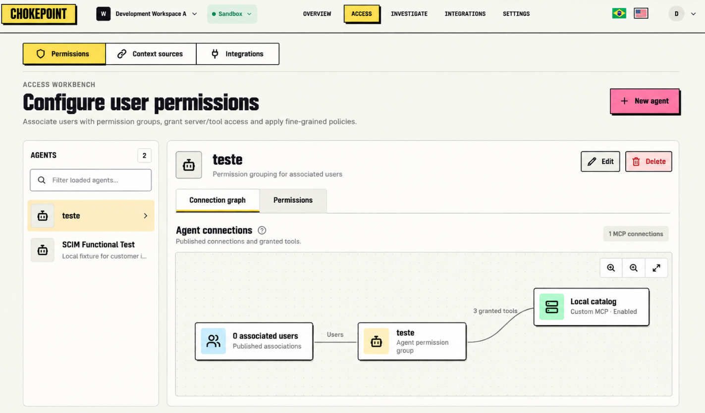

# Specification: Admin Design System Refresh

- **Specification ID**: 022
- **Date**: 2026-10-30
- **Slug**: admin-design-system
- **Status**: In Progress
- **Owner**: Admin
- **Related Specification**: [001 — Admin Shell](001-2026-10-24-admin-shell.md)

## Context and problem

The admin uses a shared design system, but its typography, colors and controls differ from the visual direction supplied by the user. The new system must give the entire admin a consistent identity, while preserving existing workflows, accessibility and backend contracts. The supplied Access workbench screenshot is the primary visual reference; it is a direction for the whole application, not a request to reproduce fictional data or change behavior.

## Solution

Update the admin design system, reusable CSS primitives and screen-specific styles across the entire admin. Prefer CSS and existing markup. Change React only when the existing markup cannot deliver the design or accessible behavior. Keep the system local to the admin and document the resulting tokens and component rules.

## Visual reference

The screenshot above is the visual reference for the system described below.

## Visual language

- **Typography:** Barlow Condensed Bold for page and section titles; IBM Plex Sans for interface text, navigation, buttons, forms and descriptions; IBM Plex Mono for code, identifiers, technical values and logs. Host fonts locally and include licenses. Keep regular interface text legible, and do not use the condensed display face for dense data or form labels.
- **Brand:** Reuse the home header wordmark from the frontend. The home implements it as text styled with Anton, a yellow background, dark border and offset dark shadow, rather than as an image. Preserve that identity in the admin header, with an accessible name and link. Anton is a brand exception to the title font choice.
- **Color:** Use a warm off-white canvas and near-white surfaces, near-black text and controls, yellow for current navigation and selection, and pink for primary actions. Use restrained green, red and amber for semantic states. Match the screenshot's balance: color directs attention, while content surfaces remain quiet. Define semantic tokens for each role; do not scatter new one-off color values.
- **Borders and shape:** Use dark, clearly defined borders on the wordmark, primary navigation, prominent buttons and graph nodes. Use lighter neutral borders on large panels and dividers. Keep corners square or subtly rounded. Use short, solid dark offset shadows on prominent actions and selected navigation; avoid soft decorative shadows.
- **Hierarchy and density:** Give page titles a clear condensed display hierarchy, with concise muted descriptions. Keep workbench controls compact, with predictable spacing and readable dense tables. Preserve existing responsive layouts and task order.

## Reusable components

Define or update shared tokens and CSS for the app shell and wordmark; primary and secondary navigation; page headings and labels; primary, secondary, destructive and icon buttons; text inputs, selects, textareas and selection controls; tabs and segmented controls; panels, lists and tables; badges, notices, dialogs, menus and tooltips; and code and graph surfaces. The same purpose must have the same visual treatment across screens. Screen-specific styles should consume the shared tokens and primitives instead of creating competing themes.

Specify and implement default, hover, focus-visible, active and disabled treatments where applicable. Loading, empty, error, selected and success states must remain understandable without color alone. Maintain visible keyboard focus, native semantics, readable contrast, zoom and reduced-motion behavior. Preserve horizontal overflow handling for dense content on narrow screens.

## Implementation decisions

1. Apply the visual system to all existing admin screens, including authentication and feature-specific styles. Preserve existing content, actions, navigation, permissions and API behavior.
2. Use the screenshot for visual decisions, adapting its styling to existing layouts and content. Do not introduce new backend data, UI features or a dark theme.
3. Reuse the existing semantic token and component stylesheet entrypoint. Update the design-system documentation, token reference and specimen to reflect the implemented system.
4. Use local font assets and licenses; make no runtime remote font requests. Use the frontend home wordmark implementation as the source for its brand treatment.
5. Prefer CSS changes. React changes are allowed only when needed to render the home wordmark or preserve accessibility and the existing interaction contract.

## User stories

- [ ] An administrator sees a coherent visual language across the admin and recognizes Chokepoint's home identity.
- [ ] An administrator can identify the active navigation, primary actions and status without relying on color alone.
- [ ] A keyboard or small-screen user can continue to use the existing workflows.
- [ ] A developer can reuse documented tokens and components without duplicating styles for each screen.

## Verification and acceptance criteria

- [ ] The specified fonts, logo and visual roles are applied across the admin, including feature-specific screens and authentication.
- [ ] Shared component states, semantic colors, focus, responsive layouts and reduced motion are documented and verified.
- [ ] Existing behavior, navigation and API contracts remain unchanged.
- [ ] The design-system documentation and visual specimen match the implementation.
- [ ] `npm run check` and `npm run build` pass.
- [ ] Functional browser review covers the shell and representative screens, controls and narrow viewport. Record any unavailable checks and their limits.

## Out of scope

New product capabilities, backend changes, changes to the public frontend, new data, a dark theme, and redesign of the separate workbench mock.
