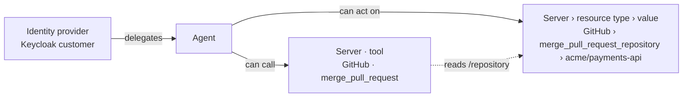

# Specification: Agent Delegation Editor

- **Specification ID**: 026
- **Date**: 2026-10-31
- **Slug**: agent-delegation-editor
- **Status**: Proposed
- **Owner**: Admin — Access and Permissions
- **Design**: [Agent delegation authorization](../../backend/docs/agent-delegation-authorization.md), section 8
- **Related Specification**: [Backend 029 — ReBAC Model and OpenFGA Integration](../../backend/specs/029-2026-10-31-rebac-model-and-openfga-integration.md)
- **Related Specification**: [Backend 031 — PDP Relation Checks and Call Conditions](../../backend/specs/031-2026-10-31-pdp-relation-checks-and-call-conditions.md)
- **Related Specification**: [Backend 032 — PEP Chokepoint Token and Actor Projection](../../backend/specs/032-2026-10-31-pep-chokepoint-token-and-actor-projection.md)
- **Related Specification**: [Backend 033 — Agent Permission Administration and Tuple Publication](../../backend/specs/033-2026-10-31-agent-permission-administration-and-tuple-publication.md)
- **Superseded in part**: [009](009-2026-10-26-authorization-management-workbench.md) (people, grants and policy editors), [010](010-2026-10-27-enterprise-and-custom-mcp-connections.md) (agent connection graph), [012](012-2026-10-28-scim-people-selection.md) and [024](024-2026-10-30-service-principal-selection.md) (member selection inside the group)
- **Visual reference**: layout prototype on the task branch `design/agent-delegation-screens` (folder `src/features/access/delegation`). Fixed data only. It is not merged.

> **On hold for Backend 029–033.** The backend contracts are approved (029) or decided (030–035) but not implemented. The layout below was agreed with the user on 2026-10-31 in the prototype. The [Backend dependencies](#backend-dependencies) section lists what the backend must define before implementation.

---

## Context & Background

Today the selected agent has two tabs:

- **Connection graph** (Admin 010): users → agent → MCP connections, read only, from the published permissions.
- **Permissions** (Admin 009, 012, 024): people and services as group members, server and tool grants, CEL policies scoped to a server or a tool.

On 2026-10-31 the model changed (Backend 029–033). The subject **delegates** to the agent. The agent **acts** and is verified. The agent configuration has four collections: delegations, capabilities, resources and call conditions. Relations go to OpenFGA. Call conditions stay in PostgreSQL and the PDP evaluates them with CEL.

---

## Problem Statement

### 1. The agent is shown as a permission group

The current screens add people as members of a group. In the new model a person or a service account delegates to the agent. The screens do not show delegation, consent or expiration.

### 2. No resources and no rule scope

A grant ends at a tool. The screens have no concrete resource. A CEL policy is scoped to a server or a tool, not to the agent · server · tool relation.

### 3. Two screens for one configuration

The graph only shows. The editors only edit. The administrator must switch tabs to understand what an agent can do.

### 4. Scale

A graph with one node for each person or each resource breaks with 100 subjects or hundreds of repositories.

---

## Solution

One view, **Delegation and access**, replaces the Connection graph and Permissions tabs. The graph is the map and the editor. Each relation opens its editor in a side panel. A list view shows the same relations as tables.

### Vocabulary on the screen

| Term | Meaning |
| :--- | :--- |
| Who can delegate | Subjects (people and services) of an identity provider that delegate to the agent. |
| Server · tool | A tool always belongs to one MCP server. |
| Resource | A concrete object where the agent acts. It belongs to the agent, inside a server and a resource type. By default each tool has its own resource type, so each tool has its own list of allowed values. |
| Resource type | A label that identifies one type of resource on a server, for example `merge_pull_request_repository`. The tool mapping declares it in the tool review: the Admin proposes `<tool>_<argument>` and the administrator can edit it. It is only a label that is unique on the server. Two tools share a list of values only when they use the same label. The backend field is `kind` (Backend 029). The screen never shows the word "kind". |
| Rule | A CEL condition on call data. It belongs to the triad agent · server · tool. |

---

## Practical Gains & Operational Outcomes

1. **One place for the agent**:
   - *Before*: a read-only graph and separate editors for members, grants and policies.
   - *Now*: one graph that shows and edits every relation, with a list view for keyboards and long lists.
2. **Rules without CEL**:
   - *Before*: the administrator writes CEL by hand.
   - *Now*: a rule builder writes the CEL. Raw CEL stays as an advanced option.
3. **Scale**:
   - *Before*: one node for each user and each connection.
   - *Now*: one node for each identity provider, and group nodes for long tool and resource columns.

---

## User Stories

- [ ] 1. As an administrator, I see who can delegate, what the agent can call, where it can act and the rules, in one graph.
- [ ] 2. As an administrator, I let everyone in an identity provider delegate, with exclusions, and I record the consent once.
- [ ] 3. As an administrator, I add a rule to agent · server · tool without writing CEL.
- [ ] 4. As an administrator, I allow concrete resources by server and resource type.
- [ ] 5. As an administrator, I understand the model from the help dialog.
- [ ] 6. As an administrator, the graph stays usable with 100 subjects and hundreds of resources.
- [ ] 7. As an administrator, I see the published revision and whether my last publication is effective.
- [ ] 8. As an administrator, I disable an agent at once.

---

## Architecture Gate

### 1. Bounded Context & Ubiquitous Language

- **Context**: Admin — Access. The Admin owns interaction, view state and API consumption. The backend owns validation, publication, tuples, CEL compilation and decisions.
- **Package Ownership**: `src/features/access`. The old graph (`features/access/graph`) and the permission editors (`features/permissions`) are replaced, without a compatibility layer.
- **Terms**: see [Vocabulary on the screen](#vocabulary-on-the-screen).

### 2. Aggregate Root & State Transitions

- The agent configuration is one revisioned aggregate with `draft` and `published` (Backend 033). The screen edits the draft. Only Publish, Discard and revocation change state.
- A published revision is pending until OpenFGA confirms, then effective. The screen shows the state; it does not change it.
- Invariants: no rule on a person; a rule on agent · server · tool only; a resource only for a tool with a reviewed mapping; the Admin never writes to OpenFGA.

### 3. Commands, Queries & Domain Ports

Read and change the agent permission aggregate (Backend 033), read the identity provider directory (Admin 012, 024), read the server tool catalog and approved bindings. Exact contracts: see [Backend dependencies](#backend-dependencies).

---

## Implementation Decisions

### 1. Agent header

1. The header shows the agent status, **Active** or **Disabled**, as a text chip.
2. A **Disable agent** / **Enable agent** action changes the status (kill switch, Backend 032 Resolved Decision 2). Disabled: the AS issues no new token and the PEP rejects the next call. The configuration and the client key stay.
3. The agent client and key registration are not in this specification (Admin A2).

### 2. Agent rail

The agent list rail collapses to a narrow column of agent icons. A chevron button in the rail heading toggles it. The button has `aria-expanded` and a text label.

### 3. Toolbar and section bar

1. The toolbar has the title, a **How this works** help button, a **Graph / List** toggle, a **Draft / Published** toggle and **Reset layout** after a box was moved.
2. **Published** shows the published revision, read only. Add actions are hidden and the side panel controls are disabled.
3. Below the title, a section bar shows **Who can delegate**, **Servers and tools** and **Resources**, each with its count and an add action. The bar is the same in Graph and List.

### 4. Graph

1. Four columns: who can delegate → agent → servers and tools → resources.
2. **Who can delegate:** one node for each identity provider, never one node for each person. The subtitle says "Everyone · people and services · N excluded" or "N selected".
3. **Servers and tools:** a dashed box for each server, labeled with the server name and type (Custom or Enterprise MCP). A tool node shows "Resource: <resource type>" or "No resource mapping".
4. **Resources:** a box for each **server › resource type**. The heading shows the resource type, for example `merge_pull_request_repository`, and "GitHub · used by" with the tools that use it. The allowed values are inside the box. Long labels wrap to the next line.
5. **Edges:**
   - identity provider → agent: delegation;
   - agent → tool: capability;
   - agent → resource type box: resource relation. It is drawn under the server boxes, from the agent, because the relation is agent → resource;
   - tool → resource type box: a dashed line labeled "reads /pointer". It shows the mapping. It is not a relation.
6. An edge has a handle: a clock when it expires, `{} N` when it has rules, `+` when it has neither. `+` opens the panel with the condition choice open. A resource edge shows the value count.
7. **Large columns:** a server with more than 8 tools becomes one node "N tools". A resource type with more than 8 values becomes one node "N values". The node opens a group panel.
8. **Interaction:**
   - drag a box to move it. Edges and boxes follow. A box stops at the visible edge of the canvas. Moving a box never resizes the canvas;
   - drag the background to pan; mouse wheel zooms at the cursor; buttons zoom in, zoom out and fit;
   - the canvas fills the window height below its top edge;
   - **Full screen** covers the window, keeps the side panel and the publication bar. Escape leaves full screen;
   - a click without movement selects; keyboard activation also selects.
9. Box positions are a view preference only. They are not saved in the permission document.

### 5. Side panel

The panel opens on the right of the graph or the list. It has a close button and, when opened from a group, "Back to {group}".

| Selection | Content |
| :--- | :--- |
| Identity provider | **Everyone in {IdP}** with exclusions, or **Only selected subjects**; kinds (People, Services); a searchable subject list (30 per page); expiration; consent; remove. |
| Agent · server · tool | Server; resource mapping (read only); expiration; the rules for this triad; **Add condition**; remove tool. |
| Resource | Resource type, value and server; the tools that use it; remove. A resource is an allow list: it has no rules and no expiration. |
| Group | Summary (total, expire, with rules), search, 50 per page, add action. |
| Add | Add identity provider; add tools (reviewed tools of each server, with mapping); add resource (choose server › resource type, enter the value). |

**Everyone in {IdP}.** Publication saves one delegation for each subject listed now in the identity provider directory, without the excluded subjects (Backend 033 stores one delegation for each subject). A subject added to the identity provider later needs a new publication. The screen says this in the option text.

**Consent.** In v1 no identity provider supports delegation, so the administrator records the consent once for the identity provider scope. Each delegation that the scope creates has `source` = `administrator`, `recorded_by` = the administrator and `recorded_at` = the time (Backend 033 Resolved Decision 1). The add flow requires a consent checkbox.

### 6. Conditions

1. One **Add condition** action. The administrator chooses the condition type, and the type decides the store:
   - **Expiration**: a relation condition in OpenFGA. Available on delegation and on agent · server · tool.
   - **Rule on call data**: a CEL call condition in PostgreSQL, evaluated by the PDP. Available only on agent · server · tool.
2. A rule never targets a person. On a delegation, "Rule on call data" is disabled with this reason.
3. A resource relation has no rules (decided with the user on 2026-10-31: a rule only makes sense for agent · server · tool). Backend 031 Resolved Decision 3 records it.

### 7. Rule builder

Administrators do not write CEL by hand by default.

1. "Allow the call when **all / any** of these are true", then one row for each check: **field**, **operator**, **value**.
2. Fields, grouped by origin: the call arguments of the tool (from its schema) and the trusted attributes of the approved bindings of the tool. Each field shows its type.
3. Operators by type:
   - string: is, is not, is one of, starts with;
   - number: is at most, is less than, is at least, is more than, is;
   - bool: is true, is false (no value).
4. A value can be a literal or another field of the same type ("Compare with a field").
5. The builder shows "Reads as: …", a sentence of the rule. An empty name uses this sentence.
6. **Generated CEL** is collapsed. It uses the current expression paths: `context.chokepoint.arguments["name"]` and `subject|resource.properties.chokepoint["binding"].values["attribute"]`.
7. Required bindings come from the fields used. The administrator does not select them.
8. **Edit as CEL (advanced)** opens the expression as text. After a CEL edit, the rule cannot go back to the builder. The backend validates the expression (boolean result, known bindings). The Admin does not compile CEL.

Example rules: `close_pull_request` "At least 2 approvals" (`resource … approvals >= 2`); `move_issue` "Only closed issues" (`resource … status == "closed"`).

### 8. List view

Three tables: Who can delegate (identity provider, who, kinds, consent), Servers and tools (tool, server, resource mapping), Resources (value, resource type, server, used by). Each table shows expiration and rules. Each row has **Open**, **Add condition** (not on resources) and **Remove**.

### 9. Publication bar

1. Left: "Draft · N unpublished changes" or "No unpublished changes", and the runtime state: "Revision N effective", or "Revision N pending · revision N-1 still applies".
2. Right: **Discard draft** and **Review & publish**.
3. Reconciliation is automatic (Backend 033 Solution 5). The screen has no repair action and no OpenFGA detail.

### 10. Help dialog

**How this works** opens a dialog with:

1. a diagram of a real example: Keycloak customer (alice, bruno) → Deploy bot → GitHub · `merge_pull_request` (rule: 2 approvals) and `list_issues` → `merge_pull_request_repository` › `acme/payments-api` and `list_issues_repository` › `acme/payments-api`, `acme/web`, with the dashed "reads /repository" lines;
2. the four checks in order, with the deny reason of each: `no_delegation`, `no_grant`, `no_resource`, `condition`;
3. example calls and their results;
4. what to remember: a resource belongs to the agent inside server and resource type; the resource type is proposed as `<tool>_<argument>`; a rule belongs to agent · server · tool; expiration ends a delegation or a tool relation; OpenFGA checks relations, the PDP checks rules.

The diagram is static SVG. The Admin has no Mermaid dependency.

### 11. Files

The editor stays in `src/features/access`. Data hooks, layout, graph, panels, rule builder, list and help are separate files. Each file stays under about 300 lines.

---

## Backend dependencies

The screen needs these items. Backend 029–033 do not define them yet. Each one is a backend specification change, decided with the user before implementation.

1. **Document shape** ([Backend 033](../../backend/specs/033-2026-10-31-agent-permission-administration-and-tuple-publication.md)). Field names and JSON of `delegations`, `capabilities`, `resources` and `conditions`; how a condition names its edge; the expiration format.
2. **Publication state in the read API** ([Backend 033](../../backend/specs/033-2026-10-31-agent-permission-administration-and-tuple-publication.md)). Pending or effective revision, the effective revision number and the reconciliation state.
3. **Agent status API** ([Backend 032](../../backend/specs/032-2026-10-31-pep-chokepoint-token-and-actor-projection.md), Resolved Decision 2). The field or command for Active / Disabled.
4. **Identity provider scope** ([Backend 033](../../backend/specs/033-2026-10-31-agent-permission-administration-and-tuple-publication.md)). The Admin expands "Everyone" into one delegation for each subject. The backend does not store the mode or the exclusions, so a reopened agent shows "N selected". To keep the intent, the backend must store the scope.
5. **Rules on resource relations** ([Backend 031](../../backend/specs/031-2026-10-31-pdp-relation-checks-and-call-conditions.md), [Backend 033](../../backend/specs/033-2026-10-31-agent-permission-administration-and-tuple-publication.md)). Resolved on 2026-10-31: Backend 031 Resolved Decision 3 removes call conditions from agent → resource.
6. **Directory listing for "Everyone"** ([Backend 015](../../backend/specs/015-2026-10-28-scim-user-directory.md), [Backend 027](../../backend/specs/027-2026-10-30-service-principals.md)). Publication needs the full subject list of the identity provider (people and services), with paging (Admin 024 cursor contract).
7. **Tool arguments and bindings for the rule builder** ([Backend 006](../../backend/specs/006-2026-10-25-mcp-server-registry-and-tool-discovery.md), [Backend 009](../../backend/specs/009-2026-10-26-trusted-api-attribute-sources.md)). The current catalog and binding APIs supply them. Confirm at implementation that they are available for each server tool.

**Waiting backend chip.** In the prototype, each element that needs one of these items has a "Waiting backend · <spec>" chip. When the backend implements an item:

1. remove the chip of each element that the item unblocks, in the prototype and in the workbench mock, in the same change;
2. mark the item here as resolved, with the backend specification that implements it.

The real Admin never shows this chip. A limitation that remains after implementation uses the temporary warning of `AGENTS.md`.

---

## Testing Decisions

No automated tests (see `AGENTS.md`). Run `npm run check` and `npm run build`. The user runs the interface test in the built-in browser.

---

## Acceptance Criteria

- [ ] 1. One "Delegation and access" view replaces the Connection graph and Permissions tabs.
- [ ] 2. The graph shows identity providers, the agent, server boxes with tools, and server › resource type boxes with values, with the edges of section 4.
- [ ] 3. Boxes move inside the visible canvas, the canvas never resizes when a box moves, and wheel zoom, pan, fit and full screen work.
- [ ] 4. Columns over 8 items show group nodes with a searchable, paged panel.
- [ ] 5. Expiration is offered on delegation and agent · server · tool; rules only on agent · server · tool; resources have neither.
- [ ] 6. The rule builder produces the CEL of section 7, and the advanced CEL edit is one-way.
- [ ] 7. The list view has the three tables with Open, Add condition and Remove.
- [ ] 8. The publication bar shows the draft changes and the effective or pending revision.
- [ ] 9. The help dialog has the diagram, the four checks and the examples.
- [ ] 10. Every item of Backend dependencies is resolved in a backend specification before implementation.
- [ ] 11. No "Waiting backend" chip remains for an implemented item.
- [ ] 12. `npm run check` and `npm run build` pass.
- [ ] 13. The user confirms the interface test.

---

## Out of Scope

- The resource mapping in the tool review ([027](027-2026-10-31-tool-resource-mapping-review.md)).
- Agent client and key registration, and the new auth type for custom MCP (Admin A2, separate specifications).
- Investigate, Inbox and Overview with actor and relations (Admin A3).
- "Who can do X" queries (ListUsers; Backend 034 Out of Scope).
- Call limits (`max_call_count`; pending in Backend 031).
- Native IdP delegation (Backend 030 follow-ups).

---

## Further Notes

### Follow-up work

- **Resource maintenance.** In v1 each agent keeps an exact list of values. Options, from the least cost: bulk paste of values; a parent resource (organization → repositories; `parent` is in the 029 model, not written in v1); vendor synchronization (future work in the design); shared resource sets; "any resource of this resource type".
- **A readable label** next to the resource type identifier (for example "Repositories to merge (`merge_pull_request_repository`)"). It needs a label in the tool review.

### Prototype

The prototype marks backend data with a "Waiting backend · spec" chip. Its hover text says what the element is for and names the backend specification, as `docs/design-system/visual-specification.md` requires for the Planned tag. The chip is for the prototype only. The real Admin uses the temporary warning of `AGENTS.md` where a limitation stays. The workbench mock (`docs/chokepoint-workbench`) does not have this screen yet; a mock change needs a request from the user.
