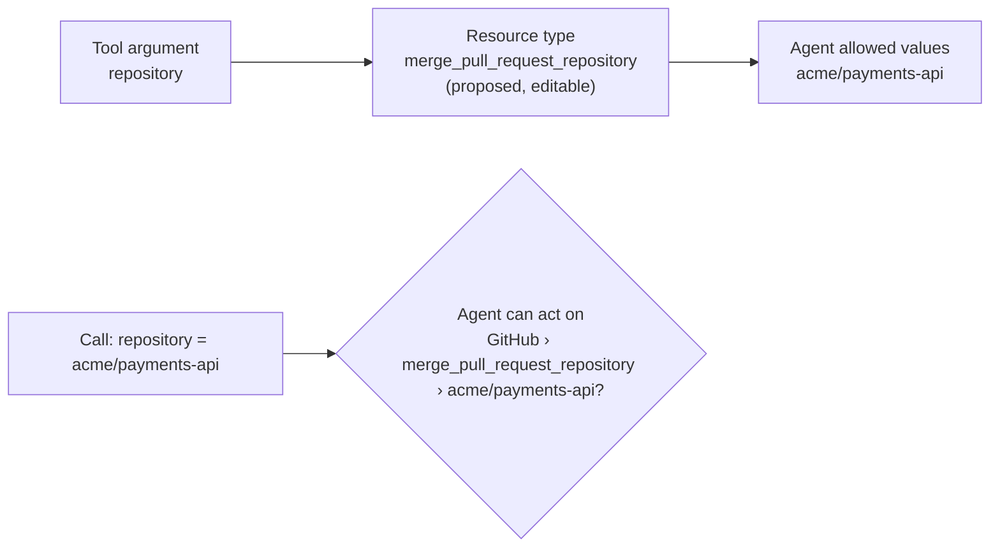

# Specification: Tool Resource Mapping Review

- **Specification ID**: 027
- **Date**: 2026-10-31
- **Slug**: tool-resource-mapping-review
- **Status**: Proposed
- **Owner**: Admin — Integrations
- **Design**: [Agent delegation authorization](../../backend/docs/agent-delegation-authorization.md)
- **Related Specification**: [Backend 029 — ReBAC Model and OpenFGA Integration](../../backend/specs/029-2026-10-31-rebac-model-and-openfga-integration.md) (resource mapping for each tool)
- **Related Specification**: [Backend 032 — PEP Chokepoint Token and Actor Projection](../../backend/specs/032-2026-10-31-pep-chokepoint-token-and-actor-projection.md) (resource projection)
- **Related Specification**: [026 — Agent Delegation Editor](026-2026-10-31-agent-delegation-editor.md) (consumes the resource types)
- **Related Specification**: [007 — MCP Server Management and Discovery Preview](007-2026-10-25-mcp-server-management-and-discovery-preview.md), [009 — Authorization Management Workbench](009-2026-10-26-authorization-management-workbench.md) (COAZ mapping review)
- **Visual reference**: layout prototype on the task branch `design/agent-delegation-screens` (`src/features/mcp/ResourceMapping.tsx`). Fixed data only. It is not merged.

> **On hold for Backend 029.** Backend 029 is approved and not implemented. It decides the mapping but does not define its API. See [Backend dependencies](#backend-dependencies). This is the first part of Admin A2; agent identity and the Chokepoint token auth type for custom MCP servers are separate specifications.

---

## Context & Background

Integrations shows the tools of each MCP server. Each managed tool has its status, the origin of its COAZ mapping with **Configure mapping**, its description, annotations and contract.

Backend 029 adds a **resource mapping** for each tool: an RFC 6901 pointer into the tool arguments and a resource type (backend field `kind`). It is reviewed with the tool, like source bindings. A tool without a mapping has no resource check. A call with a missing, empty or non-string mapped argument fails closed.

Admin 026 shows the resources of each agent as **server › resource type › values**. Those resource types come from this review.

---

## Problem Statement

### 1. No place to declare the resource

The tool review has no field for the argument that identifies the resource of a call. Without it, an agent cannot be limited to concrete objects, for example one GitHub repository.

### 2. A free identifier is hard to choose

The resource type is only a label. An administrator does not know what to write, and a typo silently creates a separate list of values.

### 3. Changes have effects on agents

A changed or removed mapping changes which allowed values apply to calls of the tool. The administrator must see that before approval.

---

## Solution

Each managed tool in the server detail gets a **Resource** block, below the description. It follows the same draft and review lifecycle as the COAZ mapping.

---

## Practical Gains & Operational Outcomes

1. **Resource-level control**:
   - *Before*: a tool is allowed on every object or on none.
   - *Now*: the administrator names the argument once; each agent then allows concrete values.
2. **No naming effort**:
   - *Before*: not applicable.
   - *Now*: the Admin proposes `<tool>_<argument>`; the administrator only confirms or edits it.
3. **Safe changes**:
   - *Before*: not applicable.
   - *Now*: a draft has no effect, and the screen names the affected agents before approval.

---

## User Stories

- [ ] 1. As an administrator, I select the argument that identifies the resource of a tool.
- [ ] 2. As an administrator, I accept or edit the proposed resource type.
- [ ] 3. As an administrator, I see an example of how a call becomes a checked resource.
- [ ] 4. As an administrator, I save a draft, then approve it, or discard it.
- [ ] 5. As an administrator, I see which agents a change affects before I approve it.
- [ ] 6. As an administrator, I remove a mapping, so the tool has no resource check.

---

## Architecture Gate

### 1. Bounded Context & Ubiquitous Language

- **Context**: Admin — Integrations. The Admin owns the form, the proposal and the view state. `mcpregistry` owns the mapping, its review and its validation (Backend 029).
- **Package Ownership**: `src/features/mcp`, next to the COAZ mapping review. A separate component for the Resource block; the API client and the data hook in the same feature.
- **Terms**:
  - *Resource mapping*: the argument pointer and the resource type of one tool.
  - *Resource type*: a label that identifies one type of resource on a server. Backend field `kind`. The screen never shows the word "kind".

### 2. Aggregate Root & State Transitions

- States on the screen: **none**, **Active**, **Draft** (a new or changed mapping waits for review), **Removal draft**.
- Transitions: Save draft → Draft or Removal draft; Review & approve → Active (or none for a removal); Discard draft → the previous state.
- Invariants: a draft never changes runtime behavior; a mapping exists only for a reviewed tool; one mapping for each tool at most.

### 3. Commands, Queries & Domain Ports

Read the tool schema (current catalog API). Read, save, approve and discard the resource mapping of a tool, and read the agents that have values of a resource type. Exact contracts: see [Backend dependencies](#backend-dependencies).

---

## Implementation Decisions

### 1. Placement

1. The Resource block is in the server detail of Integrations, in each managed tool, below the description. It is not in the discovery selection and not in a removed tool.
2. Collapsed line: "Resource", the active mapping (`/repository → merge_pull_request_repository`, or "None"), the state chip (Active, Draft · new mapping, Removal draft) and **Configure resource**.

### 2. Editor

1. **Argument**: a select from the tool input schema. Each option shows the name, the type and "required". Only string arguments can be selected; other types are disabled with "must be a string" (Backend 029 type check). The first option is "No resource. Calls have no resource check." A tool without arguments says that it cannot have a resource.
2. **Resource type**:
   - When the administrator selects an argument, the field is filled with the proposal **`<tool>_<argument>`**, for example `merge_pull_request_repository`, and marked "proposed".
   - The text below says: "Proposed from the tool and the argument. You can edit it."
   - After an edit, the field keeps the administrator's value; a new argument does not replace it.
   - A plain text field. No dropdown arrow and no suggestion list.
   - A help icon says: "A label that identifies one type of resource on this server. It must be unique on the server. It has no other effect."
3. **Example**: a sample call and its checked resource, for example `{ "repository": "acme/payments-api" }` → `merge_pull_request_repository › acme/payments-api`, and "Missing, empty or not a string: the call is denied."
4. **Optional argument**: a warning says that a call without it is denied.
5. **Impact**: when an active mapping changes or is removed and agents have values of its resource type, a warning names those agents and the effect:
   - a changed resource type: those values do not apply to this tool after the change;
   - a removed mapping: the tool has no resource check for those agents.
6. **Actions**: Save draft; Review & approve and Discard draft when a draft exists.
7. A note says: "A draft has no effect. After approval, new calls use the mapping. A change needs a new review, like source bindings."

### 3. Lifecycle

The block follows the COAZ mapping lifecycle of Admin 009: save creates an inactive draft, review approves it, discard keeps the active mapping, and a revision conflict requires a reload. The backend validates and owns the result. The Admin does not evaluate a mapping.

### 4. Files

Keep the API client, the data hook and the component separate. Each file stays under about 300 lines.

---

## Backend dependencies

Backend 029 decides the mapping but does not define these items. Each one is a backend specification change, decided with the user before implementation.

1. **API of the resource mapping** ([Backend 029](../../backend/specs/029-2026-10-31-rebac-model-and-openfga-integration.md)): read, save draft, approve, discard and remove for one tool, with a revision for conflicts.
2. **Lifecycle states** ([Backend 029](../../backend/specs/029-2026-10-31-rebac-model-and-openfga-integration.md)): whether the mapping has draft, active and removal states like the COAZ mapping, and what happens to an active mapping when the tool contract changes.
3. **Resource type rules** ([Backend 029](../../backend/specs/029-2026-10-31-rebac-model-and-openfga-integration.md)): allowed characters and length. Backend 029 says "a short identifier" and rejects separators inside identifier values. The prototype uses lowercase letters, digits and `_`.
4. **Affected agents** ([Backend 033](../../backend/specs/033-2026-10-31-agent-permission-administration-and-tuple-publication.md)): a read of the agents that have published values of a resource type on a server.
5. **Pointer form** ([Backend 029](../../backend/specs/029-2026-10-31-rebac-model-and-openfga-integration.md), [Backend 032](../../backend/specs/032-2026-10-31-pep-chokepoint-token-and-actor-projection.md)): Backend 029 uses an RFC 6901 pointer. Confirm that v1 allows only top-level arguments (`/repository`), as the select offers.

**Waiting backend chip.** In the prototype, each element that needs one of these items has a "Waiting backend · <spec>" chip. When the backend implements an item:

1. remove the chip of each element that the item unblocks, in the prototype and in the workbench mock, in the same change;
2. mark the item here as resolved, with the backend specification that implements it.

The real Admin never shows this chip. A limitation that remains after implementation uses the temporary warning of `AGENTS.md`.

---

## Testing Decisions

No automated tests (see `AGENTS.md`). Run `npm run check` and `npm run build`. The user runs the interface test in the built-in browser.

---

## Acceptance Criteria

- [ ] 1. Each managed tool shows the Resource block with its state.
- [ ] 2. The argument select lists the schema arguments; non-string arguments are disabled.
- [ ] 3. Selecting an argument proposes `<tool>_<argument>`, marked as proposed and editable; the field has no dropdown.
- [ ] 4. The help explains that the resource type is only a unique label on the server.
- [ ] 5. The example, the optional-argument warning and the impact warning appear as in section 2.
- [ ] 6. Save draft, Review & approve and Discard draft follow section 3; a draft has no runtime effect.
- [ ] 7. Every item of Backend dependencies is resolved in a backend specification before implementation.
- [ ] 8. No "Waiting backend" chip remains for an implemented item.
- [ ] 9. `npm run check` and `npm run build` pass.
- [ ] 10. The user confirms the interface test.

---

## Out of Scope

- Agent identity: client, public key and status (Admin A2, separate specification).
- The Chokepoint token auth type for custom MCP servers (Admin A2, separate specification).
- The allowed values of each agent (Admin 026).
- A readable label next to the resource type, and resource types provided by enterprise providers (follow-up).
- Nested pointers and more than one mapping for each tool.

---

## Further Notes

The proposal makes one resource type for each tool by default, so each tool has its own list of allowed values in an agent. Two tools share a list only when the administrator gives them the same resource type.
