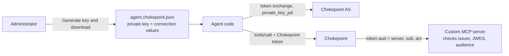

# Specification: Agent Identity and Chokepoint Token Setup

- **Specification ID**: 029
- **Date**: 2026-10-31
- **Slug**: agent-identity-and-chokepoint-token-setup
- **Status**: In Progress
- **Owner**: Admin — Access and Integrations
- **Design**: [Agent delegation authorization](../../backend/docs/agent-delegation-authorization.md)
- **Related Specification**: [Backend 030 — Agent Authorization Server](../../backend/specs/030-2026-10-31-agent-authorization-server.md) (agent client, public key, token exchange)
- **Related Specification**: [Backend 032 — PEP Chokepoint Token and Actor Projection](../../backend/specs/032-2026-10-31-pep-chokepoint-token-and-actor-projection.md) (agent status)
- **Related Specification**: [Backend 035 — Upstream Token for Custom MCP Servers](../../backend/specs/035-2026-10-31-upstream-token-for-custom-mcp-servers.md) (Chokepoint token auth type)
- **Related Specification**: [Backend 040 — Authorization Server Read and Key Author](../../backend/specs/040-2026-11-02-authorization-server-read-and-key-author.md) (key author name, values before a server exists)
- **Related Specification**: [026 — Agent Delegation Editor](026-2026-10-31-agent-delegation-editor.md), [027 — Tool Resource Mapping Review](027-2026-10-31-tool-resource-mapping-review.md)
- **Superseded in part**: [007 — MCP Server Management and Discovery Preview](007-2026-10-25-mcp-server-management-and-discovery-preview.md) (None and Bearer authentication of custom servers)
- **Visual reference**: layout prototypes at `/prototype/agent` (tab Identity) and `/prototype/mcp-server` in the Admin (`src/features/access/delegation/AgentIdentity.tsx`, `src/features/mcp/ChokepointTokenSetup.tsx`). Known difference: the prototype generates a readable key ID; this text uses the RFC 7638 thumbprint. Fixed data. It is the visual specification of this screen; where it differs from this text, this text wins.

---

## Context & Background

After Backend 030, an agent is a client of the Chokepoint authorization server of its environment. It signs in with its own key (`private_key_jwt`) and exchanges the token of a person or a service for a Chokepoint token of 5 minutes. After Backend 035, a custom MCP server receives a token for its own audience with the subject (`sub`) and the agent (`act`), and checks it with the Chokepoint keys. Backend 035 Resolved Decision 3 makes this the only auth type of a custom server.

The Admin has no place to give an agent its key, and the custom MCP form offers None and Bearer token.

---

## Problem Statement

### 1. An agent cannot get a token

Without a registered public key, the authorization server rejects every exchange of the agent.

### 2. Keys are hard to handle

Pasting a JWK or a PEM, choosing a key ID and copying several values by hand is error-prone. The private key must never reach Chokepoint.

### 3. The custom server does not know what to trust

The developer of a custom server needs the issuer, the JWKS and the audience, and an example for the framework. None and Bearer give calls without identity.

---

## Solution

Two places:

1. **Agent → Identity tab:** one action, **Generate key and download**. The key pair is created in the browser; Chokepoint registers the public key; the administrator downloads one file for the agent.
2. **Custom MCP server:** the only authentication is the **Chokepoint token**. The connection dialog and the server details show what the server must trust.



---

## Practical Gains & Operational Outcomes

1. **One click to an agent key**:
   - *Before*: no key, so no token.
   - *Now*: one button creates the key and downloads the file; the private key stays out of Chokepoint.
2. **A server that knows who calls**:
   - *Before*: None or a shared Bearer token, without identity.
   - *Now*: each call brings the person and the agent, checked with the Chokepoint keys.

---

## User Stories

- [ ] 1. As an administrator, I generate the key of an agent and download one file for it.
- [ ] 2. As an administrator, I rotate the key of an agent when the file is lost or exposed.
- [ ] 3. As an administrator with a key in a vault, I register my own public key.
- [ ] 4. As an administrator, I copy the client ID, the issuer and the token endpoint when I configure an agent by hand.
- [ ] 5. As an administrator, I connect a custom MCP server and see the three values that my server must trust.
- [ ] 6. As a developer, I copy a FastMCP example that checks the Chokepoint token and reads the person and the agent.
- [ ] 7. As an administrator, I understand each item from its help.

---

## Architecture Gate

### 1. Bounded Context & Ubiquitous Language

- **Context**: Admin — Access (agent identity) and Integrations (custom MCP servers). The backend owns the client registration, the key validation, the issuer, the JWKS and the tokens.
- **Package Ownership**: `src/features/access` (Identity tab), `src/features/mcp` (connection dialog, server details).
- **Terms**:
  - *Agent client*: the registration of the agent at the Chokepoint authorization server.
  - *Agent key*: the public key of the agent client. The private key exists only in the downloaded file or in the vault of the customer.
  - *Chokepoint token*: the token that Chokepoint issues; for a custom server, with `aud` = the server.

### 2. Aggregate Root & State Transitions

- Key states: **none** → **active** (generate, or own key) → **active** with a new key (rotate) → **none** (remove). One active key for each agent (Backend 030).
- Invariants: the browser never sends the private key; the Admin never shows a private key again after the download; a custom server has no other auth type than the Chokepoint token.

### 3. Commands, Queries & Domain Ports

Read the agent client; register, rotate and remove its public key; read the issuer, the token endpoint and the JWKS of the environment; save a custom server with the Chokepoint token auth type. Exact contracts: see [Backend dependencies](#backend-dependencies).

---

## Implementation Decisions

### 1. Identity tab

1. The agent has two views, **Delegation and access** (Admin 026) and **Identity**. The agent header (status, kill switch) is shared.
2. Heading "Identity" with a help: the agent proves who it is with its own key; without a key it can not get a token.
3. A disabled agent shows: "This agent is disabled. It gets no token, and its next call is rejected."

### 2. Key

1. **No key:** "No key yet. The agent can not get a token." and **Generate key and download**, with a help.
2. **Generate:**
   - the browser creates an ECDSA P-256 key pair with WebCrypto;
   - the key ID is the RFC 7638 thumbprint of the public key, computed in the browser; nobody types it (Backend 030 Resolved decision);
   - the Admin sends only the public key;
   - the browser downloads `<agent>.chokepoint.json` with `client_id`, `issuer`, `token_endpoint`, `kid`, `alg` and `private_key` (JWK);
   - a green record says: "File downloaded … This is the only copy of the private key. Store it like a password. Chokepoint can not show it again."
3. **Active key:** "Active key", the key ID and the algorithm, "Created by {administrator} · {time}" (`created_by_name`, Backend 040; the user ID when the user no longer exists).
4. **Rotate key**, with a help, asks for confirmation ("The current key stops working now. Give the new file to the agent at once.") and then **Rotate and download**. Tokens already issued stay valid until they expire (5 minutes).

### 3. Collapsed sections

1. **Connection details** (help: the file already has these values): Client ID, Issuer and Token endpoint, each with a help and a copy button.
2. **How the agent connects** (help: an SDK does these steps): the person signs in; the agent exchanges the token, signed with the private key; the agent calls the tools with the Chokepoint token (5 minutes). A refused exchange returns `invalid_client` or `invalid_grant`; Investigate shows the reason.
3. **Use my own public key** (advanced; for a key kept in a vault): a JWK or PEM field and an optional key ID field (the `kid` of the JWK; without it, the backend uses the RFC 7638 thumbprint). The field rejects a private key ("Paste only the public key") and an unknown format. **Use this key** registers it; no file is downloaded.

### 4. Custom MCP server: authentication

1. The connection dialog (Connect and Edit) has no authentication choice and no Bearer token field. It shows **Authentication: Chokepoint token**, with a help: the server accepts only calls that passed through Chokepoint; each call brings who the person is (`sub`) and which agent acts (`act`); it is the only option, because a shared token or no authentication would hide who calls.
2. Below it, three copyable values with a help each: **Issuer**, **JWKS** (read the URL, do not copy the keys; keys rotate) and **Audience** (the endpoint of the server; a token for another server is rejected). Issuer and JWKS come from the authorization server read of the environment (Backend 040), so they show before the server is saved: its first discovery already sends a Chokepoint token. Audience shows the typed endpoint, normalized with the standard URL parser (lower-case scheme and host, no default port, no query or fragment); after save, the server details show the `audience` of the backend (decided 2026-11-02). The text says that the server details show an example. The dialog stays short enough to need no scroll.
3. **Server details** show the same block and a collapsed **Example: FastMCP** with **Copy example**:

   ```python
   from fastmcp import FastMCP
   from fastmcp.server.auth.providers.jwt import JWTVerifier
   from fastmcp.server.dependencies import get_access_token

   auth = JWTVerifier(jwks_uri="<JWKS>", issuer="<Issuer>", audience="<Audience>", algorithm="ES256")
   mcp = FastMCP("issues", auth=auth)

   @mcp.tool
   def move_issue(repository: str, issue_number: int, column: str) -> str:
       claims = get_access_token().claims
       person, agent = claims["sub"], claims["act"]["sub"]
       ...
   ```

   The note says: in each tool, the token gives `sub` (the person or service) and `act.sub` (the agent).
4. A click anywhere on a server row opens its details. The row actions keep their own click. A second click on the same row closes the details.

### 5. Shared fixes

1. A tooltip inside a modal dialog renders inside the dialog, so that it is not behind the top layer.
2. Every help is a `Tooltip` on a help icon, with hover and keyboard focus.

---

## Backend dependencies

The contracts and decisions are written in the backend specifications (2026-11-01).

1. **Issuer, token endpoint, JWKS and metadata URLs:** [Backend 030](../../backend/specs/030-2026-10-31-agent-authorization-server.md), Admin contract 1.
2. **Agent key API:** [Backend 030](../../backend/specs/030-2026-10-31-agent-authorization-server.md), Admin contract 2–5 (JWK only; the Admin converts a PEM in the browser).
3. **Key ID:** resolved in Backend 030 (Admin contract, Resolved decision).
4. **Rotation overlap:** resolved in Backend 030 (Admin contract, Resolved decision).
5. **Signing algorithm:** resolved in Backend 030 (Admin contract, Resolved decision).
6. **Chokepoint token auth type:** [Backend 035](../../backend/specs/035-2026-10-31-upstream-token-for-custom-mcp-servers.md), Admin contract (`chokepoint_token`, `audience`, `issuer`, `jwks_uri`).
7. **Discovery:** resolved in Backend 035 (Admin contract, Resolved decision).
8. **Existing custom servers:** resolved, [Backend 035](../../backend/specs/035-2026-10-31-upstream-token-for-custom-mcp-servers.md) Resolved Decision 3.
9. **Key author name:** [Backend 040](../../backend/specs/040-2026-11-02-authorization-server-read-and-key-author.md) Solution 1 (`key.created_by_name`; decided 2026-11-02).
10. **Issuer and JWKS before a server exists:** [Backend 040](../../backend/specs/040-2026-11-02-authorization-server-read-and-key-author.md) Solution 2 (`GET …/authorization-server`; decided 2026-11-02).

**Waiting backend chip.** In the prototype, each element that needs one of these items has a "Waiting backend · <spec>" chip. When the backend implements an item, remove the chip of each element that it unblocks, in the same change. The real Admin never shows the chip.

---

## Testing Decisions

No automated tests (see `AGENTS.md`). Run `npm run check` and `npm run build`. The user runs the interface test in the built-in browser.

---

## Acceptance Criteria

- [ ] 1. The agent has an Identity view next to Delegation and access.
- [ ] 2. Generate key and download creates the key pair in the browser, sends only the public key and downloads one file with the values of section 2.
- [ ] 3. The Admin never shows the private key after the download.
- [ ] 4. Rotate key asks for confirmation and downloads a new file.
- [ ] 5. Use my own public key rejects a private key.
- [ ] 6. The custom server dialog has no None or Bearer option and shows Issuer, JWKS and Audience without scroll.
- [ ] 7. The server details show the FastMCP example with Copy example.
- [ ] 8. A click anywhere on a server row opens its details.
- [ ] 9. Every help opens on hover and focus, also inside a modal dialog.
- [ ] 10. Every item of Backend dependencies is resolved in a backend specification before implementation.
- [ ] 11. No "Waiting backend" chip remains for an implemented item.
- [ ] 12. `npm run check` and `npm run build` pass.
- [ ] 13. The user confirms the interface test.

---

## Out of Scope

- Sign-in in the browser for MCP clients such as Cursor or Claude Code (OAuth authorization code for the Chokepoint authorization server). Later.
- An SDK that does the token exchange.
- Native identity provider delegation (Backend 030 follow-ups).
- Third-party servers that accept only a static API key (Backend 035 Resolved Decision 3).

---

## Further Notes

References: [FastMCP — Token Verification](https://gofastmcp.com/servers/auth/token-verification), [FastMCP — Authorization](https://gofastmcp.com/servers/authorization). `get_access_token()` exists since FastMCP 2.11.
